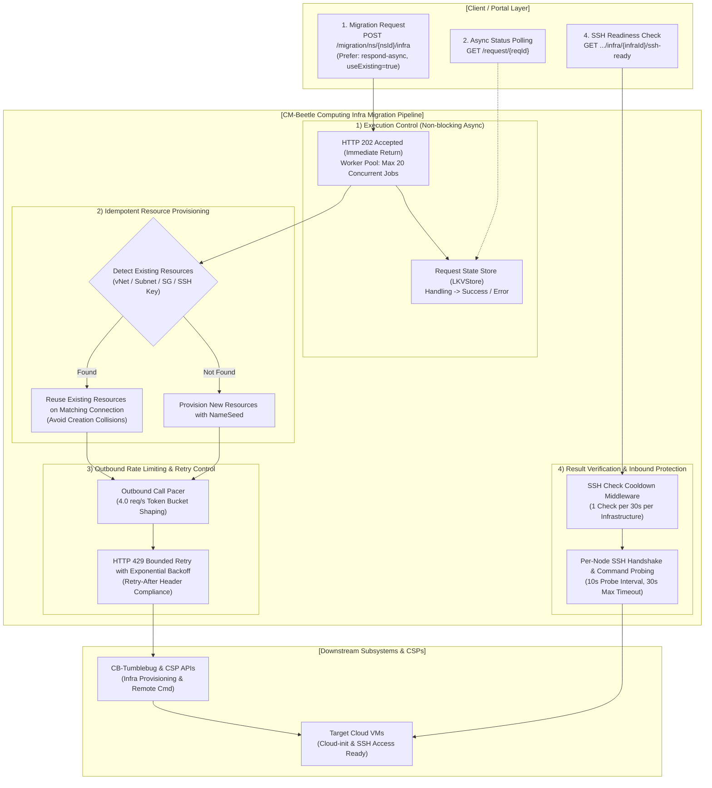

# Infrastructure

This document covers recommendation and migration support for computing infrastructure resources (VM, VNet, Subnet, Security Group, SSH Key) across supported Cloud Service Providers (CSPs), along with the architecture and execution control model of the CM-Beetle computing infrastructure migration pipeline.

## Support Status

| Resource        | AWS | Azure | GCP | Alibaba | Tencent | IBM | (OpenStack) | NCP | NHN | (KT) |
| --------------- | :-: | :---: | :-: | :-----: | :-----: | :-: | :---------: | :-: | :-: | :--: |
| VNet            | ✅  |  ✅   | ✅  |   ✅    |   ✅    | ✅  |     📅      | ✅  | ✅  |  -   |
| Subnet          | ✅  |  ✅   | ✅  |   ✅    |   ✅    | ✅  |     📅      | ✅  | ✅  |  -   |
| Security Group  | ✅  |  ✅   | ✅  |   ✅    |   ✅    | ✅  |     📅      | ✅  | ✅  |  -   |
| SSH Key         | ✅  |  ✅   | ✅  |   ✅    |   ✅    | ✅  |     📅      | ✅  | ✅  |  -   |
| Node Spec       | ✅  |  ✅   | ✅  |   ✅    |   ✅    | ✅  |     📅      | ✅  | ✅  |  -   |
| OS Image        | ✅  |  ✅   | ✅  |   ✅    |   ✅    | ✅  |     📅      | ✅  | ✅  |  -   |
| Virtual Machine | ✅  |  ✅   | ✅  |   ✅    |   ✅    | ✅  |     📅      | ✅  | ✅  |  -   |

## Supported Operations

| Operation      | Supported Resources                                              |
| -------------- | ---------------------------------------------------------------- |
| Recommendation | VNet, Subnet, Security Group, VM Spec, OS Image, Virtual Machine |
| Migration      | VNet, Subnet, Security Group, SSH Key, Virtual Machine           |

## Migration Pipeline Architecture & Execution Flow

The CM-Beetle computing infrastructure migration pipeline automates provisioning, non-blocking execution control, outbound rate limiting, and end-to-end verification across target CSPs:

### Core Pipeline Capabilities

1. **Idempotent Resource Provisioning (`useExisting`)**:
   - By default (`useExisting=true`), the pipeline detects pre-existing network and security primitives (`vNet`, `subnet`, `securityGroup`, `sshKey`) in the target namespace under the requested CSP connection.
   - Reuses matching resources instead of recreating them, preventing name collisions and enabling safe repeated executions.
   - For details, see [Target Infrastructure Validation](core-validation.md) and [NameSeed: Late Binding for Resource Names](core-naming-rule.md).

2. **Non-blocking Async Execution & State Tracking (`Prefer: respond-async`)**:
   - Supports RFC 7240 `Prefer: respond-async` headers for long-running infrastructure provisioning.
   - Immediately returns `HTTP 202 Accepted` along with a unique request ID (`reqId`), executing the provisioning pipeline in a bounded background worker pool (maximum 20 concurrent jobs).
   - Callers track execution progress via `GET /beetle/request/{reqId}` until status transitions from `Handling` to `Success` or `Error`.
   - For details, see [Async Responses](core-async-response.md).

3. **Outbound Rate Limiting & Retry Control (Pacer & Bounded Retry)**:
   - Enforces proactive traffic shaping via a token bucket `Pacer` targeting 4.0 req/s (burst 1), keeping CM-Beetle safely under downstream CB-Tumblebug rate limits (5.0 req/s on infra endpoints).
   - Recovers from unexpected HTTP 429 responses using exponential backoff and bounded retries adhering to `Retry-After` headers.
   - For details, see [Tumblebug Call Pacer](../tumblebug-call-pacer.md) and [pkg/ratelimit/README.md](../../pkg/ratelimit/README.md).

4. **Target VM Remote Accessibility Verification (`ssh-ready` API)**:
   - Provides `GET /migration/ns/{nsId}/infra/{infraId}/ssh-ready?option=detail` to confirm that all provisioned VMs have completed cloud-init and are actively accepting remote SSH commands.
   - Protected by `SSHCheckCooldown` middleware (maximum 1 check per 30 seconds per infrastructure) to prevent SSH server overload.
   - For details, see [GPU Infrastructure Migration API Guide (Section 6.1)](../gpu-infra-migration-api-guide.md#61-타겟-인프라-ssh-접속-준비-상태-확인-api-get-ssh-ready).

## Roadmap

- **Planned**: OpenStack
