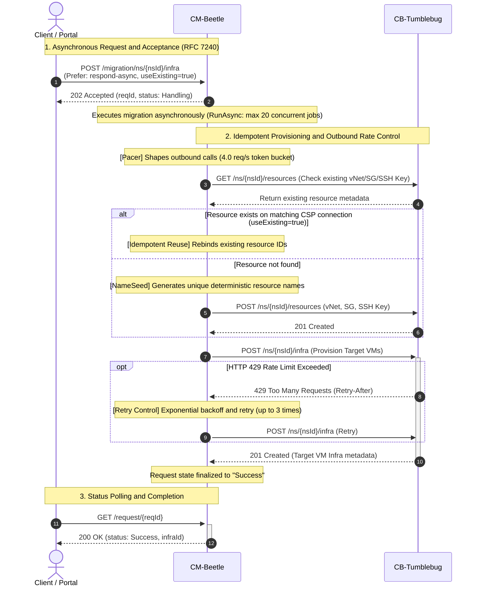
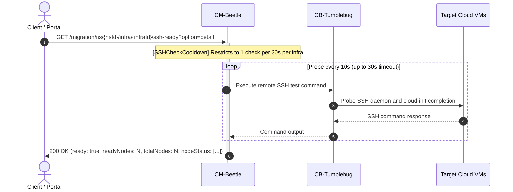

# Infrastructure

This document covers recommendation and migration support for computing infrastructure resources (VM, VNet, Subnet, Security Group, SSH Key) across supported Cloud Service Providers (CSPs), along with the execution flow and control mechanisms of computing infrastructure migration.

## Support Status

| Resource        | AWS | Azure | GCP | Alibaba | Tencent | IBM | (OpenStack) | NCP | NHN | (KT) |
| --------------- | :-: | :---: | :-: | :-----: | :-----: | :-: | :---------: | :-: | :-: | :--: |
| VNet            | ✅  |  ✅   | ✅  |   ✅    |   ✅    | ✅  |     📅      | ✅  | ✅  |  -   |
| Subnet          | ✅  |  ✅   | ✅  |   ✅    |   ✅    | ✅  |     📅      | ✅  | ✅  |  -   |
| Security Group  | ✅  |  ✅   | ✅  |   ✅    |   ✅    | ✅  |     📅      | ✅  | ✅  |  -   |
| SSH Key         | ✅  |  ✅   | ✅  |   ✅    |   ✅    | ✅  |     📅      | ✅  | ✅  |  -   |
| Node Spec       | ✅  |  ✅   | ✅  |   ✅    |   ✅    | ✅  |     📅      | ✅  | ✅  |  -   |
| OS Image        | ✅  |  ✅   | ✅  |   ✅    |   ✅    | ✅  |     📅      | ✅  | ✅  |  -   |
| Virtual Machine | ✅  |  ✅   | ✅  |   ✅    |   ✅    | ✅  |     📅      | ✅  | ✅  |  -   |

## Supported Operations

| Operation      | Supported Resources                                              |
| -------------- | ---------------------------------------------------------------- |
| Recommendation | VNet, Subnet, Security Group, VM Spec, OS Image, Virtual Machine |
| Migration      | VNet, Subnet, Security Group, SSH Key, Virtual Machine           |

## Migration Execution Flow

CM-Beetle manages computing infrastructure migration through non-blocking asynchronous execution, idempotent resource migration, outbound rate limiting, and remote connectivity verification across target Cloud Service Providers (CSPs).

The execution lifecycle consists of two primary flows:
1. **Asynchronous Migration Execution Flow**: Handles asynchronous request acceptance, background idempotent resource migration, traffic shaping, and completion polling.
2. **Post-Migration Verification and Readiness Flow**: Verifies remote SSH accessibility of migrated virtual machines while protecting target instances from probe overload.

### 1. Asynchronous Migration Execution Flow

The following sequence diagram illustrates the end-to-end migration execution process, from initial asynchronous request acceptance to target virtual machine deployment:

#### Core Migration Mechanisms

1. **Non-blocking Async Execution and State Tracking (`Prefer: respond-async`)**:
   - Supports RFC 7240 `Prefer: respond-async` headers for long-running infrastructure migration.
   - Immediately returns `HTTP 202 Accepted` with a unique request identifier (`reqId`), executing migration logic asynchronously in the background (maximum 20 concurrent jobs via `RunAsync`).
   - Callers track execution progress via `GET /beetle/request/{reqId}` until status transitions from `Handling` to `Success` or `Error`.
   - For details, see [Async Responses](core-async-response.md).

2. **Idempotent Resource Migration (`useExisting`)**:
   - By default (`useExisting=true`), CM-Beetle detects pre-existing network and security primitives (`vNet`, `subnet`, `securityGroup`, `sshKey`) in the target namespace under the requested CSP connection.
   - Reuses matching resources instead of recreating them, preventing name collisions and enabling safe repeated executions.
   - For details, see [Target Infrastructure Validation](core-validation.md) and [NameSeed: Late Binding for Resource Names](core-naming-rule.md).

3. **Outbound Rate Limiting and Retry Control (Pacer and Bounded Retry)**:
   - Enforces proactive traffic shaping via a token bucket `Pacer` targeting 4.0 req/s (burst 1), keeping CM-Beetle safely under downstream CB-Tumblebug rate limits (5.0 req/s on infra endpoints).
   - Recovers from unexpected HTTP 429 responses using exponential backoff and bounded retries adhering to `Retry-After` headers.
   - For details, see [Tumblebug Call Pacer](../tumblebug-call-pacer.md) and [pkg/ratelimit/README.md](../../pkg/ratelimit/README.md).

---

### 2. Post-Migration Verification and Readiness Flow

After virtual machines are migrated to target CSPs, guest operating systems perform initialization tasks (cloud-init, user setup, SSH daemon startup). CM-Beetle provides a dedicated readiness check to ensure all target nodes are fully accessible before application workloads are transferred:

#### Core Verification Mechanisms

1. **Target VM Remote Accessibility Verification (`ssh-ready` API)**:
   - Provides `GET /migration/ns/{nsId}/infra/{infraId}/ssh-ready?option=detail` to confirm that all migrated VMs have completed cloud-init and are actively accepting remote SSH commands.
   - Automatically probes target nodes every 10 seconds for up to a 30-second bounded window, returning early as soon as all nodes respond.
   - For details, see [GPU Infrastructure Migration API Guide (Section 6.1)](../gpu-infra-migration-api-guide.md#61-타겟-인프라-ssh-접속-준비-상태-확인-api-get-ssh-ready).

2. **Inbound Rate Limiting Protection (`SSHCheckCooldown`)**:
   - Protects migrated virtual machines and CB-Tumblebug bastion channels from probe storms via `SSHCheckCooldown` middleware.
   - Restricts readiness checks to at most one check per 30 seconds per target infrastructure (`nsId:infraId`). Early repeat requests are refused with `HTTP 429` and a `Retry-After` header without executing remote commands.
   - For details, see [pkg/ratelimit/README.md (Users in this repository)](../../pkg/ratelimit/README.md#users-in-this-repository).

## Roadmap

- **Planned**: OpenStack
