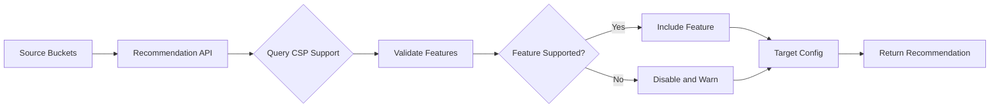
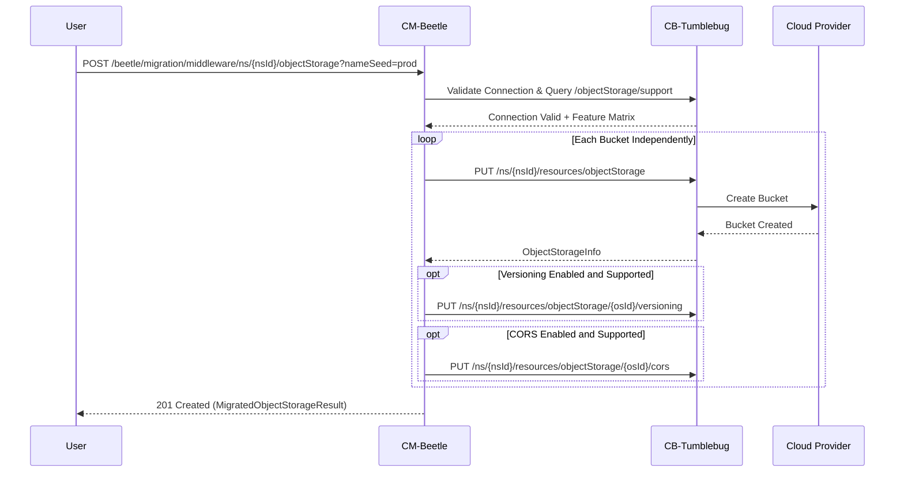

# Object Storage Feature Guide

## Overview

CM-Beetle provides Object Storage (bucket) recommendation, provisioning, and post-migration verification capabilities for multi-cloud environments. This feature enables you to:

- **Recommend** compatible object storage configurations for target cloud providers
- **Validate** feature compatibility across different CSPs (CORS, Versioning, Presigned URLs)
- **Migrate (Provision)** object storage buckets with automatic feature configuration and independent multi-bucket handling
- **Verify and Clean Up** migrated buckets and objects through unified REST APIs

CM-Beetle integrates with CB-Tumblebug (`cb-tumblebug`) to query CSP capabilities, provision buckets, configure initial bucket policies, and manage lifecycle cleanup.

---

## Operational Scope: CM-Beetle vs. CB-Tumblebug

Object Storage in Cloud-Barista follows the AWS S3 de-facto standard model across supported CSPs:

| Lifecycle Phase | System | Supported Operations |
| --- | --- | --- |
| **1. Assessment & Recommendation** | **CM-Beetle** | Analyze source bucket properties, reconcile CORS/Versioning support per target CSP, and output `RecommendedObjectStorage` |
| **2. Bucket Provisioning** | **CM-Beetle** | Create target buckets (`POST /beetle/migration/middleware/ns/{nsId}/objectStorage`), apply `nameSeed` (Late Binding), and configure initial Versioning and CORS rules |
| **3. Data Transfer & Verification** | **CM-Beetle** | Transfer objects (`POST /beetle/migration/data`), inspect bucket metadata (`GET`/`HEAD`), verify migrated objects (`GET .../object`, `HEAD .../object/{objectKey}`, `DELETE .../object/{objectKey}`), and clean up buckets (`DELETE .../objectStorage/{osId}`) |
| **4. Day-2 Operations** | **CB-Tumblebug** | Generate Presigned URLs for upload/download, modify or delete CORS/Versioning rules after provisioning, query bucket location, and run metadata reconciliation |

---

## Object Storage Recommendation

### What It Does

The recommendation API analyzes source object storage configurations and generates CSP-compatible target configurations:

1. **Validates** requested features against target CSP capabilities queried from CB-Tumblebug
2. **Adjusts** configurations automatically when features are unsupported on the target CSP
3. **Generates** deterministic base bucket names (`os-01`, `os-02`, ...)
4. **Provides** explicit warnings when features are disabled
5. **Returns** migration-ready configurations (`RecommendedObjectStorage`)

### How It Works



### CSP Feature Support Matrix

| CSP | CORS | Versioning | PresignedUrl | Notes |
| --- | --- | --- | --- | --- |
| AWS | Yes | Yes | Yes | Full bucket-level support |
| GCP | Yes | Yes | Yes | Full bucket-level support |
| Azure | No | No | Yes | Configured at Storage Account level rather than per bucket |
| Alibaba | Yes | Yes | Yes | Full bucket-level support |
| Tencent | Yes | Yes | Yes | Full bucket-level support |
| IBM | Yes | Yes | Yes | Full bucket-level support |
| OpenStack | Yes | No | Yes | Versioning not supported |
| NCP | No | No | Yes | Bucket-level CORS/Versioning not supported via Tumblebug |
| NHN | No | No | Yes | Bucket-level CORS/Versioning not supported via Tumblebug |
| KT | Yes | Yes | Yes | Full bucket-level support |

> [!NOTE]
> Live feature support is queried dynamically from CB-Tumblebug (`GET /tumblebug/objectStorage/support`) at both recommendation time and migration time.

### API Reference

**Endpoint:** `POST /beetle/recommendation/middleware/objectStorage`

**Parameters:**

| Parameter | Type | Location | Required | Description |
| --- | --- | --- | --- | --- |
| `desiredCsp` | string | query | No | Target CSP (case-insensitive, e.g., `aws`, `azure`, `gcp`, `ncp`) |
| `desiredRegion` | string | query | No | Target region (e.g., `ap-northeast-2`, `kr`) |
| `request` | JSON | body | Yes | Source object storage configurations (`RecommendObjectStorageRequest`) |

**Precedence Rule:** Target CSP and region can be provided in `desiredCloud` inside the JSON body or via `desiredCsp` / `desiredRegion` query parameters. Query parameters override body values when both are specified.

**Request Body Schema:**

```json
{
  "desiredCloud": {
    "csp": "string (required if desiredCsp query param is omitted)",
    "region": "string (required if desiredRegion query param is omitted)"
  },
  "sourceObjectStorages": [
    {
      "bucketName": "string (required)",
      "versioningEnabled": true,
      "corsEnabled": true,
      "corsRule": [
        {
          "allowedOrigin": ["https://example.com"],
          "allowedMethod": ["GET", "PUT"],
          "allowedHeader": ["*"],
          "exposeHeader": ["ETag"],
          "maxAgeSeconds": 3600
        }
      ]
    }
  ]
}
```

### Request/Response Examples

#### Example 1: AWS (Full Feature Support)

```bash
curl -s -X POST "http://localhost:8056/beetle/recommendation/middleware/objectStorage?desiredCsp=aws&desiredRegion=ap-northeast-2" \
  -H "Content-Type: application/json" \
  -u "default:default" \
  -d '{
    "sourceObjectStorages": [
      {
        "bucketName": "production-data",
        "versioningEnabled": true,
        "corsEnabled": true,
        "corsRule": [
          {
            "allowedOrigin": ["https://example.com"],
            "allowedMethod": ["GET", "PUT"],
            "allowedHeader": ["*"],
            "maxAgeSeconds": 3600
          }
        ]
      }
    ]
  }' | jq .
```

**Response (`200 OK`):**

```json
{
  "success": true,
  "data": {
    "status": "recommended",
    "description": "Successfully recommended 1 object storage configuration(s) for aws ap-northeast-2",
    "targetCloud": {
      "csp": "aws",
      "region": "ap-northeast-2"
    },
    "targetObjectStorages": [
      {
        "sourceBucketName": "production-data",
        "bucketName": "os-01",
        "versioningEnabled": true,
        "corsEnabled": true,
        "corsRule": [
          {
            "allowedOrigin": ["https://example.com"],
            "allowedMethod": ["GET", "PUT"],
            "allowedHeader": ["*"],
            "maxAgeSeconds": 3600
          }
        ]
      }
    ]
  }
}
```

#### Example 2: Azure or NCP (Automatic Feature Adjustment)

When the target CSP does not support bucket-level Versioning or CORS, CM-Beetle disables those options automatically, sets `status` to `"partial"`, and lists the adjustments in `warnings`:

```json
{
  "success": true,
  "data": {
    "status": "partial",
    "description": "Recommended 1 object storage configuration(s) for azure eastus with 2 warning(s)",
    "warnings": [
      "Bucket 'user-uploads': versioning disabled (not supported on azure)",
      "Bucket 'user-uploads': CORS disabled (not supported on azure)"
    ],
    "targetCloud": {
      "csp": "azure",
      "region": "eastus"
    },
    "targetObjectStorages": [
      {
        "sourceBucketName": "user-uploads",
        "bucketName": "os-01",
        "versioningEnabled": false,
        "corsEnabled": false
      }
    ]
  }
}
```

---

## Object Storage Migration (Provisioning)

### What It Does

The migration API provisions object storage buckets in the target cloud based on the recommendation output:

1. **Applies `nameSeed`** prefix to each target bucket name at migration time (Late Binding, e.g., `os-01` -> `prod-os-01`)
2. **Validates** that the target CSP connection (`{csp}-{region}`) exists in CB-Tumblebug
3. **Provisions each bucket independently**: if one bucket fails in a multi-bucket request, remaining buckets are still attempted
4. **Configures** Versioning and CORS rules on each created bucket when supported by the CSP
5. **Returns `MigratedObjectStorageResult`** (`201 Created`) containing `status` (`"created"` or `"partial"`), `warnings`, and full `objectStorage` details for every created bucket

### How It Works



### API Reference

**Endpoint:** `POST /beetle/migration/middleware/ns/{nsId}/objectStorage`

**Parameters:**

| Parameter | Type | Location | Required | Description |
| --- | --- | --- | --- | --- |
| `nsId` | string | path | Yes | Namespace ID (e.g., `mig01`) |
| `nameSeed` | string | query | No | Name prefix applied at migration time (`1-20` chars, alphanumeric and `-`, starting with alphanumeric) |
| `Prefer` | string | header | No | Set `Prefer: respond-async` to run asynchronously (`202 Accepted`) |
| `request` | JSON | body | Yes | Recommendation result (`MigrateObjectStorageRequest`) |

**Responses:**

- `201 Created`: `ApiResponse[MigratedObjectStorageResult]` when at least one bucket is created (`status: "created"` if all succeeded without warnings, `"partial"` if some buckets failed or feature configuration produced warnings)
- `202 Accepted`: `ApiResponse[AsyncAcceptedResponse]` when `Prefer: respond-async` is specified; poll `GET /beetle/request/{reqId}` for the `MigratedObjectStorageResult` in `responseData`
- `400 Bad Request`: Invalid request body, invalid `nameSeed`, or invalid cloud connection configuration
- `404 Not Found`: Target namespace or upstream dependency not found
- `409 Conflict`: All requested bucket IDs/names already exist
- `503 Service Unavailable`: Async job runner at capacity (`Retry-After` header) or upstream rate-limited

### Synchronous Migration Example

```bash
curl -s -X POST "http://localhost:8056/beetle/migration/middleware/ns/mig01/objectStorage?nameSeed=prod" \
  -H "Content-Type: application/json" \
  -u "default:default" \
  -d '{
    "targetCloud": {
      "csp": "aws",
      "region": "ap-northeast-2"
    },
    "targetObjectStorages": [
      {
        "sourceBucketName": "production-data",
        "bucketName": "os-01",
        "versioningEnabled": true,
        "corsEnabled": true,
        "corsRule": [
          {
            "allowedOrigin": ["https://example.com"],
            "allowedMethod": ["GET", "PUT"],
            "allowedHeader": ["*"],
            "maxAgeSeconds": 3600
          }
        ]
      },
      {
        "sourceBucketName": "backup-data",
        "bucketName": "os-02",
        "versioningEnabled": true,
        "corsEnabled": false
      }
    ]
  }' | jq .
```

**Response (`201 Created`):**

```json
{
  "success": true,
  "data": {
    "status": "created",
    "description": "Successfully created 2 of 2 object storage(s) for aws ap-northeast-2",
    "objectStorage": [
      {
        "id": "prod-os-01",
        "name": "prod-os-01",
        "connectionName": "aws-ap-northeast-2",
        "cspResourceName": "prod-os-01-...",
        "status": "Available"
      },
      {
        "id": "prod-os-02",
        "name": "prod-os-02",
        "connectionName": "aws-ap-northeast-2",
        "cspResourceName": "prod-os-02-...",
        "status": "Available"
      }
    ]
  }
}
```

---

## Late Binding with `nameSeed`

`nameSeed` applies an environment or team prefix at migration time rather than embedding prefixes into the recommendation model:

- Omit `nameSeed`: `os-01`, `os-02`
- `?nameSeed=dev`: `dev-os-01`, `dev-os-02`
- `?nameSeed=prod`: `prod-os-01`, `prod-os-02`

> [!TIP]
> `nameSeed` is strictly a **query parameter** on migration APIs, never a JSON body field. You can preview final names before provisioning via `POST /beetle/naming/preview?nameSeed=prod`.

---

## Bucket Management & Object Verification APIs

### 1. Bucket Lifecycle APIs

| Method & Endpoint | Description | Success Status |
| --- | --- | --- |
| `GET /beetle/migration/middleware/ns/{nsId}/objectStorage` | List all object storages in the namespace | `200 OK` |
| `GET /beetle/migration/middleware/ns/{nsId}/objectStorage/{osId}` | Get detailed bucket metadata | `200 OK` |
| `HEAD /beetle/migration/middleware/ns/{nsId}/objectStorage/{osId}` | Check whether the bucket exists (`404` if absent) | `200 OK` (no body) |
| `DELETE /beetle/migration/middleware/ns/{nsId}/objectStorage/{osId}` | Empty or delete the bucket (supports `option` and `Prefer: respond-async`) | `204 No Content` (`202` async) |

#### `DELETE` Options (`?option=...`)

`DELETE /beetle/migration/middleware/ns/{nsId}/objectStorage/{osId}` strictly validates `option` against `""`, `"empty"`, and `"force"` (any other value returns `400 Bad Request`):

| Query Option | Target Bucket Deleted? | Behavior | Missing Bucket (`404`) Handling |
| --- | --- | --- | --- |
| _(omitted)_ | **Yes** | Deletes an empty bucket. Fails if the bucket still contains objects or object versions. | Treated as idempotent success (`204 No Content`) |
| `?option=empty` | **No (Bucket Preserved)** | Deletes all objects and versions inside the bucket while keeping the bucket itself intact. | Returns `404 Not Found` |
| `?option=force` | **Yes** | Empties all objects/versions first and then deletes the bucket and CB-Tumblebug metadata. | Treated as idempotent success (`204 No Content`) |

```bash
# 1. Empty all objects inside the bucket (bucket remains active; returns 204 No Content)
curl -i -X DELETE "http://localhost:8056/beetle/migration/middleware/ns/mig01/objectStorage/prod-os-01?option=empty" \
  -u "default:default"

# 2. Standard delete (for an empty bucket; returns 204 No Content)
curl -i -X DELETE "http://localhost:8056/beetle/migration/middleware/ns/mig01/objectStorage/prod-os-01" \
  -u "default:default"

# 3. Force delete (empties objects/versions and deletes the bucket in one call; returns 204 No Content)
curl -i -X DELETE "http://localhost:8056/beetle/migration/middleware/ns/mig01/objectStorage/prod-os-01?option=force" \
  -u "default:default"
```

### 2. Post-Migration Object Verification APIs

After running data migration (`POST /beetle/migration/data`), use these endpoints to verify transferred objects or remove test objects:

| Method & Endpoint | Description | Notes |
| --- | --- | --- |
| `GET /beetle/migration/middleware/ns/{nsId}/objectStorage/{osId}/object` | List objects in the bucket (`contents`, `keyCount`, `isTruncated`) | Verifies object count, keys, sizes, and ETags |
| `HEAD /beetle/migration/middleware/ns/{nsId}/objectStorage/{osId}/object/{objectKey}` | Inspect single object metadata without downloading content | Returns HTTP `200 OK` with empty body and `ETag`, `Last-Modified`, `Content-Length` (when reported upstream), and `X-Storage-Class` headers |
| `DELETE /beetle/migration/middleware/ns/{nsId}/objectStorage/{osId}/object/{objectKey}` | Delete a single object from the bucket | Useful for cleaning up verification/probe objects |

> [!NOTE]
> `objectKey` values containing `/` or special characters should be URL-encoded when passed as a single path parameter (for example, `folder%2Freport.csv`). CM-Beetle normalizes path segment encoding before forwarding to CB-Tumblebug.

---

## Test-Only Client Helper APIs (Non-Production)

> [!WARNING]
> **Non-Production Test Helpers Only**
> The endpoints under the `[Test] Client Helper (Non-Production)` Swagger tag (`GET /beetle/migration/security/publicKey`, `POST /beetle/migration/middleware/objectStorage/scan`, and `POST /beetle/migration/middleware/objectStorage/inspect`) exist **exclusively** for local testing, evaluation, and Beetle UX Lab UI prototyping.
>
> - **Do NOT use these endpoints in production.** Production clients must scan and inspect source S3 buckets directly on the client side, and encrypt data migration credentials using `GET /beetle/migration/data/encryptionKey` together with the `transx/fieldsec` package.
> - Supported S3-compatible CSPs for `/scan` and `/inspect`: `aws`, `gcp`, `alibaba`, `tencent`, `ibm`, `ncp`. Unsupported CSPs or malformed regions are rejected with `400 Bad Request` (no fallback endpoint is used).

---

## Troubleshooting

### Issue 1: Bucket Remains After Calling `DELETE ?option=empty`

**Symptom:** Calling `DELETE .../objectStorage/{osId}?option=empty` returns `204 No Content` (or `202 Accepted` with `"Object storage '<osId>' emptied successfully (bucket preserved)"` in async mode), and the bucket still appears in `GET .../objectStorage`.

**Cause:** By design, `option=empty` only removes objects inside the bucket and preserves the bucket itself.

**Solution:**
- To delete an already-empty bucket: call `DELETE .../objectStorage/{osId}` without `option`.
- To empty all objects/versions and delete the bucket in one step: call `DELETE .../objectStorage/{osId}?option=force`.

### Issue 2: `409 Conflict` During Bucket Migration

**Symptom:** `POST /beetle/migration/middleware/ns/{nsId}/objectStorage` returns `409 Conflict` (or `status: "partial"` with a conflict warning when migrating multiple buckets).

**Cause:**
- An object storage resource with the same `osId` / `name` (for example, `prod-os-01`) already exists in the CB-Tumblebug namespace, or the bucket name conflicts on the target CSP.

**Solution:**
```bash
# Option A: Use a distinct nameSeed query parameter
curl -s -X POST "http://localhost:8056/beetle/migration/middleware/ns/mig01/objectStorage?nameSeed=prod02" \
  -H "Content-Type: application/json" \
  -u "default:default" \
  -d @recommendation.json

# Option B: Inspect existing buckets in the namespace and delete obsolete ones
curl -s "http://localhost:8056/beetle/migration/middleware/ns/mig01/objectStorage" -u "default:default" | jq .
curl -s -X DELETE "http://localhost:8056/beetle/migration/middleware/ns/mig01/objectStorage/prod-os-01?option=force" -u "default:default"
```

### Issue 3: Partial Migration (`status: "partial"`)

**Symptom:** `POST /beetle/migration/middleware/ns/{nsId}/objectStorage` returns `201 Created` with `"status": "partial"` and non-empty `"warnings"`.

**Cause:** CM-Beetle attempts every bucket in `targetObjectStorages` independently. Either:
- One or more buckets failed to create while at least one bucket succeeded, or
- A bucket was created, but applying Versioning or CORS failed or was skipped for the target CSP.

**Solution:** Inspect `data.warnings` and `data.objectStorage` in the `201 Created` response body to see which buckets succeeded and why specific buckets or policies produced warnings.

### Issue 4: Invalid Connection Configuration (`400 Bad Request`)

**Symptom:** `"Invalid cloud configuration: aws invalid-region"`

**Solution:** Verify registered connection configs in CB-Tumblebug (`GET http://localhost:1323/tumblebug/connConfig`) and ensure `{csp}-{region}` is registered.

---

## References

### API Documentation

- **CM-Beetle Swagger YAML:** [`api/swagger.yaml`](../../api/swagger.yaml)
- **CB-Tumblebug Swagger UI:** `http://localhost:1323/tumblebug/api`

### Source Code

- **Recommendation Controller:** [`recommendation-object-storage.go`](../../pkg/api/rest/controller/recommendation-object-storage.go)
- **Migration & Verification Controller:** [`migration-object-storage.go`](../../pkg/api/rest/controller/migration-object-storage.go)
- **Test Client Helper Controller:** [`test-client-helper.go`](../../pkg/api/rest/controller/test-client-helper.go)
- **Core Migration Logic:** [`object-storage.go`](../../pkg/core/migration/object-storage.go)
- **Tumblebug Client:** [`object-storage.go`](../../pkg/client/tumblebug/object-storage.go)
- **Storage Models (`imdl`):** [`imdl/storage-model/`](../../imdl/storage-model/)

### CB-Tumblebug Upstream Endpoints

- **Feature Support Matrix:** `GET /tumblebug/objectStorage/support`
- **Bucket Lifecycle:** `POST|GET /tumblebug/ns/{nsId}/resources/objectStorage`, `GET|HEAD|DELETE /tumblebug/ns/{nsId}/resources/objectStorage/{osId}`
- **CORS / Versioning:** `PUT|GET|DELETE /tumblebug/ns/{nsId}/resources/objectStorage/{osId}/cors`, `PUT|GET /tumblebug/ns/{nsId}/resources/objectStorage/{osId}/versioning`
- **Day-2 Presigned URL:** `GET /tumblebug/ns/{nsId}/resources/objectStorage/{osId}/object/{objectKey}/presignedUrl`

### Related Guides

- [NameSeed: Late Binding for Resource Names](core-naming-rule.md)
- [Async Responses](core-async-response.md)
- [Migrated Infra Resource Cleanup Guide](../migrated-infra-resource-cleanup-guide.md)
- [Object Storage Migration Example](../../examples/object-storage-migration/README.md)
- [Object Storage Test CLI](../../cmd/test-cli/object-storage/README.md)
