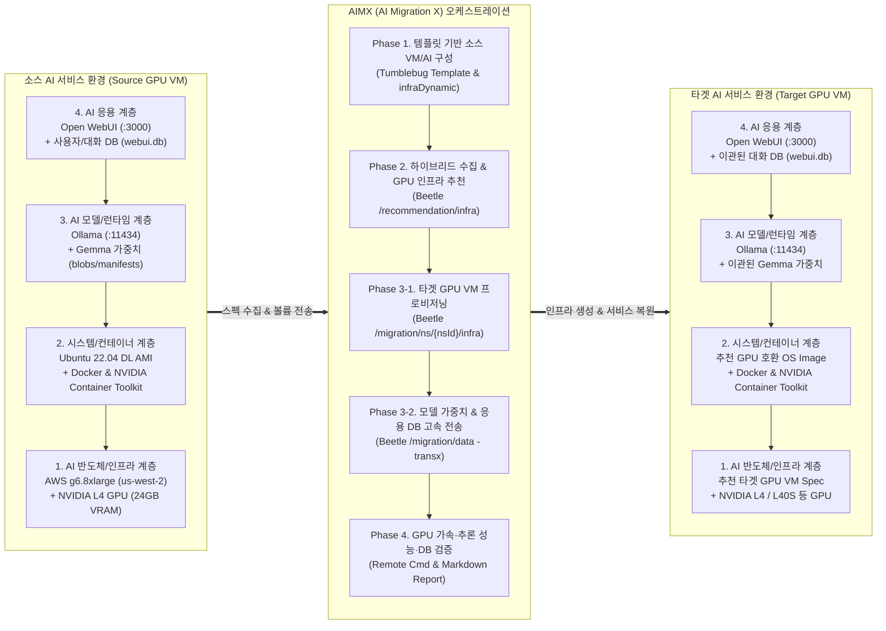
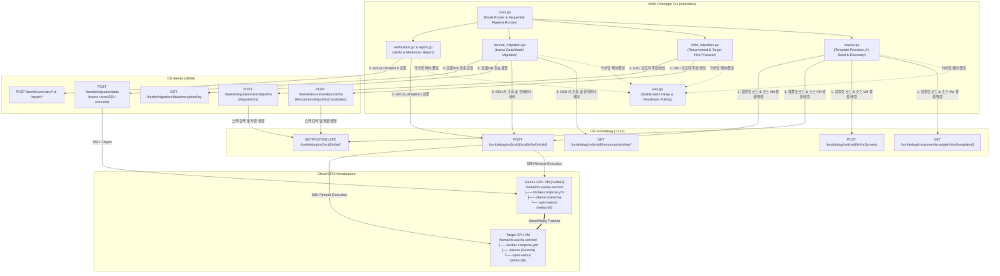
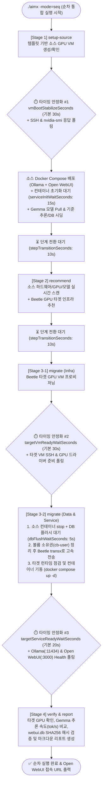
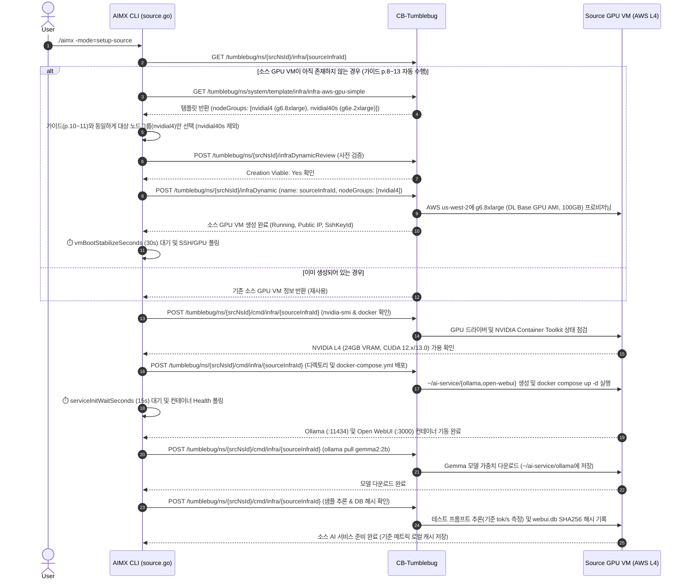
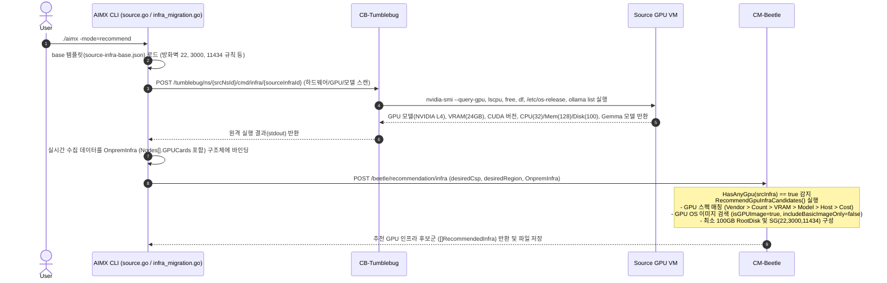
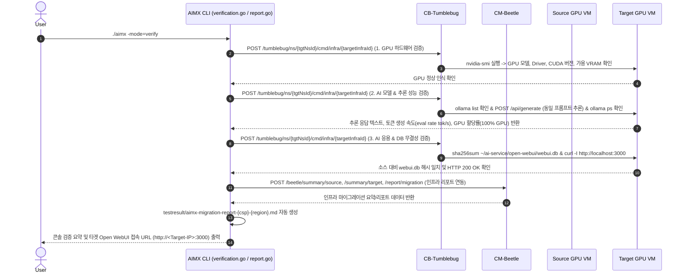
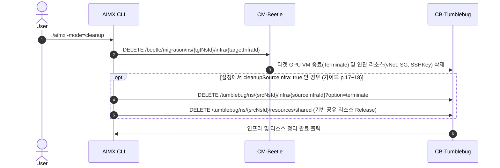

# AIMX: AI 서비스 마이그레이션 설계 및 프로토타입(PoC) 개발 계획서

본 문서는 **CB-Tumblebug**과 **CM-Beetle (`transx` 포함)** API를 결합하여, **AI 반도체(GPU) 기반 VM 인프라 및 AI 모델(Gemma)·응용(Open WebUI) 통합 마이그레이션**을 수행하는 프로토타입 **`AIMX`**의 설계 및 구현 계획서입니다.

---

## 0. 프로토타입 브랜딩: **AIMX (AI Migration X)**

* **대표 브랜드명**: **`AIMX`** (**AI Migration X** — *AI Migration eXecutor*)
* **브랜드 스토리 & 의미**:
  * **SpaceX 스타일의 상징성(`X`)**: 클라우드와 AI 반도체(GPU)의 경계를 가로지르는 **Cross-Cloud & Cross-GPU (`X`)** 마이그레이션을 상징합니다.
  * **실행 엔진으로서의 정체성(`eXecutor`)**: CM-Beetle의 데이터 전송 모듈인 **`transx`**와 패밀리 브랜딩(`-x` 시리즈)을 형성하며, 인프라 추천·프로비저닝부터 모델 가중치/응용 DB 이관 및 추론 검증까지 엔드투엔드 파이프라인을 완결성 있게 실행(**Execute**)합니다.
* **디렉토리 및 CLI 바이너리**: `cmd/aimx` (실행 명령어: `./aimx` 또는 `go run .`)
* **별도 설계 산출물 문서**: `README.md`(CLI 사용 가이드)와 별개로, 과제 산출물(**「AI반도체 기반 AI 서비스 마이그레이션 시나리오 정의」** 및 **「AI 서비스 마이그레이션 구조 설계」**)에 바로 활용할 수 있는 **`cmd/aimx/docs/ai-service-migration-design.md`** 문서를 함께 작성합니다.

---

## 1. AI 반도체 기반 AI 서비스 마이그레이션 시나리오 정의

### 1.1 시나리오 개요 및 4계층 구조
* **시나리오 명**: AWS GPU VM 기반 설치형 LLM(Gemma) 및 웹 챗봇 응용(Open WebUI)의 타겟 클라우드 GPU 인프라 마이그레이션
* **마이그레이션 4대 계층 (4-Layer AI Migration Stack)**:
  1. **Hardware / AI Accelerator 계층**: GPU 카드(NVIDIA L4 24GB ➔ 타겟 GPU), GPU 드라이버 및 CUDA 런타임
  2. **VM Infrastructure 계층**: Compute Spec(`g6.8xlarge` 등), Deep Learning GPU OS Image(`ami-071b54254e6f59477`), Root Disk(100GB+), vNet/Subnet, Security Group(22, 3000, 11434), SSH Key
  3. **AI Model & Serving Runtime 계층**: Ollama 서빙 컨테이너(GPU Passthrough) 및 로컬 스토리지에 저장된 Gemma 모델 가중치(`gemma2:2b` / `gemma3:4b` 블롭 및 매니페스트)
  4. **AI Application & State 계층**: Open WebUI 컨테이너 및 사용자 계정·대화 이력·프롬프트 지식베이스(`webui.db`, 벡터/업로드 데이터)



---

## 2. AI 서비스 마이그레이션 구조 설계 및 모드별 상세 다이어그램

### 2.1 전체 컴포넌트 연동 구조도



---

### 2.2 순차 실행 모드(`-mode=seq` / `-mode=all`) 및 타이밍 안정화(Wait & Retry) 설계



#### 타이밍 제어 파라미터 (`test-config.yaml` 설정 가능)
| 설정 키 (`timing.*`) | 기본값 | 역할 및 타이밍 이슈 방지 목적 |
| :--- | :---: | :--- |
| `stepTransitionSeconds` | `10s` | 순차 실행(`seq`) 시 각 모드(`setup-source` ➔ `recommend` ➔ `migrate` ➔ `verify`) 전환 사이의 쿨다운 대기 |
| `vmBootStabilizeSeconds` | `30s` | Tumblebug에서 GPU VM이 `Running`이 된 직후 `cloud-init`, `sshd`, NVIDIA 드라이버가 안정화될 때까지 대기 |
| `sshRetryMaxAttempts` / `sshRetryIntervalSeconds` | `12회` / `10s` | 원격 명령(`Remote Cmd`) 또는 `transx` 실행 전 SSH 및 `nvidia-smi` 명령이 정상 응답할 때까지 최대 2분간 재시도 폴링 |
| `serviceInitWaitSeconds` | `15s` | `docker compose up -d` 실행 후 Ollama API(`:11434`) 및 Open WebUI(`:3000`)가 초기화되고 `webui.db`를 생성할 때까지 대기 |
| `dbFlushWaitSeconds` | `5s` | `transx` 복사 직전 소스 컨테이너 `docker compose stop` 후 SQLite WAL 버퍼가 디스크(`webui.db`)에 완전히 기록(`sync`)되도록 대기 |
| `targetServiceReadyWaitSeconds` | `20s` | 타겟 VM에서 이관된 볼륨으로 컨테이너 기동 후 Gemma 모델 추론 검증(`verify`)을 시작하기 전 워밍업 대기 |

---

### 2.3 개별 모드별 상세 시퀀스 다이어그램

#### ① `-mode=setup-source` (템플릿 기반 소스 GPU VM 생성 및 AI 서비스 시딩)



#### ② `-mode=recommend` (하이브리드 소스 수집 및 타겟 GPU 인프라 추천)



#### ③ `-mode=migrate` (타겟 GPU VM 프로비저닝 및 AI 모델/응용 데이터 마이그레이션)

```mermaid
sequenceDiagram
    autonumber
    actor User
    participant AIMX as AIMX CLI (infra_migration.go / service_migration.go)
    participant BT as CM-Beetle ( & transx )
    participant TB as CB-Tumblebug
    participant Src as Source GPU VM
    participant Tgt as Target GPU VM

    User->>AIMX: ./aimx -mode=migrate
    Note over AIMX,Tgt: Step 3-1. 타겟 GPU VM 인프라 프로비저닝
    AIMX->>BT: POST /beetle/migration/ns/{tgtNsId}/infra (추천 후보 1순위 RecommendedInfra)
    BT->>TB: vNet, Subnet, SecurityGroup(22,3000,11434), SSHKey, GPU VM 생성 요청
    TB->>Tgt: 타겟 클라우드 GPU VM 프로비저닝 및 부팅 대기
    TB-->>BT: 생성된 VmInfraInfo (Public IP, SshKeyId 등) 반환
    BT-->>AIMX: 타겟 GPU VM 프로비저닝 완료 응답
    AIMX->>AIMX: ⏱️ vmBootStabilizeSeconds (30s) 대기 및 타겟 VM SSH/GPU 응답 폴링

    Note over AIMX,Tgt: Step 3-2. SSH 접속 키 확보, 컨테이너 정지 및 파일 소유권(cb-user) 정리
    AIMX->>TB: GET /tumblebug/ns/{nsId}/resources/sshKey/{srcSshKeyId & tgtSshKeyId}
    TB-->>AIMX: 소스 및 타겟 VM의 SSH Private Key (PEM) 반환
    AIMX->>TB: POST /tumblebug/ns/{srcNsId}/cmd/infra/{sourceInfraId} (docker compose stop && sync && sudo chown -R cb-user)
    TB->>Src: 컨테이너 정지(WAL 플러시) 및 root 생성 볼륨 파일의 cb-user 읽기 권한 부여
    AIMX->>AIMX: ⏱️ dbFlushWaitSeconds (5s) 대기
    AIMX->>TB: POST /tumblebug/ns/{tgtNsId}/cmd/infra/{targetInfraId} (mkdir -p ~/ai-service && Docker/NVIDIA 런타임 점검)
    TB->>Tgt: 타겟 수신 디렉토리 및 컨테이너 런타임 준비

    Note over AIMX,Tgt: Step 3-3. Beetle transx 기반 AI 모델(Gemma) & 응용(Open WebUI) 데이터 전송
    AIMX->>BT: POST /beetle/migration/data (Source SSH -> Destination SSH, path: /home/cb-user/ai-service)
    BT->>Src: transx (rsync over SSH) 연결 및 블록 단위 증분/압축 전송 실행
    Src==>Tgt: docker-compose.yml + ollama/(Gemma 가중치) + open-webui/(webui.db) 고속 전송
    BT-->>AIMX: 데이터 마이그레이션 완료 응답 (소요 시간, 전송 결과)

    Note over AIMX,Tgt: Step 3-4. 타겟 AI 서비스 기동 및 안정화 대기
    AIMX->>TB: POST /tumblebug/ns/{tgtNsId}/cmd/infra/{targetInfraId} (cd ~/ai-service && docker compose up -d)
    TB->>Tgt: 이관된 볼륨을 마운트하여 Ollama + Open WebUI 컨테이너 즉시 기동
    AIMX->>AIMX: ⏱️ targetServiceReadyWaitSeconds (20s) 대기 및 Health 폴링
    Tgt-->>AIMX: 타겟 AI 서비스 컨테이너 Running 및 포트 응답 확인
```

#### ④ `-mode=verify` (GPU 가속, Gemma 추론 성능 및 Open WebUI 정합성 검증 & 리포트)



#### ⑤ `-mode=cleanup` (소스/타겟 인프라 및 기반 리소스 정리)



---

## 3. CM-Beetle 코어 추천 엔진 개선 및 실전 구동 잠재 이슈 해결

### 3.1 CM-Beetle GPU 추천 엔진 개선 (`pkg/core/recommendation/`)
| 번호 | 대상 파일 | 문제점 및 원인 | 해결 방안 |
| :---: | :--- | :--- | :--- |
| **1** | `pkg/core/recommendation/resource-node-image.go` | **[치명적 버그] `IncludeBasicImageOnly=true`와 `IsGPUImage=true` 동시 전송으로 GPU 이미지 0건 반환**: CB-Tumblebug에서 `isBasicImage`와 `isGPUImage`는 상호 배타적(`isGPUImage=true`이면 무조건 `isBasicImage=false`)인데, Beetle이 두 플래그를 모두 `true`로 보내 Tumblebug이 모든 GPU 이미지를 필터링으로 제거함. | `isGpu == true`일 때 `IncludeBasicImageOnly = &falseValue`로 설정하여 GPU 전용 OS 이미지(`Deep Learning Base GPU AMI` 등)가 정상 검색되도록 수정. |
| **2** | `pkg/core/recommendation/resource-node-spec-gpu.go` | **Tumblebug 조회 `fetchLimit`(15) 병목**: 저렴한 소형 GPU VM 15개만 반환되어 `g6.8xlarge`(32 vCPU, 128 GiB) 등 고사양 호스트 스펙이 정렬 전에 누락됨. | `fetchLimit` 최소값을 `100`으로 상향하여 리전 내 가용 GPU 스펙 풀 전체를 대상으로 다차원 정렬 수행. |
| **3** | `pkg/core/recommendation/resource-node-spec-gpu.go` | **동일 GPU 모델명(`gpuModelMatch`) 우선순위 부재**: 24GB VRAM 동급 스펙 중 `L4`와 `A10G`를 구분하지 못함. | `Vendor > Count > VRAM > Model > Host L1 > Cost` 순으로 정렬하도록 `gpuModelMatch` 기준 추가. |
| **4** | `pkg/core/recommendation/resource-node-spec-gpu.go` | **VRAM 하향(Under-provisioning) 방지 및 `rightSizeUpVramTier` 오차 허용**: 요구 VRAM 미달 스펙 배제 및 `24.1 GB` 같은 미세 오차 시 `24GB` 티어 유지 필요. | 요구 VRAM 충족(`>=`) 스펙 우선 배치 및 티어 매핑 시 `0.5 GB` 허용 오차 적용. |

### 3.2 실전 마이그레이션 구동 시 신경 써야 할 3대 운영 포인트 (AIMX 내장)
1. **Docker 컨테이너 `root` 생성 파일과 `transx`(`rsync`) 권한 충돌 방지**:
   * `ollama`와 `open-webui` 컨테이너는 내부적으로 `root`(UID 0)로 실행되어 호스트의 `~/ai-service/{ollama,open-webui}` 하위 파일들이 `root:root` 소유로 생성됩니다.
   * 반면 `transx`는 `cb-user` SSH 세션으로 `rsync`를 실행하므로, `transx` 호출 직전에 `sudo chown -R cb-user:cb-user ~/ai-service && sudo chmod -R u+rwX ~/ai-service`를 원격 실행하여 `Permission denied`를 원천 차단합니다.
2. **소스/타겟 Security Group 포트(3000, 11434) 및 검증 안정성**:
   * 타겟 VM은 `source-infra-base.json`의 `firewallTable`에 `22`, `3000`, `11434` 포트를 명시하여 Beetle이 Security Group 생성 시 자동으로 외부 접속 포트를 열어줍니다.
   * 소스 VM(템플릿 기본 SG 사용)에서도 외부 브라우저 테스트가 필요할 수 있으므로, Tumblebug 방화벽 규칙 추가 API(`POST /tumblebug/ns/{nsId}/resources/securityGroup/{sgId}/rules`)로 포트 오픈을 시도하고, CLI 검증(`verify`) 자체는 방화벽 영향이 없는 VM 내부 루프백(`localhost:3000`, `localhost:11434`) 원격 명령으로 수행합니다.
3. **타겟 GPU VM의 Docker & NVIDIA Container Toolkit 자가 점검(Self-healing check)**:
   * 추천된 타겟 GPU 이미지에 혹시라도 `docker compose` 플러그인이나 `nvidia-container-toolkit` 설정이 누락되어 있을 경우, 타겟 기동 전에 자동으로 감지하여 설정(`nvidia-ctk runtime configure --runtime=docker`)하는 방어 스크립트를 포함합니다.

### 3.3 CB-Tumblebug API 기반 SSH Key 획득 및 `aimx` 임시 관리 / Beetle 암호화 연동 설계

CM-Beetle의 데이터 마이그레이션 API(`POST /beetle/migration/data`)는 내부적으로 `transx`를 사용하여 소스 VM과 타겟 VM 간 `rsync over SSH` 전송을 수행합니다. 이를 위해 `aimx`는 CB-Tumblebug API로부터 소스 및 목표 노드의 SSH Key를 발급받아 **메모리에서 일시적으로만 관리**하고, Beetle의 **1회용 임시키(`KeyStore`) 암호화**를 거쳐 안전하게 전달합니다.

1. **CB-Tumblebug SSH Key 조회 및 `aimx` 내 일시적(In-Memory Ephemeral) 관리**:
   * **Step 1 (노드별 `sshKeyId` 및 접속 계정 식별)**:
     - 소스 VM: `GET /tumblebug/ns/{srcNsId}/infra/{sourceInfraId}` 응답(`tbmodel.InfraInfo`)의 `node[0].sshKeyId`, `node[0].publicIP`, `node[0].nodeUserName` 추출.
     - 타겟 VM: `POST /beetle/migration/ns/{tgtNsId}/infra` 응답(`cloudmodel.VmInfraInfo`)의 `node[0].sshKeyId`, `node[0].publicIP`, `node[0].nodeUserName` 추출.
   * **Step 2 (`aimx`의 임시 SSH Key 획득 및 메모리 격리)**:
     - `GET /tumblebug/ns/{nsId}/resources/sshKey/{sshKeyId}`를 호출하여 `tbmodel.SshKeyInfo`의 `.PrivateKey`(PEM 원문)와 `.Username`을 획득합니다.
     - 획득한 `.PrivateKey`는 로컬 상태 파일(`.aimx-state.json`)이나 영구 디스크에 **절대 저장하지 않으며**, `aimx`의 전송 함수 내 임시 구조체(`ephemeralSshKeyPair`)에서만 일시 보관한 뒤 `defer`를 통해 전송 완료 즉시 메모리에서 소거(`Zeroing/Clear`)합니다.
   * **Step 3 (Beetle 1회용 임시키 발급 API 연동 및 민감정보 암호화)**:
     - `GET /beetle/migration/data/encryptionKey`를 호출하여 Beetle 서버의 인메모리 `KeyStore`가 발급한 1회용 RSA-2048 공개키 번들(`transx.PublicKeyBundle`)을 수신합니다.
     - `transx.EncryptModel()`(RSA-OAEP-256 + AES-256-GCM 하이브리드 암호화)을 통해 `source.filesystem.ssh.privateKey`와 `destination.filesystem.ssh.privateKey`를 암호화하여 `POST /beetle/migration/data`로 전송합니다(서버 복호화 직후 1회용 키 자동 파기).

2. **`transx` 전송 전략(`strategy: "relay"`)을 통한 이종 VM 간 SSH Key 처리**:
   * 소스 VM(`mc-daisy`)과 타겟 VM(Beetle 마이그레이션 생성 VM)은 서로 다른 SSH Key를 가지므로, `aimx`는 기본 전송 전략으로 **`strategy: "relay"`**를 사용합니다.
   * **동작 방식**: Beetle(`transx`)이 소스 SSH Key로 소스 VM에서 스테이징 경로로 `pull` 한 뒤, 타겟 SSH Key로 타겟 VM에 `push` 하므로(`transx` 코어 수정 없이), 소스와 타겟의 SSH Key가 다르거나 두 VM 간 직접 SSH 포트가 열려 있지 않아도 100% 안정적으로 전송됩니다.

### 3.4 CM-Beetle (`transx`) 데이터 전송 필터(`FilterOption`) 분석 및 설계

CM-Beetle의 `POST /beetle/migration/data` 요청 페이로드(`transx.DataMigrationModel`)는 `source.filter` 및 `destination.filter`에 **`transx.FilterOption` (`include: []string`, `exclude: []string`)**을 지원하며, `transx/executor-rsync.go`에서 이를 `rsync`의 `--include=...` 및 `--exclude=...` 인자로 변환합니다.

1. **AI 서비스 디렉토리(`/home/cb-user/ai-service/`) 구조와 필터링 대상**:
   ```text
   /home/cb-user/ai-service/
   ├── docker-compose.yml               # [필수 포함] 컨테이너 오케스트레이션 정의
   ├── ollama/
   │   ├── id_ed25519*                  # [선택/제외 가능] 노드 고유 식별키
   │   └── models/
   │       ├── manifests/**             # [모드별 제어] Gemma 모델 매니페스트
   │       └── blobs/sha256-*           # [모드별 제어] 대용량 GGUF 모델 가중치 (1.6GB ~ 5.5GB+)
   └── open-webui/
       ├── webui.db                     # [필수 포함] 사용자/프롬프트/채팅 히스토리 SQLite DB
       ├── .webui_secret_key            # [필수 포함] 세션 암호화 키
       ├── uploads/**                   # [포함/선택] RAG 업로드 문서
       ├── vector_db/**                 # [포함/선택] ChromaDB 벡터 인덱스
       └── cache/**                     # [기본 제외] 런타임 임시 캐시 파일
   ```

2. **`AIMX`의 `transx` 필터 프로파일 설계 (`buildTransxFilter`)**:
   * **① 기본 위생 필터 (Default Hygiene Filter — 항상 적용)**:
     - 마이그레이션에 불필요한 런타임 캐시 및 임시/로그 파일(`open-webui/cache/**`, `*.log`, `*.tmp`, `__pycache__/**`)을 `source.filter.exclude`에 기본 등록하여 전송량을 줄이고 불필요한 파일 충돌을 방지합니다.
   * **② 전체 스택 전송 모드 (`transferModelWeights: true`, 기본값)**:
     - `docker-compose.yml` + `ollama/models/**` (Gemma 가중치 블롭 및 매니페스트) + `open-webui/**` (`webui.db` 등) 전체를 전송하되, 위생 필터 및 사용자 지정 `exclude` 패턴만 제외합니다.
   * **③ 경량 상태 전용 전송 모드 (`transferModelWeights: false`)**:
     - `source.filter.exclude`에 `ollama/models/blobs*` 및 `ollama/models/manifests*` 패턴을 자동 추가하여 수 GB 모델 가중치 전송을 생략하고, `docker-compose.yml`과 `open-webui/webui.db`만 수 초 내에 고속 전송한 뒤 타겟 GPU VM에서 `ollama pull`을 수행합니다.
   * **④ 사용자 정의 필터 오버라이드 (`aiService.filter.include` / `aiService.filter.exclude`)**:
     - `test-config.yaml`의 `aiService.filter` 섹션에서 사용자가 직접 `include` 및 `exclude` 패턴 리스트를 정의할 수 있으며, `AIMX`가 이를 병합·중복 제거하여 `POST /beetle/migration/data`에 전달합니다.

### 3.5 소스/타겟 Open WebUI 브라우저 접속 링크 출력 및 원격 자동화 검증 설계

1. **단계별 Open WebUI 브라우저 접속 링크 안내 (수동 확인 지원)**:
   * **Stage 1 (`setup-source`) 완료 시**: 소스 Open WebUI 접속 링크(`http://<Source-Public-IP>:3000`)와 Ollama API 링크(`http://<Source-Public-IP>:11434/api/tags`)를 배너로 출력합니다. 사용자는 브라우저로 직접 접속해 Gemma 모델과 대화를 나누어 채팅 이력을 생성한 뒤 마이그레이션(`-mode=migrate`)을 수행할 수 있습니다.
   * **Stage 3 (`migrate`) 완료 직전 해시 동기화**: 사용자가 브라우저에서 추가한 최신 채팅 이력까지 검증에 반영되도록, `migrate` 단계에서 소스 컨테이너 정지(`docker compose stop && sync`) 직후 소스 `webui.db`의 최종 `SHA-256` 해시와 레코드 수를 재측정하여 기준값으로 기록합니다.
   * **Stage 3 (`migrate`) & Stage 4 (`verify`) 완료 시**: **소스 Open WebUI 링크(`http://<Source-IP>:3000`)**와 **타겟 Open WebUI 링크(`http://<Target-IP>:3000`)**를 나란히 출력하여 브라우저에서 즉시 비교 확인할 수 있도록 지원합니다.

2. **Open WebUI + Gemma 4단계 원격 자동화 테스트 (`verify`)**:
   * **① 외부 HTTP 접속 자동 테스트 (`probeExternalWebUI`)**: `aimx`를 실행 중인 로컬 클라이언트에서 직접 `GET http://<Public-IP>:3000/api/config` 및 `GET http://<Public-IP>:3000/health`를 호출하여 Security Group 방화벽(3000번 포트)과 Open WebUI 웹 서버의 외부 응답 여부를 자동으로 검증합니다.
   * **② Open WebUI 백엔드 API & 버전/상태 검증 (`/api/config`, `/health`)**: VM 내부 및 외부에서 Open WebUI의 `/api/config` JSON(`status: true`, `name: "Open WebUI"`, `version`)과 `/health`(`status: true`)를 파싱하여 웹 응용의 정상 동작을 검증합니다.
   * **③ SQLite `webui.db` 무결성(`SHA-256`) 및 테이블/레코드 검증**: 소스와 타겟의 `/home/cb-user/ai-service/open-webui/webui.db` 파일 `SHA-256` 해시가 100% 일치(`MATCH`)하는지 대조합니다.
   * **④ Gemma GPU 실 추론 벤치마크 (`/api/generate` & `ollama ps`)**: 동일 프롬프트에 대한 추론 응답 텍스트, `100% GPU` 오프로딩 여부, 초당 토큰 생성 속도(`eval tokens/sec`)를 자동 측정하여 비교 리포트(`testresult/aimx-migration-report-{csp}-{region}.md`)를 생성합니다.

---

## 4. 프로토타입 개발 구조 (`cmd/aimx`)

```text
cmd/aimx/
├── main.go                        # CLI 엔트리포인트 (-config, -mode=seq|setup-source|recommend|migrate|verify|cleanup)
├── config.go                      # TestConfig(TimingConfig, TransxFilterConfig 포함), AuthConfig, AIServiceConfig 구조체 및 로더
├── wait.go                        # 단계별 안정화 대기(Countdown) 및 SSH / GPU / Docker / HTTP Readiness 폴링 유틸리티
├── source.go                      # [Stage 1] Tumblebug 템플릿(infra-aws-gpu-simple) 기반 소스 VM 생성, AI 서비스 설치 및 하이브리드 스펙 수집
├── infra_migration.go             # [Stage 2 & 3-1] Beetle GPU 인프라 추천(/recommendation/infra) 및 프로비저닝(/migration/ns/{nsId}/infra)
├── service_migration.go           # [Stage 3-2] Tumblebug SSH Key 조회, transx 필터 구성, 데이터 마이그레이션(/migration/data) 및 타겟 기동
├── verification.go                # [Stage 4] 소스 vs 타겟 GPU(nvidia-smi), Gemma 추론 성능(tok/s, GPU 오프로딩), Open WebUI DB/HTTP 검증
├── report.go                      # 마크다운 마이그레이션 결과 리포트(testresult/*.md) 및 콘솔 요약 출력 생성
├── main_test.go                   # 설정 파싱, 하드웨어/추론 출력 파서, 템플릿/transx 필터링 및 리포트 생성 단위 테스트
├── README.md                      # AIMX 빠른 시작, 설정 방법 및 모드별 실행 가이드
├── docs/
│   └── ai-service-migration-design.md  # [과제 산출물용] AI반도체 기반 AI 서비스 마이그레이션 시나리오 정의 및 구조 설계서
├── testconf/
│   ├── template-test-config.yaml  # 소스 템플릿(infra-aws-gpu-simple), 타겟 CSP·리전, Gemma 모델명, transx 필터/전략, 타이밍 설정 템플릿
│   ├── template-auth-config.json  # Beetle / Tumblebug API 인증 및 엔드포인트 설정 템플릿
│   └── source-infra-base.json     # 하이브리드 수집 시 베이스가 되는 OnpremInfra 기본 템플릿 (방화벽 포트 22/3000/11434 포함)
└── testresult/                    # 실행 결과 마크다운 리포트 및 단계별 중간 상태(.aimx-state.json) 저장 경로
```

