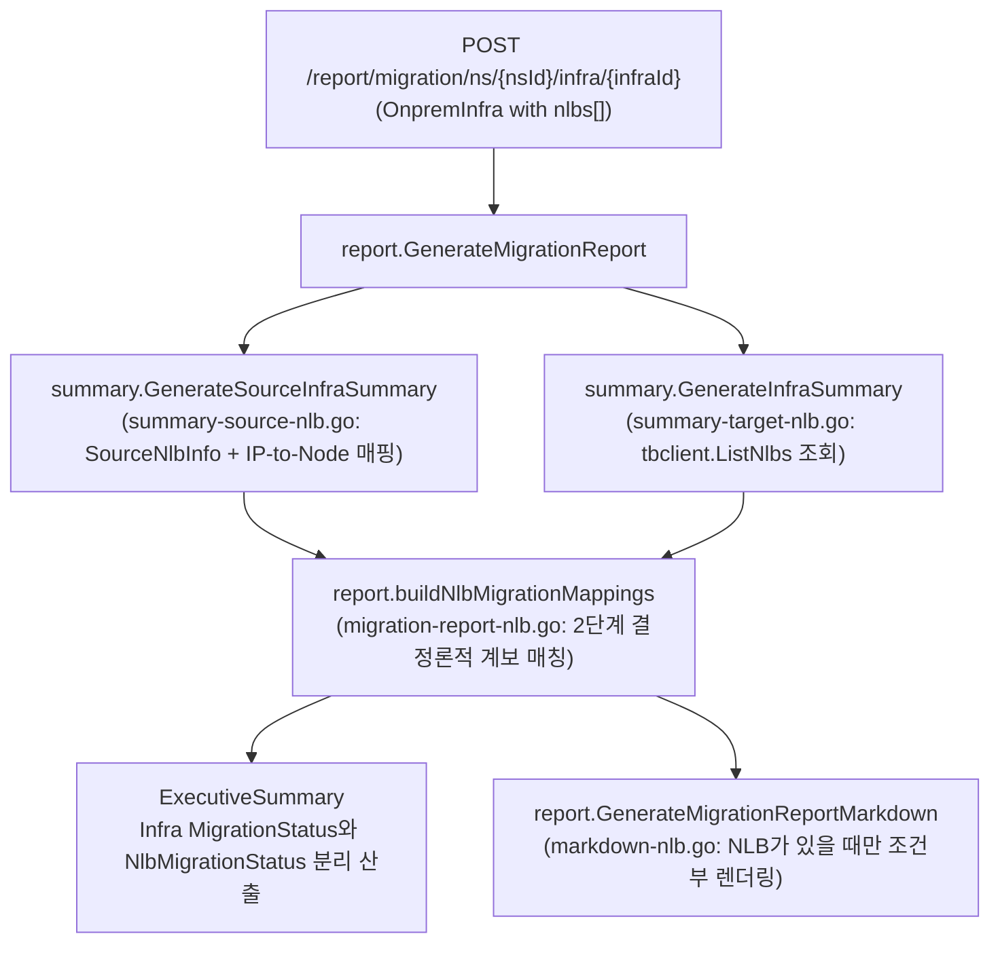

# NLB 연계 인프라 Summary 및 Migration Report 개선 계획

> **Status**: Draft / Aligned  
> **Target Subsystems**: CM-Beetle (`imdl/lineage`, `pkg/core/summary`, `pkg/core/report`, `cmd/test-cli/infra-with-nlb`)  
> **Related Documents**:  
> - [`docs/plan/nlb-plan-for-recommendation-and-migration.md`](./nlb-plan-for-recommendation-and-migration.md)  
> - [`docs/plan/plan-test-cli-for-infra-with-nlb.md`](./plan-test-cli-for-infra-with-nlb.md)  
> - [`docs/plan/lineage-plan.md`](./lineage-plan.md)  

---

## 1. 개요 및 문제 정의

### 1.1 배경
CM-Beetle은 `POST /beetle/recommendation/infraWithNlb`를 통해 온프레미스 서버(`nodes`)와 소프트웨어 로드밸런서(`nlbs`, 예: HAProxy)를 연계 분석하여 목표 클라우드 인프라(`targetInfra`)와 네트워크 로드밸런서(`targetNlbList`)를 통합 추천합니다. 이후 사용자는 인프라 마이그레이션(`POST /beetle/migration/ns/{nsId}/infra`)과 NLB 마이그레이션(`POST /beetle/migration/middleware/ns/{nsId}/infra/{infraId}/nlb`)을 순차 실행합니다.

그러나 현재 `infra-with-nlb` 시나리오를 끝까지 수행한 뒤 생성된 아래 3종의 결과 문서에는 **NLB 구성 정보 및 소스-타겟 NLB 매칭 정보가 전혀 포함되지 않는 문제**가 있습니다.
- 소스 인프라 요약: [`beetle-summary-source.md`](file:///home/ubuntu/dev/cloud-barista/cm-beetle/cmd/test-cli/infra-with-nlb/testresult/beetle-summary-source.md)
- 타겟 인프라 요약: [`beetle-summary-target-aws.md`](file:///home/ubuntu/dev/cloud-barista/cm-beetle/cmd/test-cli/infra-with-nlb/testresult/beetle-summary-target-aws.md)
- 마이그레이션 리포트: [`beetle-report-mig-source-to-aws.md`](file:///home/ubuntu/dev/cloud-barista/cm-beetle/cmd/test-cli/infra-with-nlb/testresult/beetle-report-mig-source-to-aws.md)

### 1.2 원인 분석
1. **소스 요약(`pkg/core/summary`)의 `infraData.NLBs` 누락**:
   - `POST /beetle/summary/source` 및 `POST /beetle/report/migration/ns/{nsId}/infra/{infraId}`는 이미 `nlbs` 배열이 포함된 [`onpremmodel.OnpremInfra`](file:///home/ubuntu/dev/cloud-barista/cm-beetle/imdl/on-premise-model/model.go#L20-L32)를 입력받지만, [`GenerateSourceInfraSummary`](file:///home/ubuntu/dev/cloud-barista/cm-beetle/pkg/core/summary/summary-source.go#L28)가 `infraData.NLBs`를 수집하지 않습니다.
2. **타겟 요약(`pkg/core/summary`)의 Tumblebug NLB 미조회**:
   - [`GenerateInfraSummary`](file:///home/ubuntu/dev/cloud-barista/cm-beetle/pkg/core/summary/summary-target.go#L31)는 Infra, VNet, SSH Key, Security Group, Spec, Image만 조회하며, [`tbclient.NewSession().ListNlbs(nsId, infraId)`](file:///home/ubuntu/dev/cloud-barista/cm-beetle/pkg/client/tumblebug/nlb.go#L66)를 호출하지 않습니다.
3. **리포트(`pkg/core/report`)의 소스-타겟 NLB 매칭 및 마크다운 렌더러 부재**:
   - [`GenerateMigrationReport`](file:///home/ubuntu/dev/cloud-barista/cm-beetle/pkg/core/report/migration-report.go#L28) 및 [`GenerateMigrationReportMarkdown`](file:///home/ubuntu/dev/cloud-barista/cm-beetle/pkg/core/report/markdown.go#L27)에 NLB 매칭 모델, 백엔드 서버-타겟 VM 연결 로직, 마크다운 출력 섹션이 없습니다.

---

## 2. `infra`와 `nlb`의 연계(Coupling) 및 분리(Decoupling) 종합 분석

Summary와 Migration Report에서 어느 범위까지 단일 파일로 통합하고 어떻게 상태를 표현할지 결정하기 위해, 전 주기에 걸친 `infra`와 `nlb`의 결합도를 분석했습니다.

| 단계 / 영역 | 관련 코드 및 API | 연계(Coupled)된 부분 | 분리(Decoupled) 및 단절된 부분 |
| :--- | :--- | :--- | :--- |
| **1. 소스 모델** | [`model.go`](file:///home/ubuntu/dev/cloud-barista/cm-beetle/imdl/on-premise-model/model.go#L6-L32), [`nlb.go`](file:///home/ubuntu/dev/cloud-barista/cm-beetle/imdl/on-premise-model/nlb.go#L11-L21) | `OnpremInfra` 내부에 `NLBs []NlbProperty`가 내장됨. `HostMachineId`(HAProxy 호스트 서버)와 `Backend.Servers[].IP`(서버 NIC IP와 매칭)를 통해 `Nodes`와 직접 연결됨. | 단독 추출용 `SourceNlbModel`(`SourceNlb []SourceNlb`, `HostMachineId` 없음)도 별도 타입으로 정의되어 있음. |
| **2. 추천 (Recommendation)** | [`server.go`](file:///home/ubuntu/dev/cloud-barista/cm-beetle/pkg/api/rest/server.go#L361-L377), [`infra-with-nlb.go`](file:///home/ubuntu/dev/cloud-barista/cm-beetle/pkg/core/recommendation/infra-with-nlb.go#L41-L140) | `POST /recommendation/infraWithNlb`가 단일 `RecommendedInfra` 응답 안에서 `TargetInfra`와 `TargetNlbList`를 동시 설계함.<br>- 백엔드 서버들을 N:1 NodeGroup(`ng-<backend>`)으로 병합<br>- NodeGroup에 `nlbBackend`, `cm-source-machine-ids` 라벨 주입<br>- 백엔드 SG에 헬스체크/트래픽 허용 방화벽 규칙 자동 보강 | `objectStorage`, `rdbms`와 달리 `/recommendation/middleware/nlb` 같은 독립 NLB 추천 API가 없음. 즉, 추천 단계에서 NLB는 인프라 토폴로지 결정의 일부로 강결합되어 있음. |
| **3. 네이밍 및 사전 검증** | [`naming.go`](file:///home/ubuntu/dev/cloud-barista/cm-beetle/pkg/core/common/naming.go#L160-L164), [`infra.go`](file:///home/ubuntu/dev/cloud-barista/cm-beetle/pkg/core/validation/infra.go#L47-L107) | `ApplyNameSeed`와 `ValidateReferentialIntegrity`는 `TargetNlbList[].TargetGroup.NodeGroupId`가 실제 `NodeGroups`에 존재하는지 함께 갱신하고 검증함. | - `PropagateNameChange`에는 NodeGroup 이름 변경 시 NLB 참조 전파 로직이 없음.<br>- `POST /validation/ns/:nsId/infra`(`ValidateTargetInfra`)는 NLB 포트/프로토콜 제약이나 기존 NLB 충돌을 검증하지 않음. |
| **4. 마이그레이션 실행 및 수명주기** | [`migration.go`](file:///home/ubuntu/dev/cloud-barista/cm-beetle/pkg/api/rest/controller/migration.go#L167-L240), [`migration-nlb.go`](file:///home/ubuntu/dev/cloud-barista/cm-beetle/pkg/api/rest/controller/migration-nlb.go#L35-L120) | **Tumblebug 리소스 계층상 부모-자식 종속**:<br>- `objectStorage`/`rdbms`(`ns/:nsId/...`)와 달리 NLB는 반드시 특정 `:infraId` 하위 경로(`ns/:nsId/infra/:infraId/nlb`)에 종속됨.<br>- Tumblebug에서 `nlb.Id == nodeGroupId`(1:1 바인딩)이며 `targetGroup.nodes`가 해당 Infra 내 VM ID 목록을 직접 참조함.<br>- 삭제 시에도 NLB를 먼저 삭제해야 Infra(Subnet/VNet) 삭제가 가능함. | **API 호출과 실행 시점이 분리됨**:<br>1) `POST /migration/ns/:nsId/infra`는 `TargetNlbList`를 무시하고 VM/네트워크만 생성함. `?nameSeed=` 적용 시 변환된 `TargetNlbList`를 반환하지 않아 호출자([`main.go`](file:///home/ubuntu/dev/cloud-barista/cm-beetle/cmd/test-cli/infra-with-nlb/main.go#L646-L650))가 수동으로 `ComposeName`을 다시 적용해야 함.<br>2) `POST /migration/middleware/ns/:nsId/infra/:infraId/nlb`는 별도 요청(`RecommendedNlb`)으로 나중에 실행됨.<br>3) 추천 없이 기존 Infra 위에 NLB만 수동 생성하거나, Infra만 먼저 생성하고 NLB는 미실행/실패/선삭제된 상태가 존재할 수 있음. |
| **5. Summary / Report 및 UI** | [`server.go`](file:///home/ubuntu/dev/cloud-barista/cm-beetle/pkg/api/rest/server.go#L497-L518), [`MigratedInfraManagement.tsx`](file:///home/ubuntu/dev/cloud-barista/cm-beetle/ui/src/components/operations/MigratedInfraManagement.tsx#L1560-L1625) | `POST /summary/source`와 `POST /report/migration/ns/:nsId/infra/:infraId` 모두 이미 `nlbs`가 포함된 `OnpremInfra`와 `:infraId`를 입력으로 받고 있음. UI 역시 이 3개 API가 반환하는 HTML/Markdown을 그대로 렌더링함. | 현재 `pkg/core/summary`와 `pkg/core/report`가 `OnpremInfra.NLBs`와 `tbclient.ListNlbs(nsId, infraId)`를 전혀 조회하지 않음. |

---

## 3. 문서(파일) 및 API 통합/분리 아키텍처 설계

### 3.1 단일 파일 통합 가능 영역 vs 별도 처리 필요 영역

1. **기존 `infra` Summary / Migration Report 단일 파일에 통합이 적합한 영역**:
   - **정적 구성 및 토폴로지 요약 (`beetle-summary-source.md`, `beetle-summary-target-<csp>.md`)**:
     - 온프레미스 HAProxy 구성(호스트 서버, Frontend, Backend 서버 IP 및 매핑된 서버 Hostname, 헬스체크)과 타겟 클라우드 NLB 구성(리스너 DNS/IP, 연결된 `NodeGroup` 및 타겟 VM 목록, 헬스체크).
     - 추천 단계에서 NLB 때문에 백엔드 서버들이 N:1 `NodeGroup`으로 병합되고 SG 방화벽 규칙이 보강되므로, 한 문서 안에서 NodeGroup/SG 표와 NLB 표를 함께 제공해야 아키텍처 인과관계가 명확해집니다.
   - **소스-타겟 NLB 매칭 및 아키텍처 전환 분석 (`beetle-report-mig-source-to-<csp>.md`)**:
     - 소스 HAProxy(`frontend -> backend`)와 타겟 클라우드 관리형 NLB(`listener -> targetGroup(nodeGroupId)`)의 1:1 매칭.
     - 백엔드 멤버 서버(`backend.servers[].ip -> machineId`)와 타겟 NodeGroup 내 개별 VM(`cm-source-machine-ids` 기반) 간의 매핑.
     - HAProxy가 설치되어 있던 온프레미스 호스트 서버(예: `ip-10-0-1-30`)에서 클라우드 관리형 NLB로의 로드밸런싱 역할 오프로딩(Offloading) 명시.
2. **단일 파일 통합 시 고려해야 할 경계 및 분리 영역**:
   - **실행 시점 차이(Timing Mismatch)에 따른 상태 분리**: `MigrateInfra` 직후(아직 `MigrateNlbs` 실행 전) 리포트를 생성할 때 타겟 NLB가 0개라고 해서 이미 성공한 서버(Infra) 마이그레이션 상태(`MigrationStatus`)까지 실패/부분 완료로 왜곡해서는 안 됩니다. 따라서 **Infra 이관 상태(`MigrationStatus`)와 NLB 이관 상태(`NlbMigrationStatus`)를 분리 표기**합니다.
   - **실시간 런타임 헬스체크(`healthz`) 및 부하 분산 검증 제외**: `GET /migration/middleware/ns/{nsId}/infra/{infraId}/nlb/{nlbId}/healthz`는 실시간 CSP API를 호출하므로 응답 지연과 초기 프로비저닝 직후의 일시적 `Unhealthy` 상태 변동을 수반합니다. 따라서 Summary/Report에서는 Tumblebug 메타데이터 조회(`ListNlbs`)만 사용하고, 실시간 헬스체크는 전용 API(`healthz`)의 역할로 분리합니다.
   - **Go 내부 소스 코드 파일 분리 (SRP 준수)**: 출력 마크다운은 단일 파일로 조건부 통합하더라도, [`pkg/core/report/markdown.go`](file:///home/ubuntu/dev/cloud-barista/cm-beetle/pkg/core/report/markdown.go)가 이미 1,243줄이므로 Go 내부 구현은 K8s(`*-k8s.go`)와 동일하게 `*-nlb.go` 파일로 책임을 분리합니다.

### 3.2 아키텍처 대안 비교 및 최종 선택

| 구분 | 방안 1. 조건부 단일 파일 통합 (채택) | 방안 2. 하이브리드 (단일 파일 통합 + NLB 전용 API 병행) | 방안 3. 완전 분리 (Infra와 NLB 파일/API 완전 분리) |
| :--- | :--- | :--- | :--- |
| **API 구성** | 기존 `/summary/source`, `/summary/target/.../infra/:id`, `/report/migration/.../infra/:id` 유지 | 기존 API에 NLB 요약 포함 + `/report/migration/middleware/.../nlb` 전용 API 추가 | 기존 `infra` API는 순수 VM/네트워크만 출력 + 신규 `middleware/.../nlb` API 신설 |
| **출력 파일** | 기존 3개 `.md` 파일 내에 소스/타겟 NLB가 존재할 때만 NLB 섹션 자동 렌더링 (`infra` 단독 시 기존과 100% 동일) | 통합 리포트 `.md`에 NLB 포함 + 필요 시 NLB 전용 리포트 `.md` 별도 생성 | `beetle-report-mig-source-to-aws.md`와 `beetle-report-mig-nlb-source-to-aws.md`로 분리 |
| **채택 사유** | - API 스키마 변경 없이 기존 UI([`MigratedInfraManagement.tsx`](file:///home/ubuntu/dev/cloud-barista/cm-beetle/ui/src/components/operations/MigratedInfraManagement.tsx))와 `test-cli`에 즉시 반영됨<br>- NodeGroup N:1 병합과 NLB 백엔드 매핑을 한 문서에서 완결성 있게 추적 가능<br>- `MigrationStatus`와 `NlbMigrationStatus`를 분리 표기함으로써 실행 시점 차이 문제도 깔끔히 해결됨 | 엔드포인트 2벌 관리 부담 발생 | UI 및 클라이언트 수정 필요, NodeGroup 병합 맥락이 두 파일로 단절됨 |

### 3.3 전체 데이터 흐름도



---

## 4. 핵심 설계 규칙: 매칭 전략 및 CSP별 편차 처리

### 4.1 소스 - 타겟 NLB 2단계 결정론적 계보 매칭 (No Fallback 원칙 준수)

모호한 이름 추측이나 순서 기반 끼워맞추기를 배제하고, 아래 2단계 결정론적 계보(Lineage) 규칙으로 매칭합니다.

1. **1순위: `nlbBackend` 라벨 매칭 (`/recommendation/infraWithNlb` 표준 경로)**
   - 추천 엔진([`infra-with-nlb.go`](file:///home/ubuntu/dev/cloud-barista/cm-beetle/pkg/core/recommendation/infra-with-nlb.go#L238))이 백엔드 NodeGroup에 주입한 `nlbBackend: <sourceNlb.Backend.Name>` 라벨을 타겟 NLB의 `TargetGroup.Nodes`(또는 `TargetGroup.NodeGroupId` 소속 VM)에서 읽어 `sourceNlb.BackendName`과 대조합니다.
   - `nameSeed` 접두사(예: `my01-ng-influxdb-back`)가 붙거나 GCP 패스스루 NLB 제약으로 리스너 포트가 변경(`9999 -> 8086`)된 경우에도 100% 정확하게 매칭됩니다.
   - 만약 동일한 `BackendName`을 바라보는 소스 프론트엔드 리스너가 여러 개라면, `Listener.Port` 일치 여부로 추가 구분합니다.
2. **2순위: `cm-source-machine-ids` 백엔드 서버 계보 + `Backend Port` 매칭 (분리 생성 경로)**
   - `/recommendation/infraWithNlb`를 거치지 않고 일반 `/recommendation/infra` 후 NLB를 별도 생성하여 `nlbBackend` 라벨이 없는 경우, 타겟 `TargetGroup.Nodes`에 속한 VM들의 `cm-source-machine-ids` 집합(`resolveSourceMachineID`)과 소스 `sourceNlb.BackendServers[].MachineId` 집합의 교집합 및 `TargetGroup.Port == strconv.Itoa(sourceNlb.BackendPort)` 일치 여부로 매칭합니다.
3. **미매칭(Unmatched) 명시 처리**:
   - 매칭되는 타겟 NLB가 없는 소스 NLB는 `MigrationStatus: "Not Migrated"`로 기록합니다.
   - 매칭되는 소스 NLB가 없는 타겟 클라우드 전용 NLB는 `MigrationStatus: "Target Only"`로 기록합니다.
4. **백엔드 개별 서버 - 타겟 VM 매핑 (`BackendNodeMappings`)**:
   - 매칭된 NLB 쌍 내부에서 각 소스 `Backend.Servers[]`(`influx1`, `10.0.1.221:8086`)는 IP를 통해 확인된 소스 `MachineId`와 타겟 `TargetGroup.Nodes` 소속 VM의 `resolveSourceMachineID(vm)`을 대조하여 1:1 또는 N:1 타겟 VM(`my01-ng-influxdb-back-1`, Private IP, CSP ID)에 정확히 연결합니다.

### 4.2 멀티 클라우드(7개 CSP) NLB 응답 편차 대응

`cmd/test-cli/infra-with-nlb/testresult/beetle-test-results-*.md`에 기록된 7개 CSP의 실제 `NLBInfo` 응답 편차를 아래와 같이 정규화하여 출력합니다.

| 항목 | CSP별 실제 동작 편차 | 리포트 / 요약 처리 방식 |
| :--- | :--- | :--- |
| **Listener Endpoint** | - **AWS, Tencent**: `listener.dnsName`만 존재 (`ip` 빈 문자열)<br>- **Azure, GCP, NCP, Alibaba**: `listener.ip`만 존재 (`dnsName` 빈 문자열)<br>- **IBM**: `ip`와 `dnsName` 모두 존재 | `DNSName`과 `IP` 중 존재하는 값을 표시하고, 둘 다 있으면 모두 표시 (`DNS: ...` / `IP: ...`) |
| **Listener Port (GCP)** | **GCP**: 외부 패스스루 NLB 제약으로 [`sanitizeNlbListByCsp`](file:///home/ubuntu/dev/cloud-barista/cm-beetle/pkg/core/recommendation/infra-with-nlb.go#L558)가 리스너 포트를 백엔드 포트와 동일하게 조정 (`9999 -> 8086`) | `nlbBackend` 라벨로 정상 매칭 후, 비교표 Note 열에 `Adjusted to backend port (8086) due to CSP passthrough NLB constraint` 명시 |
| **HealthCheck Timeout (Azure)** | **Azure**: 커스텀 헬스체크 타임아웃 미지원으로 `healthChecker.timeout = -1` 설정 | `-1s` 대신 `CSP Default`로 포맷팅하고 Note 열에 안내 표시 |
| **NLB Type 빈 값 (GCP)** | **GCP**: Tumblebug 응답에서 `type` 필드가 `""`로 반환되는 경우 존재 | 빈 문자열일 경우 `PUBLIC (Default)` 또는 `-`로 안전하게 표기 |
| **삭제 중 툼스톤** | [`NLBInfo.DeletionRequestedAt`](file:///home/ubuntu/dev/cloud-barista/cm-beetle/imdl/cloud-model/copied-tb-model.go#L1317)이 비어 있지 않은 경우 삭제 진행 중 레코드임 | `DeletionRequestedAt != ""`인 레코드는 활성 마이그레이션 완료 카운트에서 제외 |

---

## 5. 패키지별 상세 구현 계획

### 5.1 Lineage 라벨 상수화 (`imdl/lineage` 및 `pkg/core/recommendation`)

추천 패키지와 리포트 패키지가 순환 참조 없이 동일한 라벨 키를 참조하도록 [`imdl/lineage/lineage.go`](file:///home/ubuntu/dev/cloud-barista/cm-beetle/imdl/lineage/lineage.go)에 `LabelNlbBackend` 상수를 추가합니다.

- **수정 파일**:
  - [`imdl/lineage/lineage.go`](file:///home/ubuntu/dev/cloud-barista/cm-beetle/imdl/lineage/lineage.go): `LabelNlbBackend = "nlbBackend"` 상수 추가
  - [`pkg/core/recommendation/infra-with-nlb.go`](file:///home/ubuntu/dev/cloud-barista/cm-beetle/pkg/core/recommendation/infra-with-nlb.go): 238행의 `"nlbBackend"` 문자열 리터럴을 `lineage.LabelNlbBackend`로 교체

```go
const (
	LabelSourceGroupId    = "cm-source-group-id"
	LabelSourceModelId    = "cm-source-model-id"
	LabelPlanningModelId  = "cm-planning-model-id"
	LabelTargetModelId    = "cm-target-model-id"
	LabelSourceMachineIds = "cm-source-machine-ids"
	LabelNlbBackend       = "nlbBackend"
	LabelMigratedAt       = "cm-migrated-at"
)
```

---

### 5.2 소스 및 타겟 인프라 Summary 확장 (`pkg/core/summary`)

#### 1) 소스 인프라 요약 (`model-source.go`, `summary-source-nlb.go`, `summary-source.go`, `markdown-source.go`)
- **[MODIFY] [`pkg/core/summary/model-source.go`](file:///home/ubuntu/dev/cloud-barista/cm-beetle/pkg/core/summary/model-source.go)**:
  - `SourceSummaryInfraOverview`에 `TotalNLBs int` (`json:"totalNlbs,omitempty"`) 추가
  - `SourceSummaryNetworkResources`에 `NLBs []SourceNlbInfo` (`json:"nlbs,omitempty"`) 추가
  - `SourceNlbInfo`, `SourceNlbBackendServerInfo`, `SourceNlbHealthCheckInfo` 구조체 정의:

```go
// SourceNlbInfo summarizes an on-premise load balancer configuration.
type SourceNlbInfo struct {
	HostMachineId       string                       `json:"hostMachineId,omitempty"`
	HostHostname        string                       `json:"hostHostname,omitempty"`
	Software            string                       `json:"software"`
	ListenerBindAddress string                       `json:"listenerBindAddress"`
	ListenerPort        int                          `json:"listenerPort"`
	ListenerProtocol    string                       `json:"listenerProtocol"`
	BackendName         string                       `json:"backendName"`
	BackendBalance      string                       `json:"backendBalance,omitempty"`
	BackendPort         int                          `json:"backendPort"`
	BackendProtocol     string                       `json:"backendProtocol"`
	BackendServers      []SourceNlbBackendServerInfo `json:"backendServers"`
	HealthCheck         SourceNlbHealthCheckInfo     `json:"healthCheck"`
}

// SourceNlbBackendServerInfo represents a backend server entry in a source NLB.
type SourceNlbBackendServerInfo struct {
	ServerName string `json:"serverName"`
	IP         string `json:"ip"`
	Port       int    `json:"port"`
	MachineId  string `json:"machineId,omitempty"`
	Hostname   string `json:"hostname,omitempty"`
}

// SourceNlbHealthCheckInfo represents health check settings of a source NLB.
type SourceNlbHealthCheckInfo struct {
	Enabled   bool `json:"enabled"`
	Interval  int  `json:"interval,omitempty"`
	Timeout   int  `json:"timeout,omitempty"`
	Threshold int  `json:"threshold,omitempty"`
}
```

- **[NEW] `pkg/core/summary/summary-source-nlb.go`**:
  - `collectSourceNlbResources(infraData *onpremmodel.OnpremInfra) []SourceNlbInfo`:
    - `infraData.Nodes`를 순회하며 `MachineId -> Hostname` 맵과 `IPv4(CIDR prefix 제거) -> (MachineId, Hostname)` 맵을 생성합니다.
    - 각 `onpremmodel.NlbProperty`의 `HostMachineId`에 대응하는 `HostHostname`을 채우고, `Backend.Servers[].IP`에 대응하는 소스 서버의 `MachineId`와 `Hostname`을 연결합니다.
- **[MODIFY] [`pkg/core/summary/summary-source.go`](file:///home/ubuntu/dev/cloud-barista/cm-beetle/pkg/core/summary/summary-source.go)**:
  - `Overview.TotalNLBs = len(infraData.NLBs)` 설정 및 `networkResources.NLBs = collectSourceNlbResources(&infraData)` 호출.
- **[MODIFY] [`pkg/core/summary/markdown-source.go`](file:///home/ubuntu/dev/cloud-barista/cm-beetle/pkg/core/summary/markdown-source.go)**:
  - `overview.TotalNLBs > 0`일 때 `Overview` 테이블에 `| Total Load Balancers | <N> |` 행을 추가하고, `## Network Resources` 하단에 `### Network Load Balancers (<N>)` 표를 조건부 렌더링합니다.

#### 2) 타겟 인프라 요약 (`model-target.go`, `summary-target-nlb.go`, `summary-target.go`, `markdown-target.go`)
- **[MODIFY] [`pkg/core/summary/model-target.go`](file:///home/ubuntu/dev/cloud-barista/cm-beetle/pkg/core/summary/model-target.go)**:
  - `TargetInfraOverview`에 `TotalNlbCount int` (`json:"totalNlbCount,omitempty"`) 추가
  - `SummaryNetworkResources`에 `NLBs []SummaryNlbInfo` (`json:"nlbs,omitempty"`) 추가
  - `SummaryVmInfo`에 `Id string` (`json:"id,omitempty"`, Tumblebug Node ID) 및 `NodeGroupId string` (`json:"nodeGroupId,omitempty"`, Tumblebug SubGroupId) 필드 추가 (NLB `TargetGroup.Nodes` 및 `TargetGroup.NodeGroupId`와의 정확한 매핑용)
  - `SummaryNlbInfo`, `SummaryNlbListenerInfo`, `SummaryNlbTargetGroupInfo`, `SummaryNlbHealthCheckerInfo` 구조체 정의:

```go
// SummaryNlbInfo represents a target cloud NLB in the infrastructure summary.
type SummaryNlbInfo struct {
	Id             string                      `json:"id"`
	Name           string                      `json:"name"`
	CspNlbId       string                      `json:"cspNlbId,omitempty"`
	CspNlbName     string                      `json:"cspNlbName,omitempty"`
	Type           string                      `json:"type,omitempty"`
	Scope          string                      `json:"scope,omitempty"`
	Status         string                      `json:"status,omitempty"`
	Description    string                      `json:"description,omitempty"`
	ConnectionName string                      `json:"connectionName,omitempty"`
	Listener       SummaryNlbListenerInfo      `json:"listener"`
	TargetGroup    SummaryNlbTargetGroupInfo   `json:"targetGroup"`
	HealthChecker  SummaryNlbHealthCheckerInfo `json:"healthChecker"`
}
```

- **[NEW] `pkg/core/summary/summary-target-nlb.go`**:
  - `collectNlbResources(nsId, infraId string) ([]SummaryNlbInfo, error)`:
    - `tbclient.NewSession().ListNlbs(nsId, infraId)`를 호출하여 `DeletionRequestedAt == ""`인 활성 NLB 목록을 `SummaryNlbInfo`로 변환하고 `Name` 기준 오름차순 정렬합니다.
    - 만약 Tumblebug에서 NLB 목록 조회 중 오류가 발생하면 경고를 로깅하고 빈 슬라이스를 반환하여 전체 Summary 생성이 중단되지 않도록 처리합니다.
- **[MODIFY] [`pkg/core/summary/summary-target.go`](file:///home/ubuntu/dev/cloud-barista/cm-beetle/pkg/core/summary/summary-target.go)**:
  - `collectComputeResources`에서 `SummaryVmInfo.Id = node.Id`, `SummaryVmInfo.NodeGroupId = node.NodeGroupId` 저장.
  - `GenerateInfraSummary`에서 `collectNlbResources(nsId, infraId)`를 호출하여 `networkResources.NLBs`와 `overview.TotalNlbCount`에 반영.
- **[MODIFY] [`pkg/core/summary/markdown-target.go`](file:///home/ubuntu/dev/cloud-barista/cm-beetle/pkg/core/summary/markdown-target.go)**:
  - `len(summary.NetworkResources.NLBs) > 0`일 때 `Overview` 테이블에 `| **Total NLBs** | <N> |`을 추가하고 `## Network Resources` 하단에 `### Network Load Balancers (NLB)` 섹션을 렌더링합니다.

---

### 5.3 Migration Report NLB 매칭 및 마크다운 출력 (`pkg/core/report`)

#### 1) 리포트 데이터 모델 확장 (`pkg/core/report/model.go`)
- `ExecutiveSummary`에 NLB 상태 및 카운트 필드 추가 (서버 기준 `MigrationStatus`와 분리):

```go
type ExecutiveSummary struct {
	MigrationStatus    string  `json:"migrationStatus" example:"Completed"`
	TotalServers       int     `json:"totalServers" example:"2"`
	MigratedServers    int     `json:"migratedServers" example:"2"`
	FailedServers      int     `json:"failedServers" example:"0"`
	NlbMigrationStatus string  `json:"nlbMigrationStatus,omitempty" example:"Completed"`
	TotalNLBs          int     `json:"totalNlbs,omitempty" example:"1"`
	MigratedNLBs       int     `json:"migratedNlbs,omitempty" example:"1"`
	FailedNLBs         int     `json:"failedNlbs,omitempty" example:"0"`
	TargetCloud        string  `json:"targetCloud" example:"AWS"`
	TargetRegion       string  `json:"targetRegion" example:"ap-northeast-2"`
	MonthlyCostUSD     float64 `json:"monthlyCostUsd" example:"382.46"`
}
```

- `MigrationReport`에 `NlbMappings []NlbMigrationMapping` (`json:"nlbMappings,omitempty"`) 추가 및 매핑 구조체 정의:

```go
// NlbMigrationMapping represents a correlation between a source NLB and a target cloud NLB.
type NlbMigrationMapping struct {
	MappingID            int                      `json:"mappingId"`
	SourceNlb            *summary.SourceNlbInfo   `json:"sourceNlb,omitempty"`
	TargetNlb            *summary.SummaryNlbInfo  `json:"targetNlb,omitempty"`
	HostNodeTargetVmName string                   `json:"hostNodeTargetVmName,omitempty"`
	BackendNodeMappings  []NlbBackendNodeMapping  `json:"backendNodeMappings,omitempty"`
	MigrationStatus      string                   `json:"migrationStatus"`
	Notes                []string                 `json:"notes,omitempty"`
}

// NlbBackendNodeMapping links a source NLB backend server to a target VM in the NLB target group.
type NlbBackendNodeMapping struct {
	ServerName       string `json:"serverName"`
	SourceIP         string `json:"sourceIp"`
	SourcePort       int    `json:"sourcePort"`
	SourceHostname   string `json:"sourceHostname,omitempty"`
	SourceMachineID  string `json:"sourceMachineId,omitempty"`
	TargetNodeName   string `json:"targetNodeName,omitempty"`
	TargetInstanceID string `json:"targetInstanceId,omitempty"`
	TargetPrivateIP  string `json:"targetPrivateIp,omitempty"`
	TargetPort       string `json:"targetPort,omitempty"`
	Status           string `json:"status"`
}
```

#### 2) NLB 매칭 빌더 구현 (`[NEW] pkg/core/report/migration-report-nlb.go`)
- `buildNlbMigrationMappings(sourceSummary *summary.SourceInfraSummary, targetSummary *summary.TargetInfraSummary) []NlbMigrationMapping`:
  - 4.1절의 2단계 결정론적 계보 매칭(`nlbBackend` 라벨 -> `cm-source-machine-ids` + `Backend Port`) 수행.
  - 소스 HAProxy 호스트 서버(`HostMachineId`)가 이관된 타겟 VM 이름(`HostNodeTargetVmName`)을 찾아 기록(HAProxy 호스트 VM에서 클라우드 관리형 NLB로 역할이 오프로딩되었음을 표시).
  - 각 백엔드 서버와 타겟 그룹 내 VM들을 `resolveSourceMachineID(vm)`으로 매칭하여 `BackendNodeMappings` 생성.
  - CSP별 조정 사항(GCP 리스너 포트 조정, Azure 헬스체크 타임아웃 기본값 등)을 `Notes`에 기록.
- `computeNlbMigrationStatus(totalNLBs, migratedNLBs int) string`:
  - `totalNLBs == 0 && migratedNLBs == 0` -> `""` (표시 생략)
  - `totalNLBs > 0 && migratedNLBs == 0` -> `"Not Migrated"`
  - `migratedNLBs < totalNLBs` -> `"Partially Completed"`
  - `migratedNLBs >= totalNLBs` -> `"Completed"`

#### 3) 마크다운 렌더러 구현 (`[NEW] pkg/core/report/markdown-nlb.go` 및 `[MODIFY] pkg/core/report/markdown.go`)
- `markdown.go` 수정 사항:
  - `writeExecutiveSummary`: `TotalNLBs > 0 || MigratedNLBs > 0`일 때 `**NLB Migration Status:**`, `**Total NLBs:**`, `**Migrated NLBs:**` (및 미이관 건이 있을 때 `**Unmigrated NLBs:**`) 출력.
  - `writeMigratedResourcesOverview`: `len(report.NlbMappings) > 0`일 때 `#8 | **Network Load Balancer** | <Target NLBs> | <Source NLBs> |` 행 추가.
  - `GenerateMigrationReportMarkdown`: `writeNetworkStatus(&md, report)` 직후에 `writeNlbMigrationStatus(&md, report)` 호출.
- `markdown-nlb.go` 예상 출력 예시 (`beetle-report-mig-source-to-aws.md`):

```markdown
## ⚖️ Network Load Balancers (NLBs)

**Summary:** 1 cloud NLB(s) have been created and matched against 1 source load balancer(s).

| No. | Migrated Cloud NLB (Target) | Listener & Endpoint | Target Group | Source Load Balancer (On-Premise) | Status |
|-----|-----------------------------|---------------------|--------------|-----------------------------------|--------|
| 1 | **Name:** my01-ng-influxdb-back<br>**CSP Name:** tbsd5l543sjssm4r416n<br>**Type / Scope:** PUBLIC / REGION | **Listener:** TCP:9999<br>**DNS:** tbsd5l543sjssm4r416n-ef4968adbbe89e0e.elb.ap-northeast-2.amazonaws.com | **Node Group:** my01-ng-influxdb-back<br>**Backend:** TCP:8086 (2 nodes) | **Software:** haproxy<br>**Host:** ip-10-0-1-30<br>**Listener:** *:9999 (tcp)<br>**Backend:** influxdb_back (roundrobin, 2 servers) | ✅ Matched |

### NLB 1: influxdb_back -> my01-ng-influxdb-back

**Configuration Comparison:**

| Property | Source Load Balancer (On-Premise) | Target Cloud NLB | Note |
|----------|-----------------------------------|------------------|------|
| **Architecture / Host** | haproxy on ip-10-0-1-30 (Machine ID: ec268ed7-821e-9d73-e79f-961262161624) | Cloud-managed NLB: my01-ng-influxdb-back | Offloaded from host Node (my01-ng-ec268ed7-821e-9d73-e79f-961262161624-1) to managed NLB |
| **Exposure / Type** | Bind `*` (all interfaces) | PUBLIC (Scope: REGION) | Mapped from source bind address |
| **Frontend Listener** | TCP:9999 | TCP:9999 (DNS: tbsd5l543sjssm4r416n-ef4968adbbe89e0e.elb.ap-northeast-2.amazonaws.com) | Listener port preserved |
| **Backend Target** | influxdb_back (TCP:8086, balance: roundrobin) | Node Group: my01-ng-influxdb-back (TCP:8086) | Cloud NLB default load-balancing algorithm applied |
| **Health Check** | Enabled (Interval: 10s, Timeout: 10s, Threshold: 3) | TCP:8086 (Interval: 10s, Timeout: 10s, Threshold: 3) | Health check settings preserved |

**Backend Node Mappings:**

| No. | Source Backend Server | Source Node | Target Node (in Target Group) | Target Backend Endpoint | Status |
|-----|-----------------------|-------------|-------------------------------|-------------------------|--------|
| 1 | **Name:** influx1<br>**Endpoint:** 10.0.1.221:8086 | **Hostname:** ip-10-0-1-221<br>**Machine ID:** ec2d32b5-98fb-5a96-7913-d3db1ec18932 | **Node Name:** my01-ng-influxdb-back-1<br>**CSP ID:** i-0dee049fb9412465b | 10.0.1.221:8086 | ✅ Mapped |
| 2 | **Name:** influx2<br>**Endpoint:** 10.0.1.138:8086 | **Hostname:** ip-10-0-1-138<br>**Machine ID:** ec288dd0-c6fa-8a49-2f60-bc898311febf | **Node Name:** my01-ng-influxdb-back-2<br>**CSP ID:** i-0cf1d4327934156dd | 10.0.1.253:8086 | ✅ Mapped |
```

---

## 6. 관련 버그 수정 계획 (`cmd/test-cli/infra-with-nlb/main.go`)

[`cmd/test-cli/infra-with-nlb/main.go`](file:///home/ubuntu/dev/cloud-barista/cm-beetle/cmd/test-cli/infra-with-nlb/main.go#L2295-L2590)의 `generateMarkdownReport` 함수를 점검한 결과, 과거 `Test Case 2: Validate Target Infrastructure` 단계가 추가되면서 `report.TestResults[...]` 배열 인덱스가 1칸씩 밀린(off-by-one) 버그가 확인되었습니다. 이로 인해 현재 `beetle-test-results-<csp>.md`의 **Test Case 13 (Migration Report) 섹션에 Migration Report가 아닌 Test Case 12 (Target Summary) 내용이 중복 출력**되고 있습니다.

| 테스트 케이스 | 실제 `TestResults` 인덱스 | 현재 `main.go` 코드의 잘못된 참조 | 증상 및 수정 내용 |
| :--- | :--- | :--- | :--- |
| **Test Case 3** (Migrate Infra 실패 폴백) | `[2]` | `report.TestResults[1]` (2301행) | `[2]`로 수정 |
| **Test Case 7** (Remote Command) | `[6]` | `report.TestResults[5]` (2368, 2375행) | `[6]`으로 수정 |
| **Test Case 11** (NLB Load Balancing Verification) | `[10]` | `report.TestResults[9]` (2455, 2464행) | `hitsDistribution` 표가 누락되던 문제를 `[10]`으로 수정하여 복구 |
| **Test Case 12** (Target Infra Summary) | `[11]` | `report.TestResults[10]` (2517, 2523행) | `[11]`로 수정하여 Target Summary 마크다운 정상 출력 |
| **Test Case 13** (Migration Report) | `[12]` | `report.TestResults[11]` (2539, 2545행) | `[12]`로 수정하여 Migration Report 마크다운 정상 출력 |
| **Test Case 14** (Delete NLBs) | `[13]` | `report.TestResults[12]` (2561, 2567행) | `[13]`으로 수정 |
| **Test Case 15** (Delete MCI) | `[14]` | `report.TestResults[13]` (2578, 2584행) | `[14]`로 수정 |

---

## 7. 변경 대상 파일 요약 및 검증 계획

### 7.1 변경 및 신규 파일 목록

| 구분 | 파일 경로 | 주요 변경 내용 |
| :--- | :--- | :--- |
| **MODIFY** | [`imdl/lineage/lineage.go`](file:///home/ubuntu/dev/cloud-barista/cm-beetle/imdl/lineage/lineage.go) | `LabelNlbBackend = "nlbBackend"` 상수 추가 |
| **MODIFY** | [`pkg/core/recommendation/infra-with-nlb.go`](file:///home/ubuntu/dev/cloud-barista/cm-beetle/pkg/core/recommendation/infra-with-nlb.go) | `"nlbBackend"` 리터럴을 `lineage.LabelNlbBackend`로 교체 |
| **MODIFY** | [`pkg/core/summary/model-source.go`](file:///home/ubuntu/dev/cloud-barista/cm-beetle/pkg/core/summary/model-source.go) | `TotalNLBs`, `SourceNlbInfo` 등 소스 NLB 요약 구조체 추가 |
| **NEW** | `pkg/core/summary/summary-source-nlb.go` | `collectSourceNlbResources` (호스트명 및 백엔드 서버 IP -> Node 매핑) 구현 |
| **MODIFY** | [`pkg/core/summary/summary-source.go`](file:///home/ubuntu/dev/cloud-barista/cm-beetle/pkg/core/summary/summary-source.go) | 소스 요약 생성 시 NLB 수집 연동 |
| **MODIFY** | [`pkg/core/summary/markdown-source.go`](file:///home/ubuntu/dev/cloud-barista/cm-beetle/pkg/core/summary/markdown-source.go) | 소스 NLB 존재 시 Overview 및 Network Resources 하단 NLB 표 렌더링 |
| **MODIFY** | [`pkg/core/summary/model-target.go`](file:///home/ubuntu/dev/cloud-barista/cm-beetle/pkg/core/summary/model-target.go) | `TotalNlbCount`, `SummaryNlbInfo` 및 `SummaryVmInfo.{Id, NodeGroupId}` 추가 |
| **NEW** | `pkg/core/summary/summary-target-nlb.go` | `collectNlbResources` (`tbclient.ListNlbs` 조회 및 정렬) 구현 |
| **MODIFY** | [`pkg/core/summary/summary-target.go`](file:///home/ubuntu/dev/cloud-barista/cm-beetle/pkg/core/summary/summary-target.go) | 타겟 요약 생성 시 NLB 수집 연동 |
| **MODIFY** | [`pkg/core/summary/markdown-target.go`](file:///home/ubuntu/dev/cloud-barista/cm-beetle/pkg/core/summary/markdown-target.go) | 타겟 NLB 존재 시 Overview 및 Network Resources 하단 NLB 섹션 렌더링 |
| **MODIFY** | [`pkg/core/report/model.go`](file:///home/ubuntu/dev/cloud-barista/cm-beetle/pkg/core/report/model.go) | `ExecutiveSummary` NLB 상태/카운트 필드 및 `NlbMigrationMapping` 구조체 추가 |
| **NEW** | `pkg/core/report/migration-report-nlb.go` | 2단계 결정론적 NLB 매칭 및 백엔드 서버-VM 매핑 로직 구현 |
| **MODIFY** | [`pkg/core/report/migration-report.go`](file:///home/ubuntu/dev/cloud-barista/cm-beetle/pkg/core/report/migration-report.go) | `buildNlbMigrationMappings` 호출 및 `ExecutiveSummary` NLB 상태 연동 |
| **NEW** | `pkg/core/report/markdown-nlb.go` | `writeNlbMigrationStatus` (NLB 매칭 요약 표, 설정 비교 표, 백엔드 노드 매핑 표) 구현 |
| **MODIFY** | [`pkg/core/report/markdown.go`](file:///home/ubuntu/dev/cloud-barista/cm-beetle/pkg/core/report/markdown.go) | Executive Summary, Migrated Resources Overview(`#8 NLB`), NLB 섹션 호출 연동 |
| **NEW** | `pkg/core/report/migration-report-nlb_test.go` | AWS/GCP/Azure NLB 매칭, 미이관 상태(`Not Migrated`), 일반 Infra(NLB 없음) 단위 테스트 |
| **MODIFY** | [`pkg/core/summary/summary-source_test.go`](file:///home/ubuntu/dev/cloud-barista/cm-beetle/pkg/core/summary/summary-source_test.go) | `collectSourceNlbResources` 단위 테스트 추가 |
| **MODIFY** | [`cmd/test-cli/infra-with-nlb/main.go`](file:///home/ubuntu/dev/cloud-barista/cm-beetle/cmd/test-cli/infra-with-nlb/main.go) | `generateMarkdownReport` 내 `TestResults` 인덱스 오프셋 버그 수정 |

### 7.2 테스트 및 검증 절차

1. **단위 테스트 및 정적 분석 실행**:
   ```bash
   /usr/local/go/bin/go test -v ./imdl/lineage/... ./pkg/core/summary/... ./pkg/core/report/... ./pkg/core/recommendation/...
   /usr/local/go/bin/go vet ./pkg/core/summary/... ./pkg/core/report/... ./cmd/test-cli/infra-with-nlb/...
   /usr/local/go/bin/go build ./cmd/test-cli/infra-with-nlb/...
   ```
2. **시나리오별 검증 항목**:
   - **Case 1 (AWS DNS 기반 NLB)**: `recommendation-request.json`(3개 서버 + 1개 HAProxy)과 AWS `NLBInfo`로 리포트 생성 시 1:1 NLB 매칭, HAProxy 호스트 VM 오프로딩 노트, 2개 백엔드 서버-타겟 VM 매핑(`influx1 -> my01-ng-influxdb-back-1`, `influx2 -> my01-ng-influxdb-back-2`)이 정확히 출력되는지 확인.
   - **Case 2 (GCP 포트 조정 및 IP 기반 NLB)**: 리스너 포트가 `9999 -> 8086`으로 조정된 경우에도 `nlbBackend` 라벨을 통해 정상 매칭되고 포트 조정 사유 노트가 출력되는지 확인.
   - **Case 3 (Azure `timeout = -1`)**: 헬스체크 타임아웃이 `-1s` 대신 `CSP Default`로 출력되는지 확인.
   - **Case 4 (Infra 이관 직후 / NLB 미생성 시점)**: `MigrationStatus`는 `Completed`(서버 기준)로 유지되면서 `NlbMigrationStatus`가 `Not Migrated` (`0 / 1`)로 분리 표기되는지 확인.
   - **Case 5 (NLB가 없는 일반 Infra)**: `TotalNLBs == 0 && MigratedNLBs == 0`일 때 기존 리포트 및 요약 마크다운과 100% 동일하게 NLB 관련 행/섹션이 생략되는지 확인.

