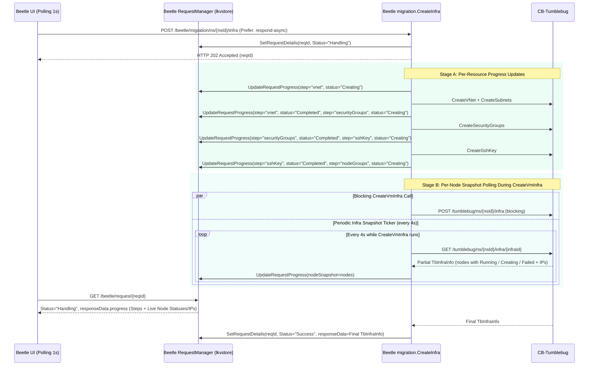

# Plan: Real-Time Per-Resource and Per-Node Status Tracking During Asynchronous Migration

## 1. Background & Problem Statement

When a user triggers an asynchronous infrastructure migration via `POST /beetle/migration/ns/{nsId}/infra` (or `/infraWithDefaults`, `/infraWithNlb`) with the `Prefer: respond-async` header:
1. CM-Beetle immediately returns `HTTP 202 Accepted` with `{ reqId, status: "Handling", statusUrl: "/beetle/request/{reqId}" }`.
2. In the background goroutine (`executeMigrateInfraAsync` in [migration.go](../../pkg/api/rest/controller/migration.go)), CM-Beetle calls `migration.CreateInfra(...)` ([infra.go](../../pkg/core/migration/infra.go)), which sequentially provisions:
   - Step 1: VNet and Subnets (`CreateVNet` / `CreateSubnets`)
   - Step 2: Security Groups (`CreateSecurityGroups`, with an internal 5-second settle wait)
   - Step 3: SSH Key (`CreateSshKey`)
   - Step 4: Node Groups / Nodes (`CreateVmInfra`, which blocks on CB-Tumblebug `POST /tumblebug/ns/{nsId}/infra` until all Node Groups finish or fail)
   - Step 5 (for `/infraWithNlb`): Network Load Balancers (`MigrateNlbs`, with an internal 15-second settle wait)
3. While `status == "Handling"`, `RequestDetails.ResponseData` in [request-manager.go](../../pkg/core/common/request-manager.go) remains `nil` until the entire `CreateInfra` call returns.

### Current Limitations Observed in E2E Testing
- **Estimated Resource Stepper**: Because `GET /beetle/request/{reqId}` does not emit resource-level progress while `status == "Handling"`, the UI (`MigrationSplitScreen.tsx`) currently relies on elapsed-time heuristics (`elapsed < 8s` -> VNet, `8..18s` -> Subnets, `18..30s` -> Security Groups, `30..40s` -> SSH Key, `>= 40s` -> Node Groups) rather than actual backend resource completion states.
- **All-at-Once Node Status**: During Step 4 (`CreateVmInfra`), CB-Tumblebug provisions multiple Node Groups and Nodes in parallel/sequence, taking anywhere from 1 to 10+ minutes (especially for GPU specs on Azure/AWS/GCP). Until `CreateVmInfra` returns, all target nodes in the UI remain in `Creating` (`Allocating...` IP) simultaneously, and individual node completions or early failures (such as CSP quota errors) are only visible after the entire job finishes.

---

## 2. Existing Infrastructure We Can Reuse

| Component | Location | Current State & Reusability |
| :--- | :--- | :--- |
| `RequestDetails` & `lkvstore` | [pkg/core/common/request-manager.go](../../pkg/core/common/request-manager.go) | Persists per-request state in memory and file-backed KV store (`reqId` key). |
| `common.UpdateRequestProgress` | [pkg/core/common/request-manager.go](../../pkg/core/common/request-manager.go#L330-L361) | Already implemented! Safely updates `RequestDetails.ResponseData` while keeping `Status: "Handling"`. Currently unused by `CreateInfra`. |
| `migration.GetInfra` | [pkg/core/migration/infra.go](../../pkg/core/migration/infra.go#L611-L654) | Calls CB-Tumblebug `GET /tumblebug/ns/{nsId}/infra/{infraId}` (`TbInfraInfo`), returning live `node` entries (`id`, `name`, `status`, `publicIP`, `privateIP`, `specId`, `systemMessage`). |
| `GET /beetle/request/{reqId}` | [pkg/api/rest/controller/request.go](../../pkg/api/rest/controller/request.go) | Polled every 1 second by the UI (`MigrationExecution.tsx` and `useGlobalJobPolling.ts`). Returns the full `RequestDetails` JSON, including `responseData`. |

---

## 3. Proposed Two-Stage Architecture

We separate the improvement into **Stage A (Per-Resource Step Progress)** and **Stage B (Real-Time Per-Node Provisioning & IP Status)** so they can be rolled out incrementally with zero breaking changes to existing API contracts.



---

### Stage A: Real-Time Per-Resource Step Progress (`VNet`, `Subnets`, `Security Groups`, `SSH Key`, `Node Groups`, `NLB`)

#### 1. Progress Payload Schema (`MigrationProgressInfo`)
Define a structured progress model in `pkg/core/migration/infra.go` (or `pkg/api/rest/model/`):

```go
type ResourceStepStatus string

const (
    StepStatusPending   ResourceStepStatus = "Pending"
    StepStatusCreating  ResourceStepStatus = "Creating"
    StepStatusCompleted ResourceStepStatus = "Completed"
    StepStatusFailed    ResourceStepStatus = "Failed"
    StepStatusSkipped   ResourceStepStatus = "Skipped"
)

type ResourceStepProgress struct {
    Step         string             `json:"step"`         // "vnet", "subnets", "securityGroups", "sshKey", "nodeGroups", "nlb"
    Label        string             `json:"label"`        // Human-readable label
    Status       ResourceStepStatus `json:"status"`       // Pending | Creating | Completed | Failed | Skipped
    ResourceName string             `json:"resourceName,omitempty"`
    TotalCount   int                `json:"totalCount,omitempty"`
    DoneCount    int                `json:"doneCount,omitempty"`
    FailedCount  int                `json:"failedCount,omitempty"`
    Message      string             `json:"message,omitempty"`
    UpdatedAt    string             `json:"updatedAt"`
}

type NodeProgressSnapshot struct {
    Id            string `json:"id"`
    Name          string `json:"name"`
    NodeGroupId   string `json:"nodeGroupId,omitempty"`
    SpecId        string `json:"specId,omitempty"`
    Status        string `json:"status"`        // "Creating", "Running", "Failed", etc.
    PublicIP      string `json:"publicIP,omitempty"`
    PrivateIP     string `json:"privateIP,omitempty"`
    SystemMessage string `json:"systemMessage,omitempty"`
}

type MigrationProgressSnapshot struct {
    CurrentStep string                 `json:"currentStep"`
    Steps       []ResourceStepProgress `json:"steps"`
    Nodes       []NodeProgressSnapshot `json:"nodes,omitempty"`
    UpdatedAt   string                 `json:"updatedAt"`
}
```

#### 2. Context or Callback Wiring Without Breaking Function Signatures
To avoid changing existing synchronous callers or cluttering function signatures across `pkg/core/migration`:
- Pass an optional progress callback via `context.Context` or a helper `CreateInfraWithProgress(nsId, infraModel, useExisting, progressFn)` where `CreateInfra` simply calls `CreateInfraWithProgress(..., nil)`.
- Alternatively, pass `reqId string` inside `executeMigrateInfraAsync` and invoke a lightweight helper `updateMigrationProgress(reqId, snapshot)` before and after each resource creation step in `CreateInfra`:
  1. Before `CreateVNet`: mark `vnet` = `Creating`
  2. After `CreateVNet` / `CreateSubnets`: mark `vnet` = `Completed`, `subnets` = `Completed` (with count), `securityGroups` = `Creating`
  3. As each Security Group finishes in `CreateSecurityGroups`: increment `doneCount` (`1 / 8` ... `8 / 8`), then mark `securityGroups` = `Completed`
  4. Before/After `CreateSshKey`: mark `sshKey` = `Creating` -> `Completed`
  5. Before `CreateVmInfra`: mark `nodeGroups` = `Creating`

---

### Stage B: Real-Time Per-Node Status & IP Allocation Tracking During `CreateVmInfra`

#### 1. How CB-Tumblebug Handles `CreateInfra` Internally
When CM-Beetle calls CB-Tumblebug `POST /tumblebug/ns/{nsId}/infra`, that HTTP call blocks until all Node Groups finish provisioning. However, CB-Tumblebug persists the `Infra` object and its `Node` records in its KV store as soon as the request starts and updates each node's `status` (`Creating` -> `Running` or `Failed`), `publicIP`, `privateIP`, and `systemMessage` as each CSP driver completes individual VM creation.

Therefore, while `CreateVmInfra` is waiting on the blocking `POST /tumblebug/ns/{nsId}/infra` call, a concurrent goroutine in CM-Beetle can query `migration.GetInfra(nsId, infraName)` every **4 to 5 seconds** to read the live partial `TbInfraInfo` from CB-Tumblebug!

#### 2. Goroutine Lifecycle in `CreateVmInfra` (Async Mode Only)
```go
stopPoll := make(chan struct{})
defer close(stopPoll)

if progressFn != nil && targetInfraName != "" {
    go func() {
        ticker := time.NewTicker(4 * time.Second)
        defer ticker.Stop()
        for {
            select {
            case <-stopPoll:
                return
            case <-ticker.C:
                liveInfra, err := GetInfra(nsId, targetInfraName)
                if err == nil && len(liveInfra.Node) > 0 {
                    progressFn(buildNodeSnapshot(liveInfra.Node))
                }
            }
        }
    }()
}
```
- **Clean Termination**: The `defer close(stopPoll)` guarantees the polling goroutine exits immediately when `CreateVmInfra` returns (whether `Success` or `Error`).
- **Final Overwrite**: When `executeMigrateInfraAsync` finishes, `SetRequestDetails` overwrites `RequestDetails.ResponseData` with the final `TbInfraInfo` (`MigrateInfraResponse`) and sets `Status = "Success"` (or `"Error"`), preserving 100% backward compatibility with all existing clients expecting `responseData` to hold `TbInfraInfo` upon completion.

#### 3. Safeguards & Rate-Limit Considerations
- **Polling Interval**: Polling CB-Tumblebug `GetInfra` once every `4s` per active async migration job generates only `0.25 req/s` against CB-Tumblebug's local KV read endpoint (`GET /tumblebug/ns/{nsId}/infra/{infraId}`), which does **not** trigger live CSP API calls (unlike `?option=status`) and simply reads Tumblebug's in-memory/etcd state.
- **UI Polling Decoupling**: Even if 5 browser tabs poll `GET /beetle/request/{reqId}` every `1s`, they only read CM-Beetle's `lkvstore` in memory; only the single background ticker in CM-Beetle queries CB-Tumblebug every `4s`.
- **Overwrite Protection**: Guard the ticker callback with a mutex or check `details.Status == common.RequestStatusHandling` before writing progress so a late tick can never overwrite the final `Success` or `Error` response.

---

## 4. Impact Scope & Effort Analysis

| Layer | Target Files | Change Scope | Risk / Impact Level |
| :--- | :--- | :--- | :--- |
| **Beetle Request Manager** | `pkg/core/common/request-manager.go` | Add a helper `SetRequestProgressData(reqId string, data interface{})` that atomically replaces `ResponseData` only while `Status == RequestStatusHandling`. (~20 LOC) | **Low** (Additive helper; does not alter existing `SetRequestDetails` or middleware) |
| **Beetle Migration Core (Stage A)** | `pkg/core/migration/infra.go`, `pkg/core/migration/nlb.go` | Add `MigrationProgressSnapshot` struct and emit step transitions (`vnet`, `subnets`, `securityGroups`, `sshKey`, `nodeGroups`, `nlb`) via optional progress callback. (~80 LOC) | **Low** (Synchronous path remains untouched when callback is `nil`) |
| **Beetle Migration Core (Stage B)** | `pkg/core/migration/infra.go` | Spawn a `4s` ticker goroutine during `CreateVmInfra` (only when progress callback is non-nil) that calls `GetInfra(nsId, infraId)` and updates `MigrationProgressSnapshot.Nodes`. (~45 LOC) | **Low-Medium** (Requires `stopPoll` channel and status guard so final `ResponseData` is never overwritten) |
| **Beetle REST Controller** | `pkg/api/rest/controller/migration.go` | In `executeMigrateInfraAsync` and `executeMigrateInfraWithNlbAsync`, pass a progress callback bound to `reqId`. (~25 LOC) | **Low** (Isolated to async goroutines) |
| **Beetle UX Lab (UI)** | `ui/src/hooks/useGlobalJobPolling.ts`, `ui/src/components/center/MigrationExecution.tsx`, `ui/src/components/center/MigrationSplitScreen.tsx` | Read `res.responseData?.steps` and `res.responseData?.nodes` while `res.status === 'Handling'` to drive the 6-step `Migration Stream` and individual `Target Cloud Nodes` cards in real time. (~70 LOC) | **Low** (Gracefully falls back to existing elapsed-time estimation if `responseData.steps` is absent) |

---

## 5. Verification Plan (When Scheduled for Implementation)

1. **Unit Tests (`pkg/core/migration` & `pkg/core/common`)**:
   - Verify `SetRequestProgressData` updates `ResponseData` when `Status == Handling` and is a no-op once `Status == Success` or `Error`.
   - Verify `MigrationProgressSnapshot` transitions through `vnet` -> `subnets` -> `securityGroups` -> `sshKey` -> `nodeGroups` in order.
2. **Live Async E2E Test (`ai-stack-testbed`)**:
   - Trigger `POST /beetle/migration/ns/mig01/infra` with `Prefer: respond-async`.
   - Poll `GET /beetle/request/{reqId}` every 2 seconds and confirm:
     - `responseData.steps` reflects exact step transitions and Security Group creation counts (`1/8` .. `8/8`).
     - During `nodeGroups` creation, `responseData.nodes` populates with individual VM statuses (`Creating` -> `Running` with `publicIP`/`privateIP`, or `Failed` with `systemMessage`) before the overall request completes.
     - Once completed, `status` transitions to `Success` and `responseData` contains the standard `MigrateInfraResponse` payload.

---

## 6. Architecture Decision and Implemented Design (v0.6.x)

During architectural review ahead of implementation, we evaluated the trade-offs of Sections 3-4 (inline `UpdateRequestProgress` calls scattered across domain functions + background polling ticker goroutines mutating `RequestDetails.ResponseData`) and adopted a cleaner, lower-coupling design that achieves all user-facing goals without domain clutter or `ResponseData` race hazards:

1. **Transport-AOP Sub-Request Tracking Instead of Inline Step Updates**:
   - Canonical `ctx context.Context` was added as the first parameter across `pkg/core/{summary,report,validation,recommendation,migration}` and passed into `tbclient.NewSession().SetContext(ctx)`.
   - Resty transport hooks in `pkg/client/tumblebug/client.go` automatically inject `X-Request-Source: cm-beetle:{reqId}` on every outbound CB-Tumblebug request and `X-Request-Id: {reqId}-{seq}` on mutating/action calls (`POST`, `PUT`, `DELETE`), recording live `SubRequest` entries (`vNet`, `securityGroup`, `sshKey`, `infra`, `nlb`, etc.) in `pkg/core/common/subrequest.go`.
   - Zero manual `UpdateRequestProgress(...)` calls are needed inside `CreateInfra`, `MigrateNlbs`, or recommendation functions, and `RequestDetails.ResponseData` remains untouched until final completion.
2. **Lightweight Projections and On-Demand Upstream Correlation**:
   - `GET /beetle/request/{reqId}?brief=true` omits large `requestInfo.body` and `responseData` payloads while returning `status`, `subRequestSummary`, and `subRequests` for 1-2s UI polling.
   - `GET /beetle/request/{reqId}?withTumblebug=true` enriches `subRequests[]` on demand from CB-Tumblebug `GET /tumblebug/request/{subReqId}` (`upstreamStatus`, `upstreamProgress`, `upstreamError`).
3. **Client-Side Throttled Node Status Polling During `infra` Step**:
   - Rather than spawning background ticker goroutines inside `pkg/core/migration/infra.go`, portal clients (such as Beetle UX Lab's `useGlobalJobPolling.ts`) detect when a `subRequests` item with `resourceType == "infra"` is in `Handling` and poll `GET /beetle/migration/ns/{nsId}/infra/{infraId}` every ~5 seconds to render per-node `Creating` / `Running` / `Failed` states and live public/private IPs.

For complete API contracts and usage examples, see [Request Tracking and Sub-Request Progress](../feature-guide/core-request-tracking.md).
