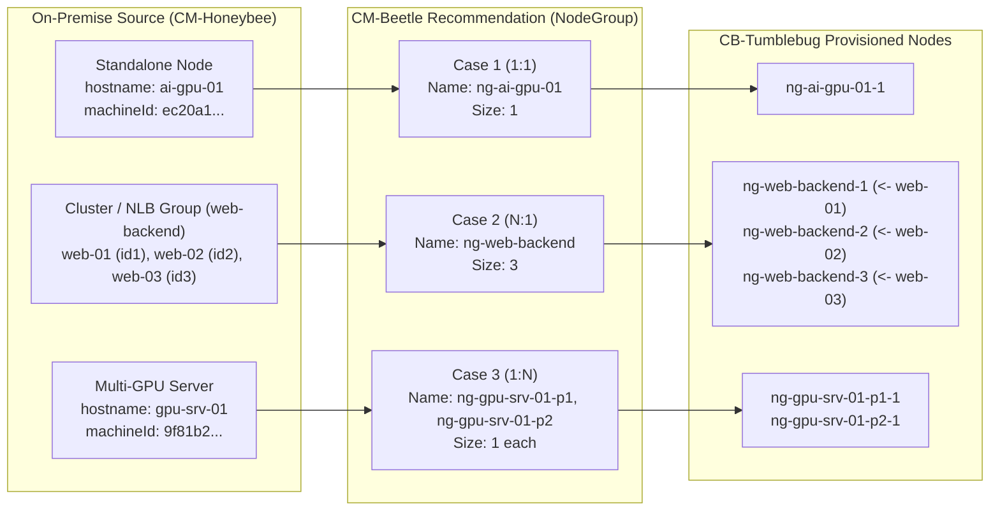

# Plan: Node Group and Node (VM) Naming Policy with Source-to-Target Lineage Mapping

## 1. Background & Problem Statement

During E2E migration and data transfer testing (`ai-stack-testbed` -> `gpu-infra-01`), selecting a **Target Node** in the **Launch New Data Migration** modal ([DataTransferCenter.tsx](../../ui/src/components/data/DataTransferCenter.tsx)) or inspecting provisioned nodes in **Cloud Infra Overview** ([MigratedInfraManagement.tsx](../../ui/src/components/operations/MigratedInfraManagement.tsx)) exposes raw UUID-based node names such as:

```text
vm-ec20a168-fa99-a35c-48a4-632bc2167f5f-1 (20.200.208.173)
```

### Root Causes Across the Pipeline

1. **Source Model Collection ([node.go](../../imdl/on-premise-model/node.go))**:
   - CM-Honeybee collects both a human-readable `Hostname` (e.g., `ai-gpu-01`, `ip-10-0-1-221`) and a hardware/OS UUID `MachineId` (e.g., `ec20a168-fa99-a35c-48a4-632bc2167f5f`) for every server in `OnpremInfra.Nodes`.
2. **CM-Beetle Recommendation Engine ([infra.go](../../pkg/core/recommendation/infra.go), [infra-composite.go](../../pkg/core/recommendation/infra-composite.go), [infra-with-nlb.go](../../pkg/core/recommendation/infra-with-nlb.go))**:
   - To avoid potential hostname collisions across on-premise servers (such as duplicate `localhost` or `ubuntu` hostnames), the recommendation engine currently sets `NodeGroup.Name` using **only `node.MachineId`** (`vm-<machineId>`, `migrated-<machineId>`, or `ng-<machineId>`).
   - `NodeGroup.Description` also references only `node.MachineId` (`"Recommended VM for <machineId> | ..."`).
   - `NodeGroup.Label` ([lineage.go](../../imdl/lineage/lineage.go)) records `cm-source-machine-ids: <machineId>`, omitting `node.Hostname`.
3. **CB-Tumblebug Provisioning Constraint**:
   - `CreateNodeGroupReq` (`SubGroupReq` in CB-Tumblebug) does not accept an array of custom per-VM names. Instead, CB-Tumblebug automatically names each VM instance inside a `NodeGroup` by appending a 1-based index (`-1`, `-2`, ..., `-N`) to `NodeGroup.Name`.
   - Furthermore, `vm-<36-char-UUID>-1` is 41 characters long, which risks exceeding OS hostname or CSP resource name length limits on certain providers.
4. **Multi-VM Node Groups (`N:1` Consolidation)**:
   - While standalone servers map `1:1` (`NodeGroupSize = 1`), servers belonging to an NLB backend pool, cluster role, or homogeneous server group can be consolidated into a single `NodeGroup` with multiple VMs (`NodeGroupSize = N`).
   - Naming and lineage mapping must therefore support `1:1` (Standalone), `N:1` (Group / Cluster / NLB Pool), and `1:N` (Decomposed Composite Server) topologies consistently.

---

## 2. Architecture & Naming Policy by Topology Case



### Summary of Naming Rules Across Cases

| Topology Case | Source Structure | `NodeGroup.Name` Rule | Tumblebug Provisioned `Node` Name(s) | Lineage Labels (`NodeGroup.Label`) |
| :--- | :--- | :--- | :--- | :--- |
| **Case 1: Standalone (`1:1`)**<br/>(`NodeGroupSize = 1`) | Single independent server<br/>(e.g., `ai-gpu-01`, `db-01`) | **`ng-<hostname>`**<br/>*(If hostname is generic/duplicated, append `-<shortMachineId(6 chars)>`)*<br/>e.g., `ng-ai-gpu-01` or `ng-ubuntu-ec20a1` | **`ng-ai-gpu-01-1`** | `cm-source-machine-ids`: `ec20a1...`<br/>`cm-source-hostnames`: `ai-gpu-01` |
| **Case 2: Group / Cluster (`N:1`)**<br/>(`NodeGroupSize = N`) | NLB backend pool, K8s role, or homogeneous server group<br/>(e.g., `web-01`, `web-02`, `web-03` in `web-backend`) | **`ng-<groupName>`** or **`ng-<groupName>-<tier>`**<br/>e.g., `ng-web-backend`, `ng-infer-pool-gpu` | **`ng-web-backend-1`**<br/>**`ng-web-backend-2`**<br/>**`ng-web-backend-3`** | `cm-source-machine-ids`: `id1,id2,id3`<br/>`cm-source-hostnames`: `web-01,web-02,web-03`<br/>`cm-source-group-name`: `web-backend` |
| **Case 3: Decomposed (`1:N`)**<br/>(`DecomposeOnpremNodes`) | Single heterogeneous multi-GPU server split into multiple NodeGroups<br/>(e.g., `gpu-srv-01`) | **`ng-<hostname>-p1`**, **`ng-<hostname>-p2`**<br/>e.g., `ng-gpu-srv-01-p1` | **`ng-gpu-srv-01-p1-1`**<br/>**`ng-gpu-srv-01-p2-1`** | `cm-source-machine-ids`: `id1`<br/>`cm-source-hostnames`: `gpu-srv-01` |

---

## 3. Detailed Design Rules

### 3.1 Hostname Sanitization & Collision Resolution (`Case 1: 1:1`)
1. **Sanitization (`sanitizeNodeGroupBaseName`)**:
   - Convert `node.Hostname` to lowercase, replace non-alphanumeric characters with `-`, collapse consecutive `-`, and trim leading/trailing `-`.
   - Truncate the sanitized hostname stem to at most **20 characters** so that `ng-<stem>-<shortId>-1` never exceeds 30 characters.
2. **When to Append `<shortMachineId>` (First 6 Characters of `MachineId`)**:
   - **Generic / Reserved Hostnames**: Always append `<shortMachineId>` if `hostname` is empty or matches generic defaults (`localhost`, `ubuntu`, `centos`, ` rocky`, `debian`, `node`, `vm`, `server`).
   - **Duplicate Hostnames**: Before generating NodeGroup names, count hostname occurrences across `srcInfra.Nodes`. If two or more source nodes share the same sanitized hostname, append `-<shortMachineId>` to disambiguate them.
   - **Unique Descriptive Hostnames**: If `node.Hostname` is unique within `srcInfra.Nodes` (e.g., `ai-gpu-01` or `ip-10-0-1-221`), use `ng-ai-gpu-01` directly (or optionally `ng-ai-gpu-01-ec20a1` if strict UUID embedding in resource names is preferred).

### 3.2 Group / Cluster Naming Priority (`Case 2: N:1`)
When multiple source servers are consolidated into a single `NodeGroup` (`NodeGroupSize = N`):
1. **NLB Backend Group**:
   - Use `ng-<sanitizeName(backendName)>` (e.g., `ng-web-backend`).
   - When hardware dividing policy (`dividing` in [infra-composite.go](../../pkg/core/recommendation/infra-composite.go)) splits a backend pool into hardware sub-groups, append the tier suffix: `ng-<backendName>-gpu`, `ng-<backendName>-cpu`, or `ng-<backendName>-<vendor>-<model>`.
2. **Cluster / Role Group (Future Cluster Discovery)**:
   - When source nodes are grouped by cluster or role (`node.Role` such as `control-plane`, `worker`, `storage`), name the group `ng-<clusterName>-<role>` or `ng-<role>-pool`.
3. **Homogeneous Prefix Group**:
   - If source nodes without an explicit NLB/cluster name are grouped by identical hardware and a shared hostname prefix (e.g., `was-01`, `was-02`, `was-03` -> common prefix `was`), name the group `ng-<prefix>-pool`.

### 3.3 Deterministic Ordinal Lineage Mapping for `N:1` Groups
In a consolidated `NodeGroup` with `NodeGroupSize = N` (`ng-web-backend-1` .. `ng-web-backend-N`), users performing **Data Migration** or reviewing **Migration Reports** need a deterministic 1:1 pairing between the `N` source servers and the `N` target VMs:
1. **Canonical Ordering at Recommendation Time**:
   - Sort the member source nodes of the `NodeGroup` deterministically by `(Hostname ASC, MachineId ASC)` before constructing the `NodeGroup`.
2. **Ordered Comma-Separated Lineage Labels ([lineage.go](../../imdl/lineage/lineage.go))**:
   - Store both `MachineId` and `Hostname` lists in matching order:
     ```go
     const (
         LabelSourceGroupId    = "cm-source-group-id"
         LabelSourceModelId    = "cm-source-model-id"
         LabelPlanningModelId  = "cm-planning-model-id"
         LabelTargetModelId    = "cm-target-model-id"
         LabelSourceMachineIds = "cm-source-machine-ids" // e.g., "id1,id2,id3"
         LabelSourceHostnames  = "cm-source-hostnames"  // e.g., "web-01,web-02,web-03"
         LabelSourceIPs        = "cm-source-ips"        // e.g., "10.0.1.11,10.0.1.12,10.0.1.13"
         LabelNlbBackend       = "nlbBackend"
         LabelMigratedAt       = "cm-migrated-at"
     )
     ```
3. **Ordinal Pairing Rule (`k`-th Target VM <-> `k`-th Source Member)**:
   - Parse the trailing numeric suffix `-k` from the Tumblebug VM name (`<subGroupId>-k`, 1-based index `k = 1..N`).
   - Map `<subGroupId>-k` to the `(k - 1)`-th element of `cm-source-machine-ids`, `cm-source-hostnames`, and `cm-source-ips`.
   - Example:
     - `ng-web-backend-1` <-> `web-01` (`10.0.1.11`, `id1`)
     - `ng-web-backend-2` <-> `web-02` (`10.0.1.12`, `id2`)
     - `ng-web-backend-3` <-> `web-03` (`10.0.1.13`, `id3`)

---

## 4. UI Resolution & Display Plan

### 4.1 Universal Source Lineage Resolver Helper (`resolveTargetNodeSourceInfo`)
Create a shared frontend utility that resolves the corresponding source server metadata for any Tumblebug `NodeInfo`, supporting **both newly named NodeGroups and legacy `vm-<machineId>-1` infrastructures**:
1. **Step 1 (Label Lookup)**: Check `node.label["cm-source-hostnames"]` and `node.label["cm-source-machine-ids"]` (using the trailing `-k` ordinal index if comma-separated).
2. **Step 2 (SubGroupId / Name UUID Extraction for Legacy Infras)**: If `cm-source-hostnames` is absent, match `cm-source-machine-ids` or any `<machineId>` substring in `node.name` / `node.subGroupId` against `refinedSourceInfra.nodes` (`savedSourceModels`) and `hbConnections`.
3. **Output**:
   - `sourceHostname` (e.g., `ai-gpu-01` or `ip-10-0-1-221`)
   - `sourceConnectionName` (from Honeybee `connection_info.name` when matched by IP/hostname, e.g., `ai-gpu-01`)
   - `sourcePrimaryIp` (e.g., `3.39.0.199` / `10.0.1.221`)
   - `groupIndexLabel` (for `N:1` groups, e.g., `2/3`)

### 4.2 Component-Specific UI Enhancements
1. **Data Transfer Modal ([DataTransferCenter.tsx](../../ui/src/components/data/DataTransferCenter.tsx))**:
   - **Target Node Dropdown Options**:
     - `1:1` Node: `[Src: ai-gpu-01] ng-ai-gpu-01-1 (20.200.208.173 | standard_nc4as_t4_v3)`
     - `N:1` Group Node: `[Src: web-02 (2/3)] ng-web-backend-2 (20.200.208.174 | standard_d2s_v5)`
     - Legacy UUID Node: `[Src: ip-10-0-1-221] vm-ec20a1...-1 (20.200.208.173 | standard_e2_v4)`
   - **Auto-Match / Highlight on Source Node Selection**:
     - When the user selects a `Source Node` on the left (`Source Endpoint`), automatically highlight (`★ Matched`) or pre-select the corresponding `Target Node` on the right (`Destination Endpoint`).
2. **2. Target Cloud Optimizer ([CloudInfraOptimizer.tsx](../../ui/src/components/design/CloudInfraOptimizer.tsx))**:
   - In the `Compute (Nodes)` tuning tab, display `Source: <Hostname> (<shortMachineId>)` (or `Source Group (3 Nodes): web-01, web-02, web-03`) instead of raw UUIDs.
3. **Cloud Infra Overview ([MigratedInfraManagement.tsx](../../ui/src/components/operations/MigratedInfraManagement.tsx)) & Topology Map ([TopologyMap.tsx](../../ui/src/components/design/TopologyMap.tsx))**:
   - In the `Nodes` table and topology node cards, display a `Source: <Hostname>` badge alongside the Target Node name so operators can immediately trace every cloud node back to its on-premise origin.

---

## 5. Implementation Checklist (For Future Execution)

- [ ] **Phase 1: Lineage & Naming Helpers (`imdl/lineage`, `pkg/core/recommendation`)**
  - [ ] Add `LabelSourceHostnames` and `LabelSourceIPs` constants to [imdl/lineage/lineage.go](../../imdl/lineage/lineage.go).
  - [ ] Implement `buildStandaloneNodeGroupName(node, duplicateHostnames)` and `buildOrderedSourceLineageLabels(nodes)` in `pkg/core/recommendation/`.
  - [ ] Update [infra.go](../../pkg/core/recommendation/infra.go), [infra-composite.go](../../pkg/core/recommendation/infra-composite.go), and [infra-with-nlb.go](../../pkg/core/recommendation/infra-with-nlb.go) to apply the new naming rules and populate `cm-source-hostnames`.
  - [ ] Update [migration-report.go](../../pkg/core/report/migration-report.go) to support ordinal matching for `N:1` NodeGroups in addition to `1:1` `machineId` matching.
- [ ] **Phase 2: Frontend Lineage Resolution & UI Updates (`ui/src/`)**
  - [ ] Add shared `resolveTargetNodeLineage` helper in `ui/src/`.
  - [ ] Update `Target Node` dropdown and auto-matching in [DataTransferCenter.tsx](../../ui/src/components/data/DataTransferCenter.tsx).
  - [ ] Update NodeGroup source badges in [CloudInfraOptimizer.tsx](../../ui/src/components/design/CloudInfraOptimizer.tsx) and Node table rows in [MigratedInfraManagement.tsx](../../ui/src/components/operations/MigratedInfraManagement.tsx).
