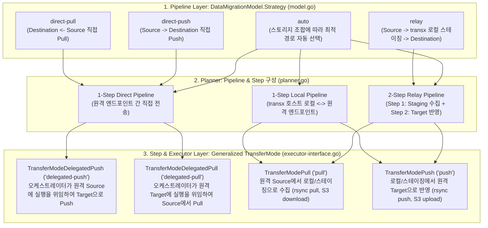

# transx Plan for Strategy and Generalized TransferMode Architecture

> **Status**: Planned (Self-Contained Implementation Blueprint for Dedicated Worktree)  
> **Author**: Cloud-Barista CM-Beetle Development Team  
> **Created**: 2026-11-03  
> **Target Components**: `transx`, `cmd/aimx`, `ui`, `docs`

---

## 1. 개요 및 배경 (Overview & Background)

`transx`는 CM-Beetle 서버 내부 모듈로 동작할 뿐만 아니라, 소스/목표 서버 상의 에이전트(Agent)나 독립 실행형 CLI 환경에서도 범용적으로 활용될 수 있도록 모듈화된 데이터 마이그레이션 패키지입니다. 또한 Filesystem(`rsync`), Object Storage(`S3` Presigned URL), 나아가 향후 RDBMS/NoSQL 등 다양한 스토리지 및 데이터베이스 엔드포인트 간의 전송을 단일 파이프라인(`Pipeline` -> `[]Step` -> `Executor`)으로 추상화하는 것을 목표로 합니다.

본 계획서는 별도의 신규 Git Worktree에서 독립적으로 즉시 구현할 수 있도록, 논의된 설계 철학과 **파일별 전체 구현 코드 명세(Copy-Ready Code Specification)**를 빠짐없이 수록한 상세 설계 문서입니다.

### 핵심 목표 요약
1. **직접 전송(Direct)의 방향성 구분 (`direct-push` vs `direct-pull`)**:
   - 소스 서버와 목표 서버 간 방화벽/NAT 개방 방향에 따라 소스에서 목표로 밀어내는 방식(`direct-push`)과 목표에서 소스를 당겨오는 방식(`direct-pull`)을 명시적으로 구분합니다.
   - `transx` 오케스트레이터는 양쪽 서버의 SSH Private Key를 메모리에만 로드(`agent.NewKeyring()`)하여 SSH Agent Forwarding으로 인증을 중계하므로, 소스/목표 서버 디스크에 상대방 비밀키 파일을 남기지 않습니다.
2. **파이프라인 레벨 `Strategy`와 스텝/실행기 레벨 `TransferMode`의 2계층 분리 (하위 호환 별칭 미유지)**:
   - **사용자 API (`DataMigrationModel.Strategy`)**: 구현 기술(`agent-forward`)을 노출하지 않고 경로와 방향만 직관적으로 나타내는 `"auto"`, `"direct-push"`, `"direct-pull"`, `"relay"` 4가지로 단일화합니다 (기존 `"direct"`, `"agent-forward-*"` 제거).
   - **내부 실행 양식 (`Step.Mode` / `Executor`의 `TransferMode`)**: `transx/executor-interface.go`로 승격하여 모든 실행기(`RsyncExecutor`, `S3Executor`)가 공유하도록 일반화하고, `"pull"`, `"push"`, `"delegated-push"`, `"delegated-pull"` 4가지로 정의합니다 (기존 `TransferModeAgentForward*` 제거).
3. **명시적 전략-스토리지 유효성 검증(`Validate`) 및 사전 연결 점검(`Pre-Flight Check`)**:
   - 지원되지 않는 `Strategy`와 `StorageType` 조합(예: 원격 Object Storage 전송에 `direct-push` 지정)은 암묵적 폴백(Silent Fallback) 없이 `Validate(dmm)`에서 즉시 명확한 에러를 반환합니다.
   - `delegated-push` / `delegated-pull` 실행 시 본 전송 전에 Primary/Peer 서버의 `rsync` 설치 여부와 서버 간 22번 포트 SSH 도달 가능성을 즉시 확인하는 **Pre-Flight Check**를 수행합니다.
4. **`RsyncExecutor` 전송 복원력 강화 (`Compress`, `Partial`, `MaxRetries`)**:
   - 대용량 AI 모델 가중치(수십 GB) 및 DB 덤프 전송 시 압축(`-z`), 중단 시 부분 파일 보존 및 체크섬 기반 이어받기(`--partial --append-verify --timeout=180`), 일시적 네트워크 단절 시 자동 재시도(`MaxRetries`, 기본 3회)를 지원합니다.
5. **Beetle UX Lab (`ui/`) 동적 옵션 제어**:
   - `4. Data Transfer` 화면에서 Source/Target 엔드포인트 종류(`remote-ssh` vs `object-storage`)에 따라 선택 불가능한 `Strategy`나 SSH 전용 옵션(`Rsync Options`, `preCmd`/`postCmd`)을 동적으로 비활성화하여 사용자 혼선을 방지합니다.

---

## 2. 아키텍처 설계: `Strategy` vs 일반화된 `TransferMode`

### 2.1 2계층 역할 분리 다이어그램

| 계층 | 타입 및 정의 위치 | 정규 상수 값 | 핵심 역할 및 철학 |
| :--- | :--- | :--- | :--- |
| **1. 파이프라인 계층 (User API)** | `Strategy` (`transx/model.go`) | `"auto"`, `"direct-push"`, `"direct-pull"`, `"relay"` | **"데이터가 어떤 네트워크 경로와 방향으로 이동하는가?"**<br>사용자가 네트워크/방화벽 환경에 맞춰 선택하는 엔드투엔드 파이프라인 경로 전략 |
| **2. 스텝/실행기 계층 (Internal)** | `TransferMode` (`transx/executor-interface.go`) | `"pull"`, `"push"`, `"delegated-push"`, `"delegated-pull"` | **"오케스트레이터(`transx`)가 단일 스텝을 어떤 방식으로 실행하는가?"**<br>`Step`, `RsyncExecutor`, `S3Executor` 등 모든 실행기가 공유하는 일반화된 실행 양식 |



### 2.2 스토리지 조합별 `Strategy` 및 `TransferMode` 검증/매핑 매트릭스

| 출발지 (`Source`) | 목적지 (`Destination`) | 허용되는 `Strategy` | 거부되는 `Strategy` (`Validate` 에러) | 생성되는 `Pipeline` 스텝 및 `Step.Mode` |
| :--- | :--- | :--- | :--- | :--- |
| **SSH** | **SSH** | `auto` (기본: `direct-push`)<br>`direct-push`<br>`direct-pull`<br>`relay` | 없음 | - `auto`, `direct-push`: 1-Step (`Mode: delegated-push`)<br>- `direct-pull`: 1-Step (`Mode: delegated-pull`)<br>- `relay`: 2-Step (`Step 1: pull`, `Step 2: push`) |
| **ObjectStorage (S3)** | **ObjectStorage (S3)** | `auto` (기본: `relay`)<br>`relay` | `direct-push`<br>`direct-pull` | - 2-Step (`Step 1: pull` [S3 Download], `Step 2: push` [S3 Upload]) |
| **SSH** | **ObjectStorage (S3)** | `auto` (기본: `relay`)<br>`relay` | `direct-push`<br>`direct-pull` | - 2-Step (`Step 1: pull` [Rsync Pull], `Step 2: push` [S3 Upload]) |
| **ObjectStorage (S3)** | **SSH** | `auto` (기본: `relay`)<br>`relay` | `direct-push`<br>`direct-pull` | - 2-Step (`Step 1: pull` [S3 Download], `Step 2: push` [Rsync Push]) |
| **Local** | **SSH / S3** | `auto`, `direct-push` | `direct-pull`, `relay` | - 1-Step (`Mode: push`) |
| **SSH / S3** | **Local** | `auto`, `direct-pull` | `direct-push`, `relay` | - 1-Step (`Mode: pull`) |

---

## 3. 백엔드(`transx/`, `cmd/aimx/`) 파일별 상세 구현 명세

### 3.1 `transx/executor-interface.go`

`TransferMode` 타입과 4개 정규 상수를 `transx/executor-interface.go`에 정의하여 `Step`, `RsyncExecutor`, `S3Executor`가 공통으로 사용하도록 합니다.

```go
// Executor defines the interface for transfer operations.
type Executor interface {
	// Execute performs the transfer from source to destination.
	Execute(source, destination DataLocation) error
}

// TransferMode defines the execution direction and delegation pattern of a transfer step.
type TransferMode string

const (
	// TransferModePull pulls or downloads data from a remote endpoint to local or staging storage.
	TransferModePull TransferMode = "pull"

	// TransferModePush pushes or uploads data from local or staging storage to a remote endpoint.
	TransferModePush TransferMode = "push"

	// TransferModeDelegatedPush delegates execution to the remote source to push directly to the remote destination.
	TransferModeDelegatedPush TransferMode = "delegated-push"

	// TransferModeDelegatedPull delegates execution to the remote destination to pull directly from the remote source.
	TransferModeDelegatedPull TransferMode = "delegated-pull"
)
```

---

### 3.2 `transx/model.go`

1. **전송 전략 상수(`Strategy*`) 정리**:
   기존 `StrategyDirect = "direct"`를 제거하고 4가지 상수로 정의합니다.
   ```go
   const (
   	// StrategyAuto automatically selects the optimal transfer strategy for the endpoints.
   	StrategyAuto = "auto"

   	// StrategyDirectPush delegates execution to the source to push data directly to the destination.
   	StrategyDirectPush = "direct-push"

   	// StrategyDirectPull delegates execution to the destination to pull data directly from the source.
   	StrategyDirectPull = "direct-pull"

   	// StrategyRelay stages data on the transx host between pull and push steps.
   	StrategyRelay = "relay"
   )
   ```

2. **`DataMigrationModel.Strategy` 태그 수정**:
   ```go
   // Strategy determines how the transfer pipeline is orchestrated (auto, direct-push, direct-pull, relay).
   Strategy string `json:"strategy,omitempty" default:"auto" validate:"omitempty,oneof=auto direct-push direct-pull relay"`
   ```

3. **`SSHConfig` 구조체에 Rsync 복원력 옵션 필드 추가**:
   ```go
   	// Rsync options
   	Archive    bool `json:"archive,omitempty" default:"true"`
   	Compress   bool `json:"compress,omitempty" default:"true"`
   	Partial    bool `json:"partial,omitempty" default:"true"`
   	MaxRetries int  `json:"maxRetries,omitempty" default:"3"`
   	Delete     bool `json:"delete,omitempty"`
   	Verbose    bool `json:"verbose,omitempty"`
   	DryRun     bool `json:"dryRun,omitempty"`
   ```

4. **`Validate(dmm DataMigrationModel)` 및 `validateStrategy(dmm)` 추가**:
   ```go
   // Validate checks if DataMigrationModel satisfies endpoint and strategy requirements.
   func Validate(dmm DataMigrationModel) error {
   	if err := validateLocation(dmm.Source, "source"); err != nil {
   		return err
   	}
   	if err := validateLocation(dmm.Destination, "destination"); err != nil {
   		return err
   	}
   	return validateStrategy(dmm)
   }

   // validateStrategy verifies that the requested strategy is compatible with the source and destination endpoints.
   func validateStrategy(dmm DataMigrationModel) error {
   	strategy := strings.TrimSpace(dmm.Strategy)
   	switch strategy {
   	case "", StrategyAuto:
   		return nil
   	case StrategyDirectPush, StrategyDirectPull:
   		if dmm.Source.IsRemote() && dmm.Destination.IsRemote() && (dmm.Source.IsObjectStorage() || dmm.Destination.IsObjectStorage()) {
   			return fmt.Errorf("strategy %q is not supported for remote object storage transfers; use %q or %q", strategy, StrategyAuto, StrategyRelay)
   		}
   		if dmm.Source.IsLocal() && strategy == StrategyDirectPull {
   			return fmt.Errorf("strategy %q is invalid when source is local filesystem; use %q or %q", strategy, StrategyAuto, StrategyDirectPush)
   		}
   		if dmm.Destination.IsLocal() && strategy == StrategyDirectPush {
   			return fmt.Errorf("strategy %q is invalid when destination is local filesystem; use %q or %q", strategy, StrategyAuto, StrategyDirectPull)
   		}
   		return nil
   	case StrategyRelay:
   		if dmm.Source.IsLocal() || dmm.Destination.IsLocal() {
   			return fmt.Errorf("strategy %q requires both source and destination to be remote endpoints", StrategyRelay)
   		}
   		return nil
   	default:
   		return fmt.Errorf("unsupported strategy %q: must be one of %s, %s, %s, %s", strategy, StrategyAuto, StrategyDirectPush, StrategyDirectPull, StrategyRelay)
   	}
   }
   ```

---

### 3.3 `transx/executor-s3.go`

`S3Executor`에도 `Mode TransferMode`를 부여하여 `TransferModePull`(다운로드)과 `TransferModePush`(업로드)를 일관되게 처리합니다.

```go
// S3Executor implements Executor for S3 object storage transfers using presigned URLs.
type S3Executor struct {
	Mode     TransferMode // Transfer mode (pull for S3 download, push for S3 upload)
	Provider S3Provider   // S3 provider for generating presigned URLs
}

// NewS3Executor creates a new S3Executor with the given provider and optional transfer mode.
func NewS3Executor(provider S3Provider, mode ...TransferMode) *S3Executor {
	var m TransferMode
	if len(mode) > 0 {
		m = mode[0]
	}
	return &S3Executor{
		Mode:     m,
		Provider: provider,
	}
}

// Execute performs S3 transfer from source to destination.
func (e *S3Executor) Execute(source, destination DataLocation) error {
	switch e.Mode {
	case TransferModePush:
		return e.upload(source.Path, destination.Path, source.Filter)
	case TransferModePull:
		return e.download(source.Path, destination.Path, source.Filter)
	case TransferModeDelegatedPush, TransferModeDelegatedPull:
		return fmt.Errorf("transfer mode %q is not supported by S3Executor; object storage requires %q or %q via staging", e.Mode, TransferModePull, TransferModePush)
	}

	srcIsS3 := source.IsObjectStorage()
	dstIsS3 := destination.IsObjectStorage()

	switch {
	case !srcIsS3 && dstIsS3:
		return e.upload(source.Path, destination.Path, source.Filter)
	case srcIsS3 && !dstIsS3:
		return e.download(source.Path, destination.Path, source.Filter)
	case srcIsS3 && dstIsS3:
		return fmt.Errorf("direct S3 to S3 transfer is not supported; use relay pipeline")
	default:
		return fmt.Errorf("invalid transfer: both source and destination are filesystem")
	}
}
```

---

### 3.4 `transx/executor-rsync.go`

`RsyncExecutor`에 다음 기능을 구현합니다:
1. `TransferModeDelegatedPush` (`executeDelegatedPush`) 및 `TransferModeDelegatedPull` (`executeDelegatedPull`)
2. `verifyDelegatedPreFlight`: Primary 서버의 `rsync` 유무 및 Primary -> Peer 서버 간 SSH 에이전트 포워딩 연결 가능 여부 사전 검증 (`DryRun`일 때는 생략)
3. `Compress` (`-z`), `Partial` (`--partial --append-verify --timeout=180`), `MaxRetries` (`runWithRetry`)
4. `buildRemoteRsyncPullCommand`: `delegated-pull` 시 목적지 서버에서 출발지 서버의 데이터를 당겨오는 `rsync` 명령어 생성

```go
// RsyncExecutor implements Executor using rsync for file transfers.
type RsyncExecutor struct {
	Mode             TransferMode // Transfer mode (pull, push, delegated-push, delegated-pull)
	Archive          bool         // -a: archive mode (default true)
	Compress         bool         // -z: compress file data during transfer (default true)
	Partial          bool         // --partial --append-verify: keep partial files and resume interrupted transfers (default true)
	MaxRetries       int          // Retry attempts when Partial is enabled (default 3)
	DeleteExtraneous bool         // --delete: remove extraneous files from destination
	DryRun           bool         // --dry-run: perform trial run without changes
	Verbose          bool         // -v: increase verbosity
	AdditionalArgs   []string     // Additional rsync arguments

	tempKeyFile string // Temporary key file path (for PrivateKey content)
}

// hasExplicitRsyncOptions checks whether any rsync boolean or retry option was explicitly set on SSHConfig.
func hasExplicitRsyncOptions(cfg *SSHConfig) bool {
	if cfg == nil {
		return false
	}
	return cfg.Archive || cfg.Compress || cfg.Partial || cfg.MaxRetries > 0 || cfg.Delete || cfg.Verbose || cfg.DryRun
}

// NewRsyncExecutor creates a new RsyncExecutor with automatically determined transfer mode.
func NewRsyncExecutor(src, dst DataLocation) (*RsyncExecutor, error) {
	mode, err := determineTransferMode(src, dst)
	if err != nil {
		return nil, err
	}

	exec := &RsyncExecutor{
		Mode:             mode,
		Archive:          true,
		Compress:         true,
		Partial:          true,
		MaxRetries:       3,
		DeleteExtraneous: false,
		DryRun:           false,
		Verbose:          false,
	}

	var srcSSH, dstSSH *SSHConfig
	if src.Filesystem != nil {
		srcSSH = src.Filesystem.SSH
	}
	if dst.Filesystem != nil {
		dstSSH = dst.Filesystem.SSH
	}

	// Apply explicit rsync options if configured on either endpoint; otherwise keep resilient defaults.
	if hasExplicitRsyncOptions(srcSSH) || hasExplicitRsyncOptions(dstSSH) {
		exec.Archive = (srcSSH != nil && srcSSH.Archive) || (dstSSH != nil && dstSSH.Archive)
		if !exec.Archive {
			exec.Archive = true
		}
		exec.Compress = (srcSSH != nil && srcSSH.Compress) || (dstSSH != nil && dstSSH.Compress)
		exec.Partial = (srcSSH != nil && srcSSH.Partial) || (dstSSH != nil && dstSSH.Partial)
		if srcSSH != nil && srcSSH.MaxRetries > 0 {
			exec.MaxRetries = srcSSH.MaxRetries
		} else if dstSSH != nil && dstSSH.MaxRetries > 0 {
			exec.MaxRetries = dstSSH.MaxRetries
		}
	}

	if srcSSH != nil {
		exec.DeleteExtraneous = srcSSH.Delete
		exec.Verbose = srcSSH.Verbose
		exec.DryRun = srcSSH.DryRun
	}
	if dstSSH != nil {
		exec.DeleteExtraneous = exec.DeleteExtraneous || dstSSH.Delete
		exec.Verbose = exec.Verbose || dstSSH.Verbose
		exec.DryRun = exec.DryRun || dstSSH.DryRun
	}

	return exec, nil
}

// determineTransferMode selects transfer mode based on endpoint types.
func determineTransferMode(src, dst DataLocation) (TransferMode, error) {
	srcIsRemote := src.Filesystem != nil && src.Filesystem.SSH != nil
	dstIsRemote := dst.Filesystem != nil && dst.Filesystem.SSH != nil

	switch {
	case srcIsRemote && dstIsRemote:
		return TransferModeDelegatedPush, nil
	case srcIsRemote && !dstIsRemote:
		return TransferModePull, nil
	case !srcIsRemote && dstIsRemote:
		return TransferModePush, nil
	default:
		return "", fmt.Errorf("local-to-local transfer not supported: at least one endpoint must be remote (SSH)")
	}
}

// Execute performs rsync transfer from source to destination.
func (e *RsyncExecutor) Execute(source, destination DataLocation) error {
	switch e.Mode {
	case TransferModePull:
		return e.runWithRetry("pull", func() error { return e.executePull(source, destination) })
	case TransferModePush:
		return e.runWithRetry("push", func() error { return e.executePush(source, destination) })
	case TransferModeDelegatedPush:
		return e.runWithRetry("delegated-push", func() error { return e.executeDelegatedPush(source, destination) })
	case TransferModeDelegatedPull:
		return e.runWithRetry("delegated-pull", func() error { return e.executeDelegatedPull(source, destination) })
	default:
		return fmt.Errorf("unknown transfer mode: %s", e.Mode)
	}
}

// runWithRetry executes fn and retries on error when Partial resume is enabled.
func (e *RsyncExecutor) runWithRetry(modeName string, fn func() error) error {
	attempts := 1
	if e.Partial && !e.DryRun && e.MaxRetries > 0 {
		attempts = 1 + e.MaxRetries
	}
	var lastErr error
	for attempt := 1; attempt <= attempts; attempt++ {
		lastErr = fn()
		if lastErr == nil {
			return nil
		}
		if attempt < attempts {
			time.Sleep(2 * time.Second)
		}
	}
	if attempts > 1 {
		return fmt.Errorf("rsync %s failed after %d attempts: %w", modeName, attempts, lastErr)
	}
	return lastErr
}

// executeDelegatedPush runs rsync on source server via SSH Agent Forwarding to push data to destination.
func (e *RsyncExecutor) executeDelegatedPush(source, destination DataLocation) error {
	if source.Filesystem == nil || source.Filesystem.SSH == nil {
		return fmt.Errorf("source SSH config is required for delegated-push mode")
	}
	if destination.Filesystem == nil || destination.Filesystem.SSH == nil {
		return fmt.Errorf("destination SSH config is required for delegated-push mode")
	}

	srcSSH := source.Filesystem.SSH
	dstSSH := destination.Filesystem.SSH

	e.ensureRemoteDirectory(destination)

	rsyncCmd := e.buildRemoteRsyncCommand(source, destination, dstSSH)
	output, err := e.runRemoteSSHWithForwardedAgent(srcSSH, dstSSH, rsyncCmd)
	if err != nil {
		return fmt.Errorf("rsync delegated-push failed: %w\nOutput: %s", err, string(output))
	}
	return nil
}

// executeDelegatedPull runs rsync on destination server via SSH Agent Forwarding to pull data from source.
func (e *RsyncExecutor) executeDelegatedPull(source, destination DataLocation) error {
	if source.Filesystem == nil || source.Filesystem.SSH == nil {
		return fmt.Errorf("source SSH config is required for delegated-pull mode")
	}
	if destination.Filesystem == nil || destination.Filesystem.SSH == nil {
		return fmt.Errorf("destination SSH config is required for delegated-pull mode")
	}

	srcSSH := source.Filesystem.SSH
	dstSSH := destination.Filesystem.SSH

	e.ensureRemoteDirectory(destination)

	rsyncCmd := e.buildRemoteRsyncPullCommand(source, destination, srcSSH)
	output, err := e.runRemoteSSHWithForwardedAgent(dstSSH, srcSSH, rsyncCmd)
	if err != nil {
		return fmt.Errorf("rsync delegated-pull failed: %w\nOutput: %s", err, string(output))
	}
	return nil
}

// runSessionWithAgent opens an SSH session on client with agent forwarding and runs cmd.
func runSessionWithAgent(client *ssh.Client, cmd string) ([]byte, error) {
	session, err := client.NewSession()
	if err != nil {
		return nil, fmt.Errorf("failed to create SSH session: %w", err)
	}
	defer session.Close()

	if err := agent.RequestAgentForwarding(session); err != nil {
		return nil, fmt.Errorf("failed to request agent forwarding: %w", err)
	}

	return session.CombinedOutput(cmd)
}

// verifyDelegatedPreFlight checks rsync availability and peer SSH reachability before running delegated rsync.
func (e *RsyncExecutor) verifyDelegatedPreFlight(client *ssh.Client, primarySSH, peerSSH *SSHConfig) error {
	if e.DryRun || peerSSH == nil {
		return nil
	}
	if _, err := runSessionWithAgent(client, "command -v rsync >/dev/null 2>&1"); err != nil {
		return fmt.Errorf("pre-flight check failed on %s: rsync is not installed", primarySSH.Host)
	}

	peerUser := peerSSH.Username
	if peerUser == "" {
		peerUser = "root"
	}
	peerHost := peerSSH.Host
	if idx := strings.Index(peerHost, ":"); idx != -1 {
		peerHost = peerHost[:idx]
	}
	peerSSHOpts := e.buildRemoteSSHOptions(peerSSH)
	checkPeerCmd := fmt.Sprintf("%s -o BatchMode=yes -o ConnectTimeout=10 %s@%s 'command -v rsync >/dev/null 2>&1'", peerSSHOpts, peerUser, peerHost)
	if out, err := runSessionWithAgent(client, checkPeerCmd); err != nil {
		return fmt.Errorf("pre-flight check failed (%s -> %s): direct SSH reachability or remote rsync check failed (verify firewall port 22 or try strategy %q): %w (%s)",
			primarySSH.Host, peerSSH.Host, StrategyRelay, err, strings.TrimSpace(string(out)))
	}
	return nil
}

// runRemoteSSHWithForwardedAgent connects to primarySSH, forwards an in-memory agent with both keys, and executes cmd.
func (e *RsyncExecutor) runRemoteSSHWithForwardedAgent(primarySSH, peerSSH *SSHConfig, remoteCmd string) ([]byte, error) {
	primaryKeyData, err := e.loadPrivateKeyData(primarySSH)
	if err != nil {
		return nil, fmt.Errorf("failed to load primary SSH private key: %w", err)
	}

	signer, err := ssh.ParsePrivateKey(primaryKeyData)
	if err != nil {
		return nil, fmt.Errorf("failed to parse primary private key: %w", err)
	}

	rawPrimaryKey, err := ssh.ParseRawPrivateKey(primaryKeyData)
	if err != nil {
		return nil, fmt.Errorf("failed to parse raw primary private key: %w", err)
	}

	keyring := agent.NewKeyring()
	if err := keyring.Add(agent.AddedKey{PrivateKey: rawPrimaryKey}); err != nil {
		return nil, fmt.Errorf("failed to add primary key to agent: %w", err)
	}

	if peerSSH != nil && (peerSSH.PrivateKey != "" || peerSSH.PrivateKeyPath != "") {
		peerKeyData, err := e.loadPrivateKeyData(peerSSH)
		if err != nil {
			return nil, fmt.Errorf("failed to load peer SSH private key: %w", err)
		}
		peerRawKey, err := ssh.ParseRawPrivateKey(peerKeyData)
		if err != nil {
			return nil, fmt.Errorf("failed to parse peer raw private key: %w", err)
		}
		if err := keyring.Add(agent.AddedKey{PrivateKey: peerRawKey}); err != nil {
			return nil, fmt.Errorf("failed to add peer key to agent: %w", err)
		}
	}

	config := &ssh.ClientConfig{
		User: primarySSH.Username,
		Auth: []ssh.AuthMethod{
			ssh.PublicKeys(signer),
		},
		HostKeyCallback: ssh.InsecureIgnoreHostKey(),
	}

	primaryAddr := e.formatSSHAddress(primarySSH)
	client, err := ssh.Dial("tcp", primaryAddr, config)
	if err != nil {
		return nil, fmt.Errorf("failed to connect to %s: %w", primaryAddr, err)
	}
	defer client.Close()

	if err := agent.ForwardToAgent(client, keyring); err != nil {
		return nil, fmt.Errorf("failed to setup agent forwarding: %w", err)
	}

	if err := e.verifyDelegatedPreFlight(client, primarySSH, peerSSH); err != nil {
		return nil, err
	}

	return runSessionWithAgent(client, remoteCmd)
}

// buildBaseRsyncFlags constructs common rsync flags based on Archive, Compress, Partial, Delete, DryRun, and Verbose.
func (e *RsyncExecutor) buildBaseRsyncFlags() []string {
	var flags []string
	if e.Archive {
		flags = append(flags, "-av")
	} else {
		flags = append(flags, "-rv")
	}
	if e.Compress {
		flags = append(flags, "-z")
	}
	if e.Partial {
		flags = append(flags, "--partial", "--append-verify", "--timeout=180")
	}
	if e.DeleteExtraneous {
		flags = append(flags, "--delete")
	}
	if e.DryRun {
		flags = append(flags, "--dry-run")
	}
	if e.Verbose {
		flags = append(flags, "-v")
	}
	return flags
}

// buildRemoteRsyncPullCommand constructs the rsync command executed on the destination server to pull from source.
func (e *RsyncExecutor) buildRemoteRsyncPullCommand(source, destination DataLocation, srcSSH *SSHConfig) string {
	var parts []string
	parts = append(parts, "rsync")
	parts = append(parts, e.buildBaseRsyncFlags()...)

	sshOpts := e.buildRemoteSSHOptions(srcSSH)
	if sshOpts != "" {
		parts = append(parts, "-e", fmt.Sprintf("'%s'", sshOpts))
	}

	if source.Filter != nil {
		for _, pattern := range source.Filter.Include {
			parts = append(parts, fmt.Sprintf("--include='%s'", pattern))
		}
		for _, pattern := range source.Filter.Exclude {
			parts = append(parts, fmt.Sprintf("--exclude='%s'", pattern))
		}
	}

	parts = append(parts, e.AdditionalArgs...)

	srcUser := srcSSH.Username
	if srcUser == "" {
		srcUser = "root"
	}
	srcHost := srcSSH.Host
	if idx := strings.Index(srcHost, ":"); idx != -1 {
		srcHost = srcHost[:idx]
	}
	srcPath := source.Path
	if !strings.HasSuffix(srcPath, "/") && isDirectoryPath(srcPath) {
		srcPath += "/"
	}
	parts = append(parts, fmt.Sprintf("%s@%s:%s", srcUser, srcHost, srcPath))

	dstPath := destination.Path
	parts = append(parts, dstPath)

	return strings.Join(parts, " ")
}
```

---

### 3.5 `transx/planner.go`

`Step` 구조체에 `Mode TransferMode` 필드를 추가하고 모든 플래닝 함수에서 각 `Step.Mode`를 명시적으로 지정합니다:

```go
// Step represents a single transfer step in the pipeline.
type Step struct {
	Name        string
	Mode        TransferMode
	Source      DataLocation
	Destination DataLocation
	Executor    Executor
}
```

- `planFilesystemTransfer(model)`:
  ```go
  	if srcIsRemote && dstIsRemote {
  		switch model.Strategy {
  		case StrategyDirectPull:
  			rsyncExec.Mode = TransferModeDelegatedPull
  		default:
  			rsyncExec.Mode = TransferModeDelegatedPush
  		}
  	}

  	return &Pipeline{
  		Name:     PipelineFilesystemTransfer,
  		Strategy: model.Strategy,
  		Steps: []Step{
  			{
  				Name:        StepRsyncTransfer,
  				Mode:        rsyncExec.Mode,
  				Source:      model.Source,
  				Destination: model.Destination,
  				Executor:    rsyncExec,
  			},
  		},
  	}, nil
  ```
- `planRelayFilesystemTransfer(model)`:
  - Step 1 (`"pull-to-staging"`): `Mode: TransferModePull`
  - Step 2 (`"push-from-staging"`): `Mode: TransferModePush`
- `planObjectStorageTransfer(model)`:
  - `srcS3Exec := NewS3Executor(srcProvider, TransferModePull)`, Step 1 (`StepDownloadFromS3`): `Mode: TransferModePull`
  - `dstS3Exec := NewS3Executor(dstProvider, TransferModePush)`, Step 2 (`StepUploadToS3`): `Mode: TransferModePush`
- `planFilesystemToObjectStorage(model)`:
  - `s3Exec := NewS3Executor(s3Provider, TransferModePush)`
  - `model.Source.IsLocal()` 1-Step: `Mode: TransferModePush`
  - Relay 2-Step: Step 1 (`StepRsyncFromServer`) `Mode: TransferModePull`, Step 2 (`StepUploadToS3`) `Mode: TransferModePush`
- `planObjectStorageToFilesystem(model)`:
  - `s3Exec := NewS3Executor(s3Provider, TransferModePull)`
  - `model.Destination.IsLocal()` 1-Step: `Mode: TransferModePull`
  - Relay 2-Step: Step 1 (`StepDownloadFromS3`) `Mode: TransferModePull`, Step 2 (`StepRsyncToServer`) `Mode: TransferModePush`

---

### 3.6 `transx/transx-sec_test.go` 단위 테스트 명세

`transx/transx-sec_test.go` 상단 import에 `"strings"`를 추가하고 아래 테스트를 추가합니다:

```go
func TestDelegatedPushPullAndStrategyValidation(t *testing.T) {
	baseModel := DataMigrationModel{
		Source: DataLocation{
			StorageType: StorageTypeFilesystem,
			Path:        "/opt/aimx/ai-service",
			Filesystem: &FilesystemAccess{
				AccessType: AccessTypeSSH,
				SSH: &SSHConfig{
					Host:       "10.0.1.11",
					Port:       22,
					Username:   "ubuntu",
					PrivateKey: "src-key",
					Archive:    true,
					Compress:   true,
					Partial:    true,
					MaxRetries: 3,
				},
			},
		},
		Destination: DataLocation{
			StorageType: StorageTypeFilesystem,
			Path:        "/opt/aimx/ai-service",
			Filesystem: &FilesystemAccess{
				AccessType: AccessTypeSSH,
				SSH: &SSHConfig{
					Host:       "43.200.1.20",
					Port:       22,
					Username:   "ubuntu",
					PrivateKey: "dst-key",
					Archive:    true,
					Compress:   true,
					Partial:    true,
					MaxRetries: 3,
				},
			},
		},
		Strategy: StrategyDirectPush,
	}

	pushPlan, err := Plan(baseModel)
	if err != nil {
		t.Fatalf("Plan(direct-push) failed: %v", err)
	}
	pushExec, ok := pushPlan.Steps[0].Executor.(*RsyncExecutor)
	if !ok || pushExec.Mode != TransferModeDelegatedPush || pushPlan.Steps[0].Mode != TransferModeDelegatedPush {
		t.Fatalf("Expected TransferModeDelegatedPush, got step=%s exec=%+v", pushPlan.Steps[0].Mode, pushPlan.Steps[0].Executor)
	}
	pushCmd := pushExec.buildRemoteRsyncCommand(baseModel.Source, baseModel.Destination, baseModel.Destination.Filesystem.SSH)
	if !strings.Contains(pushCmd, "-z") || !strings.Contains(pushCmd, "--partial") || !strings.Contains(pushCmd, "--append-verify") {
		t.Errorf("Expected compress and partial resume flags in pushCmd: %s", pushCmd)
	}
	if !strings.HasSuffix(pushCmd, "/opt/aimx/ai-service/ ubuntu@43.200.1.20:/opt/aimx/ai-service") {
		t.Errorf("Unexpected pushCmd paths: %s", pushCmd)
	}

	pullModel := baseModel
	pullModel.Strategy = StrategyDirectPull
	pullPlan, err := Plan(pullModel)
	if err != nil {
		t.Fatalf("Plan(direct-pull) failed: %v", err)
	}
	pullExec, ok := pullPlan.Steps[0].Executor.(*RsyncExecutor)
	if !ok || pullExec.Mode != TransferModeDelegatedPull || pullPlan.Steps[0].Mode != TransferModeDelegatedPull {
		t.Fatalf("Expected TransferModeDelegatedPull, got step=%s exec=%+v", pullPlan.Steps[0].Mode, pullPlan.Steps[0].Executor)
	}
	pullCmd := pullExec.buildRemoteRsyncPullCommand(pullModel.Source, pullModel.Destination, pullModel.Source.Filesystem.SSH)
	if !strings.HasSuffix(pullCmd, "ubuntu@10.0.1.11:/opt/aimx/ai-service/ /opt/aimx/ai-service") {
		t.Errorf("Unexpected pullCmd paths: %s", pullCmd)
	}

	// Verify that direct-push on remote ObjectStorage is explicitly rejected by Validate
	invalidS3Model := DataMigrationModel{
		Source: DataLocation{
			StorageType: StorageTypeObjectStorage,
			Path:        "src-bucket/prefix",
			ObjectStorage: &ObjectStorageAccess{
				AccessType: AccessTypeMinio,
				Minio: &S3MinioConfig{
					Endpoint:        "s3.amazonaws.com",
					AccessKeyId:     "AKIA",
					SecretAccessKey: "SECRET",
				},
			},
		},
		Destination: baseModel.Destination,
		Strategy:    StrategyDirectPush,
	}
	if err := Validate(invalidS3Model); err == nil {
		t.Errorf("Expected validation error for direct-push with remote object storage, got nil")
	}
}
```

---

### 3.7 `cmd/aimx/` 및 예제/문서 업데이트

1. **`cmd/aimx/service_migration.go` (`buildTransxMigrationModel`)**:
   Source 및 Destination `SSHConfig`에 `Archive: true`, `Compress: true`, `Partial: true`, `MaxRetries: 3`을 설정합니다.
2. **기존 `"direct"` 문자열 참조 일괄 치환 (`"direct"` -> `"direct-push"`)**:
   - `cmd/aimx/testconf/template-test-config.yaml` (Line 69-70): `transxStrategy: direct-push`
   - `cmd/aimx/README.md` (Line 97): `"direct-push"`, `"direct-pull"`, `"relay"`, `"auto"` 설명 업데이트
   - `transx/examples/mariadb-migration/README.md`, `transx/examples/mariadb-migration/migrate.sh`
   - `transx/docs/scenarios.md`

---

## 4. 프론트엔드(`ui/`) 상세 구현 명세

### 4.1 `ui/src/components/center/MigrationExecution.tsx`

Line 1903-1906의 `Transfer Strategy` 드롭다운 옵션을 4개 정규 `Strategy` 값으로 업데이트합니다:

```tsx
<option value="auto">Auto (Optimal Path Selection)</option>
<option value="direct-push">Direct Push (Source -&gt; Target)</option>
<option value="direct-pull">Direct Pull (Target &lt;- Source)</option>
<option value="relay">Relay (Relay Node Sync)</option>
```

### 4.2 `ui/src/components/data/DataTransferCenter.tsx`

1. **State 추가 (Line 212 부근)**:
   ```tsx
   const [dataStrategy, setDataStrategy] = useState('auto');
   const [rsyncArchive, setRsyncArchive] = useState(true);
   const [rsyncCompress, setRsyncCompress] = useState(true);
   const [rsyncPartial, setRsyncPartial] = useState(true);
   const [rsyncMaxRetries, setRsyncMaxRetries] = useState(3);
   ```

2. **엔드포인트 타입 변경 시 `Strategy` 자동 보정 (`useEffect`)**:
   Source 또는 Target 중 하나라도 `object-storage`이면 `direct-push`와 `direct-pull`은 사용할 수 없으므로 자동으로 `'auto'`로 전환합니다:
   ```tsx
   const isBothRemoteSsh = sourceAccessType === 'remote-ssh' && targetAccessType === 'remote-ssh';
   const hasAnyRemoteSsh = sourceAccessType === 'remote-ssh' || targetAccessType === 'remote-ssh';

   useEffect(() => {
     if (!isBothRemoteSsh && (dataStrategy === 'direct-push' || dataStrategy === 'direct-pull')) {
       setDataStrategy('auto');
     }
   }, [isBothRemoteSsh, dataStrategy]);
   ```

3. **Payload 생성 (`handleConfirmLaunchDataMigration` 내 `plainModel`)**:
   `source.filesystem.ssh` 및 `destination.filesystem.ssh` 객체에 다음 필드를 포함합니다:
   ```tsx
   archive: rsyncArchive,
   compress: rsyncCompress,
   partial: rsyncPartial,
   maxRetries: rsyncMaxRetries
   ```

4. **`Transfer Strategy & Rsync Resilience Options` UI 섹션 (Filter 섹션 바로 위)**:
   - `isBothRemoteSsh`가 `false`(즉, 어느 한쪽이라도 `object-storage`)일 때는 `direct-push`, `direct-pull` 버튼을 `disabled` 처리하고 안내 문구를 표시합니다.
   - `hasAnyRemoteSsh`가 `false`(양쪽 모두 `object-storage`)일 때는 `Rsync Transfer Options` 체크박스와 `Source & Destination Commands (preCmd / postCmd)` 섹션을 비활성화(`opacity-50 pointer-events-none`)하고 SSH 엔드포인트 전용임을 안내합니다.

   ```tsx
   {/* 5. Transfer Strategy & Rsync Options Section */}
   <div className="p-5 bg-bg-input/60 border border-border-main/40 rounded-2xl space-y-4">
     <div className="flex flex-wrap justify-between items-center border-b border-border-main/30 pb-2.5 gap-2">
       <span className="text-sm font-extrabold text-text-main font-mono flex items-center gap-1.5">
         <Zap className="w-4 h-4 text-emerald-500" />
         Transfer Strategy &amp; Rsync Resilience Options
       </span>
       <span className="text-xs font-normal text-text-muted">
         Select Direct Push / Pull or Relay staging and configure rsync compression and auto-resume
       </span>
     </div>

     <div className="grid grid-cols-1 lg:grid-cols-2 gap-5">
       {/* Strategy Selector */}
       <div className="space-y-2">
         <label className="block text-sm font-normal text-text-muted">
           Transfer Strategy (<code className="font-mono text-xs text-emerald-500">strategy</code>)
         </label>
         <div className="grid grid-cols-1 sm:grid-cols-2 gap-2">
           {[
             {
               id: 'auto',
               title: 'Auto (Recommended)',
               desc: 'Automatically selects optimal transfer path',
               disabled: false
             },
             {
               id: 'direct-push',
               title: 'Direct Push (Delegated)',
               desc: 'Source runs rsync to push directly to Target',
               disabled: !isBothRemoteSsh
             },
             {
               id: 'direct-pull',
               title: 'Direct Pull (Delegated)',
               desc: 'Target runs rsync to pull directly from Source',
               disabled: !isBothRemoteSsh
             },
             {
               id: 'relay',
               title: 'Relay (CM-Beetle Staging)',
               desc: 'Source -> CM-Beetle Local Staging -> Target',
               disabled: false
             }
           ].map((opt) => (
             <button
               key={opt.id}
               type="button"
               disabled={opt.disabled}
               onClick={() => !opt.disabled && setDataStrategy(opt.id)}
               className={`p-2.5 rounded-xl border text-left transition ${
                 opt.disabled
                   ? 'opacity-40 cursor-not-allowed bg-bg-panel border-border-main text-text-muted'
                   : dataStrategy === opt.id
                     ? 'bg-emerald-500/15 border-emerald-500 text-text-main shadow-xs cursor-pointer'
                     : 'bg-bg-panel border-border-main text-text-muted hover:border-emerald-500/50 cursor-pointer'
               }`}
             >
               <div className="flex items-center justify-between">
                 <span className="text-xs font-extrabold text-text-main">{opt.title}</span>
                 <span className="text-xs font-mono font-bold text-emerald-600 dark:text-emerald-400">{opt.id}</span>
               </div>
               <span className="block text-xs text-text-muted mt-0.5">{opt.desc}</span>
             </button>
           ))}
         </div>
         {!isBothRemoteSsh && (
           <p className="text-xs text-text-muted">
             Note: Object Storage transfers require staging relay (<code className="font-mono text-emerald-500">auto</code> or <code className="font-mono text-emerald-500">relay</code>). Direct Push/Pull applies only when both endpoints are Remote Servers (SSH).
           </p>
         )}
       </div>

       {/* Rsync Options */}
       <div className={`space-y-2 ${!hasAnyRemoteSsh ? 'opacity-45 pointer-events-none' : ''}`}>
         <label className="block text-sm font-normal text-text-muted">
           Rsync Transfer Options (<code className="font-mono text-xs text-teal-500">ssh.compress / ssh.partial</code>)
         </label>
         <div className="p-3.5 bg-bg-panel border border-border-main rounded-xl space-y-2.5">
           <label className="flex items-start gap-2.5 cursor-pointer">
             <input
               type="checkbox"
               checked={rsyncCompress}
               onChange={(e) => setRsyncCompress(e.target.checked)}
               className="w-4 h-4 mt-0.5 accent-emerald-500 rounded cursor-pointer"
             />
             <div>
               <span className="text-sm font-extrabold text-text-main block">
                 Compress Data in Transit (<code className="font-mono text-xs text-emerald-500">-z</code>)
               </span>
               <span className="text-xs text-text-muted block">
                 Compresses file payloads over SSH to reduce network bandwidth usage.
               </span>
             </div>
           </label>

           <label className="flex items-start gap-2.5 cursor-pointer pt-1.5 border-t border-border-main/40">
             <input
               type="checkbox"
               checked={rsyncPartial}
               onChange={(e) => setRsyncPartial(e.target.checked)}
               className="w-4 h-4 mt-0.5 accent-emerald-500 rounded cursor-pointer"
             />
             <div className="flex-1">
               <div className="flex flex-wrap items-center justify-between gap-2">
                 <span className="text-sm font-extrabold text-text-main">
                   Resume on Interruption (<code className="font-mono text-xs text-teal-500">--partial --append-verify</code>)
                 </span>
                 {rsyncPartial && (
                   <div className="flex items-center gap-1.5">
                     <span className="text-xs font-normal text-text-muted">Max Retries:</span>
                     <input
                       type="number"
                       min={0}
                       max={10}
                       value={rsyncMaxRetries}
                       onChange={(e) => setRsyncMaxRetries(Math.max(0, parseInt(e.target.value, 10) || 0))}
                       className="w-14 px-2 py-0.5 bg-bg-input border border-border-main rounded-lg text-xs font-mono font-extrabold text-text-main text-center"
                     />
                   </div>
                 )}
               </div>
               <span className="text-xs text-text-muted block">
                 Preserves partially transferred large files (such as multi-GB LLM weights) and automatically resumes from the interrupted offset.
               </span>
             </div>
           </label>

           <label className="flex items-center gap-2.5 cursor-pointer pt-1.5 border-t border-border-main/40">
             <input
               type="checkbox"
               checked={rsyncArchive}
               onChange={(e) => setRsyncArchive(e.target.checked)}
               className="w-4 h-4 accent-emerald-500 rounded cursor-pointer"
             />
             <span className="text-xs font-extrabold text-text-main">
               Archive Mode (<code className="font-mono text-emerald-500">-a</code>: preserve permissions, timestamps, symlinks)
             </span>
           </label>
         </div>
       </div>
     </div>
   </div>
   ```

---

## 5. 검증 체크리스트 (Verification Checklist)

새 Worktree에서 구현 완료 후 아래 명령으로 전체 테스트 및 빌드를 검증합니다:

1. **Go 단위 테스트 및 전체 빌드 검증**:
   ```bash
   go test -v ./transx/... ./cmd/aimx/...
   go build ./...
   ```
2. **레거시 상수/문자열 잔존 여부 확인**:
   ```bash
   grep -rn "StrategyDirect\b\|StrategyAgentForward\|TransferModeAgentForward" transx/ cmd/ pkg/
   ```
3. **Beetle UX Lab 린트 검증**:
   ```bash
   cd ui && npm run lint
   ```
