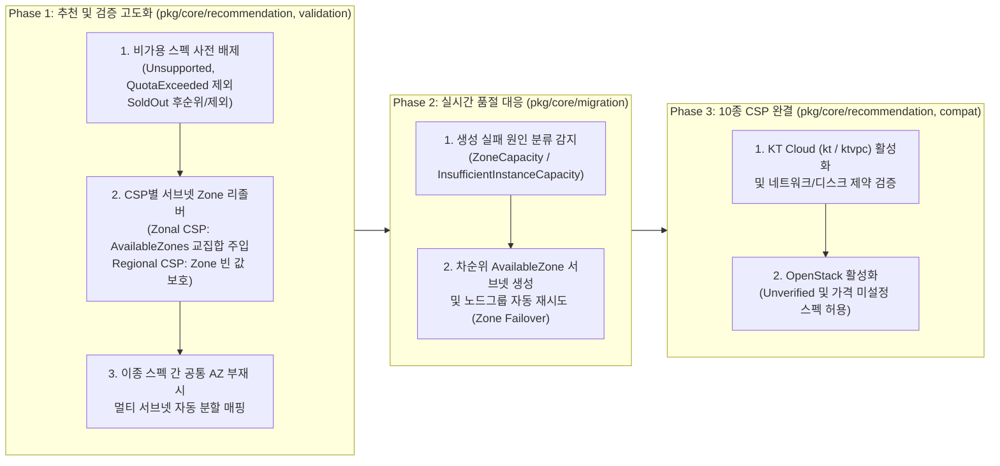

# 10종 CSP 대상 가용 영역(Zone) 인지형 인프라 추천 및 생성 재시도(Failover) 설계 계획서

- **작성일**: 2026-11-12
- **대상 범위**: `CM-Beetle` 추천 엔진(`pkg/core/recommendation`), 검증기(`pkg/core/validation`), 마이그레이션 실행기(`pkg/core/migration`)
- **하부 연동 기준**: `CB-Tumblebug v0.13.8`, `CB-Spider v0.13.17+`
- **진행 방식**: `Kotaemon + Ollama` AI 서비스 이관 PR 병합 이후 별도 후속 PR로 단계적 구현

---

## 1. 추진 배경 및 문제 정의

멀티클라우드 GPU 및 범용 인프라 마이그레이션을 실제 상용 CSP 리전에 수행할 때, 리전 단위의 스펙/이미지 호환성만으로는 프로비저닝 성공을 보장하기 어렵습니다. 특히 GPU 가속기 인스턴스(`NVIDIA L4`, `A10G`, `A100`, `H100` 등)는 일반 CPU 인스턴스와 달리 다음과 같은 세 가지 구조적 제약을 가집니다.

1. **가용 영역(AZ) 편중 배치로 인한 `Unsupported` 생성 실패**:
   - 예를 들어 AWS 서울 리전(`ap-northeast-2`)은 4개 가용 영역(`2a`, `2b`, `2c`, `2d`)을 운영하지만, `g6`(`NVIDIA L4`)나 `g5`(`NVIDIA A10G`) 스펙은 특정 1~2개 AZ에서만 상품이 개설(Offered)되어 있는 경우가 흔합니다.
   - 현재 `CM-Beetle`의 네트워크 추천(`RecommendVNet`, `buildDefaultVNet`)은 `TargetVNet.SubnetInfoList[].Zone`을 빈 문자열(`""`)로 반환하며, 하부 `CB-Tumblebug`가 커넥션의 기본 대표 Zone(예: `ap-northeast-2a` 또는 `2b`)에 서브넷을 생성합니다. 선택된 GPU 스펙이 해당 대표 Zone에 미개설 상태라면 물리 재고 유무와 무관하게 즉시 `Unsupported` 오류가 발생합니다.
2. **오퍼링(Offering) 유무와 실시간 물리 재고(Real-time Capacity) 간의 간극**:
   - AWS `DescribeInstanceTypeOfferings` 등 상당수 CSP의 가용성 조회 API는 "해당 AZ에 해당 인스턴스 타입이 상품으로 출시되어 있는가"만 반환하며, "지금 당장 유휴 GPU 카드가 몇 장 남아 있는가"는 공개하지 않습니다.
   - 따라서 추천 시점에 유효한 AZ를 정확히 지정하더라도, 실제 VM 생성 요청 시점에 `InsufficientInstanceCapacity`(AWS), `ZONE_RESOURCE_POOL_EXHAUSTED`(GCP), `ZonalAllocationFailed`(Azure) 등의 실시간 품절 오류가 발생할 수 있습니다.
3. **10종 멀티클라우드(CSP) 서브넷-Zone 아키텍처의 이질성**:
   - `CM-Beetle`은 최종적으로 10종 CSP(`AWS`, `Azure`, `GCP`, `Alibaba`, `Tencent`, `IBM`, `NCP`, `NHN`, `KT`, `OpenStack`)를 대상으로 인프라 추천 및 마이그레이션을 지원해야 합니다.
   - 그러나 모든 CSP가 서브넷에 Zone을 요구하는 것이 아닙니다. 예컨대 **Azure**나 **GCP**처럼 서브넷이 리전 전체(Regional Scope)에 걸치는 클라우드에 일괄적으로 Zone을 주입하거나 핀닝하면, 오히려 API 스키마 오류 또는 `OverconstrainedZonalAllocationRequest` 할당 거부 장애를 유발합니다.

---

## 2. 하부 인프라(`CB-Tumblebug`) 분석 및 10종 CSP 아키텍처 분류

### 2.1 `CB-Tumblebug v0.13.8` 및 `imdl/cloud-model` 내 기구축 자산

코드베이스 분석 결과, 후속 PR 구현에 필요한 핵심 데이터 모델과 CSP별 가용성 수집기는 이미 `CB-Tumblebug v0.13.8` 및 `CM-Beetle`의 `imdl/cloud-model/copied-tb-model.go`에 정의되어 있습니다.

- **능동 가용성 점검(`AvailabilityChecker`)**:
  - `CB-Tumblebug`는 9개 퍼블릭 CSP(`aws`, `azure`, `gcp`, `alibaba`, `tencent`, `ibm`, `ncp`, `nhn`, `kt`) 전용 `AvailabilityChecker`를 보유하고 있으며, 타겟팅된 GPU 스펙 조회(`POST /tumblebug/recommendSpec`) 시 능동 가용성 점검을 수행하여 응답 스펙 객체에 런타임 가용성 메타데이터를 채워 반환합니다.
- **`cloudmodel.SpecInfo` 내 가용성 필드 (`imdl/cloud-model/copied-tb-model.go`)**:
  - `AvailabilityStatus`: `Available`, `SoldOut`, `QuotaExceeded`, `Unsupported`, `Unverified`
  - `AvailableZones`: 해당 스펙이 제공되는 AZ 목록 (예: `["ap-northeast-2c"]`)
  - `UnavailableZones`: 해당 스펙이 미제공되거나 품절된 AZ 목록 (예: `["ap-northeast-2a", "ap-northeast-2b", "ap-northeast-2d"]`)
  - `AvailabilityReason`: 불가 판정 시 상세 사유 문자열
- **`cloudmodel.SubnetReq` 및 `cloudmodel.ProvisioningFailure`**:
  - `SubnetReq.Zone`: 서브넷 생성 시 바인딩할 타겟 AZ 지정 필드 (`json:"zone,omitempty"`)
  - `ProvisioningFailure`: 생성 실패 시 `CB-Tumblebug`가 정규화하여 반환하는 실패 분류 모델 (`Class: "ZoneCapacity"`, `Retryable: true`, `RetryHint: "differentZone"`, `AttemptedZone`, `SuggestedZones`)

### 2.2 CSP별 가용성 API의 판별 범위 비교 (상품 개설 vs 실시간 재고)

| 구분 | 대상 CSP | 하부 조회 메커니즘 요약 | 사전 차단 가능 오류 (추천 단계) | 실시간 생성 시점 대응 필요 오류 (프로비저닝 단계) |
| :--- | :--- | :--- | :--- | :--- |
| **오퍼링 + 재고 상태 동시 제공** | `Alibaba`, `Tencent` | `DescribeAvailableResource`(`WithStock` / `SoldOut`), `DescribeZoneInstanceConfigInfos`(`SELL` / `SOLD_OUT`) | AZ 미지원 및 명시적 `SoldOut` 사전 배제 가능 | 동시성 경합으로 인한 순간 품절(`OperationDenied.NoStock`) |
| **구독/쿼터 제약 + Zone 제한 제공** | `Azure` | `ResourceSkus` API (`NotAvailableForSubscription`, `LocationInfo.Zones` 제한) | 구독 미승인, 리전/Zone 미출시 스펙 사전 배제 가능 | 실시간 클러스터 용량 부족(`ZonalAllocationFailed`, `AllocationFailed`) |
| **AZ별 상품 개설 유무 중심 제공** | `AWS`, `GCP`, `IBM`, `NCP`, `KT`, `NHN` | AWS `DescribeInstanceTypeOfferings`, GCP `acceleratorTypes.aggregatedList` 등 | 특정 AZ에 스펙 자체가 없는 `Unsupported` 오류 **100% 사전 예방 가능** | 특정 AZ 내 일시적 물리 GPU 카드 고갈(`InsufficientInstanceCapacity`, `ZONE_RESOURCE_POOL_EXHAUSTED`) |

### 2.3 10종 CSP 서브넷-Zone 아키텍처 3대 분류 매트릭스

10종 CSP의 네트워크 및 Zone 제어 모델은 아래 3개 그룹으로 명확히 나뉘며, 추천 엔진은 반드시 이 분류에 따라 `SubnetReq.Zone` 주입 여부를 분기해야 합니다.

| 그룹 | CSP | 현재 `supportedInfraCSPs` | `TB AvailabilityChecker` | 서브넷 스코프 | 추천 시 `SubnetReq.Zone` 정책 | 핵심 제약 및 주의사항 |
| :--- | :--- | :---: | :---: | :--- | :--- | :--- |
| **Group A: Zonal Subnet** | **AWS** | `true` | 지원 | 단일 AZ 귀속 | **주입 필수** (`AvailableZones` 교집합) | GPU 스펙(`g5`, `g6` 등)의 AZ 편중이 심하여 서브넷 AZ 정합성 필수 |
| **Group A: Zonal Subnet** | **Alibaba** | `true` | 지원 | 단일 AZ 귀속 (`vSwitch`) | **주입 필수** (`AvailableZones` 교집합) | AZ별 `WithStock` 여부가 명확히 구분됨 |
| **Group A: Zonal Subnet** | **Tencent** | `true` | 지원 | 단일 AZ 귀속 | **주입 필수** (`AvailableZones` 교집합) | 서브넷이 특정 Zone에 고정 생성됨 |
| **Group A: Zonal Subnet** | **IBM** | `true` | 지원 | 단일 AZ 귀속 | **주입 필수** (`AvailableZones` 교집합) | VPC 서브넷이 단일 Zone에 결속되므로 스펙 지원 Zone과 일치해야 함 |
| **Group A: Zonal Subnet** | **NCP** | `true` | 지원 | 단일 AZ 귀속 | **주입 필수** (`AvailableZones` 교집합) | VPC 서브넷 생성 시 Zone(`KR-1`, `KR-2` 등) 결정 |
| **Group A: Zonal Subnet** | **KT** | `false` (Phase 3 대상) | 지원 | 단일 AZ 귀속 (`ktvpc`) | **주입 필수** (`AvailableZones` 교집합) | `supportedInfraCSPs` 활성화 및 디스크/방화벽 제약 검증 필요 |
| **Group B: Regional Subnet** | **Azure** | `true` | 지원 | **리전 전체 공유** | **절대 주입 금지 (`""` 유지)** | Zone 지정 시 리전 할당기가 비활성화되어 `OverconstrainedZonalAllocationRequest` 유발 |
| **Group B: Regional Subnet** | **GCP** | `true` | 지원 | **리전 전체 공유** | **주입 불필요 (`""` 유지)** | 서브넷은 Regional 리소스이며, VM 생성 시 `CB-Tumblebug`가 가용 Zone 배치 수행 |
| **Group C: Regional / Private** | **NHN** | `true` | 지원 | 리전/네트워크 단위 | 기본 `""` 유지 (스펙 가용성만 필터링) | `AvailabilityStatus` 기반 비가용 스펙 사전 필터링 적용 |
| **Group C: Regional / Private** | **OpenStack** | `false` (Phase 3 대상) | 미구현 (`Unverified`) | 구축 환경별 상이 | 기본 `""` 유지 (`Unverified` 허용) | 프라이빗 클라우드 특성상 카탈로그 가격(`0`/`-1`) 및 `Unverified` 상태 수용 필요 |

> [!WARNING]
> **Azure 및 GCP에 대한 `SubnetReq.Zone` 빈 문자열(`""`) 보호 원칙**:
> `CB-Tumblebug`의 프로비저닝 정책(`UseEmptyRepresentativeZone`)과 동일하게, Regional Subnet 구조를 사용하는 **Azure**와 **GCP**에는 `SubnetReq.Zone`을 강제로 채우지 않아야 합니다. 특히 Azure에서 GPU VM 생성 시 특정 Zone을 고정하면 리전 단위의 유연한 클러스터 할당이 차단되어 생성 실패율이 크게 높아집니다.

---

## 3. 단계별 상세 구현 설계 (별도 PR 로드맵)

코어 추천/마이그레이션 패키지의 변경 영향도를 안전하게 통제하기 위해 다음 3단계(Phase 1 ~ Phase 3)로 나누어 구현합니다.

### 3.1 Phase 1: 가용성 상태 인지형 추천 및 Zonal CSP 서브넷 Zone 자동 정합

1차 후속 PR에서 가장 높은 체감 효과를 제공하는 핵심 범위입니다.

1. **`AvailabilityStatus` 기반 비가용 스펙 사전 필터링 (`resource-node-spec-gpu.go`, `resource-node-spec.go`)**:
   - `CB-Tumblebug`로부터 수신한 `SpecInfo` 목록에서 다음 규칙을 적용합니다.
     - `AvailabilityStatus == "Unsupported"` 또는 `"QuotaExceeded"`: 추천 후보에서 즉시 제외합니다.
     - `AvailabilityStatus == "SoldOut"`: 동일 조건에 `Available` 또는 `Unverified` 스펙이 1개 이상 존재하면 제외합니다. 만약 조회된 모든 후보가 `SoldOut`이면 임의의 비가용 스펙을 반환하지 않고(`No Fallback` 원칙), 로그에 품절 사유를 명시한 뒤 빈 목록(`nothing-to-recommend`)을 반환합니다.
     - Zonal Subnet CSP(Group A)인데 `AvailabilityStatus == "Available"`이면서 `len(AvailableZones) == 0`인 비정상 메타데이터가 없는지 함께 점검합니다.
2. **CSP별 서브넷 Zone 정합성 리졸버 신설 (`pkg/core/recommendation/zone_resolver.go`)**:
   - 단일 책임 원칙(SRP)에 따라 서브넷 Zone 결정 로직을 독립 파일로 분리합니다.
   - **단일/동종 NodeGroup 케이스**: 선택된 스펙의 `AvailableZones` 중 첫 번째 가용 영역(`AvailableZones[0]`)을 `TargetVNet.SubnetInfoList[0].Zone`에 설정합니다.
   - **다중/이종 NodeGroup 케이스**:
     - 후보 인프라(`RecommendedInfra`) 내 모든 `CreateNodeGroupReq`가 참조하는 스펙들의 `AvailableZones` **교집합(`intersectAvailableZones`)**을 먼저 계산합니다.
     - 공통 가용 영역이 존재하면 모든 서브넷(또는 참조 서브넷)의 `Zone`을 해당 공통 AZ로 설정합니다.
     - 만약 NodeGroup A(예: `g6.xlarge`, `2c`만 지원)와 NodeGroup B(예: 특수 베어메탈 스펙, `2a`만 지원) 사이에 공통 AZ가 전혀 없다면, `TargetVNet`의 슈퍼넷 범위 안에서 AZ별 서브넷(`subnet-01` in `2c`, `subnet-02` in `2a`)을 분할 생성하고 각 `CreateNodeGroupReq.SubnetId`를 해당 AZ의 서브넷으로 매핑합니다.
   - **Regional Subnet CSP 보호 가드**: `TargetCloud.Csp`가 `azure`, `gcp`, `nhn`, `openstack`인 경우 `SubnetInfoList`의 `Zone` 필드를 수정하지 않고 `""`로 유지합니다.
3. **추천 오케스트레이터 4종 일괄 연동**:
   - GPU 전용 추천(`infra-gpu.go`)뿐 아니라 일반 인프라 추천(`infra.go`), NLB 포함 추천(`infra-with-nlb.go`), 복합 추천(`infra-composite.go`)에서도 후보 생성 직후 동일한 `alignCandidateSubnetsWithSpecZones` 함수를 호출하여 일관성을 보장합니다.
4. **사전 검증기(`pkg/core/validation`) 규칙 추가**:
   - 사용자가 `RecommendedInfra` JSON을 직접 수정하여 `POST /beetle/validation/ns/{nsId}/infra`를 호출할 때, Zonal CSP의 `SubnetReq.Zone`이 선택된 스펙의 `UnavailableZones`에 포함되어 있으면 프로비저닝 전에 즉시 검증 실패 사유를 안내합니다.

### 3.2 Phase 2: 프로비저닝 단계 실시간 재고 소진 대응 (Zone Failover)

추천 단계에서 상품이 개설된 유효 AZ(`ap-northeast-2c` 등)를 정확히 골랐음에도, 생성 당일 실시간 GPU 카드 재고가 소진(`InsufficientInstanceCapacity`)된 경우를 처리합니다.

1. **재시도 가능 오류(`ZoneCapacity`) 판별**:
   - `pkg/core/migration/infra.go`의 `MigrateInfra` 내 `CreateInfra` 호출 결과에서 실패한 노드가 발생했을 때, 에러 메시지 또는 `ProvisioningFailure` 구조체가 용량 부족(`Class == "ZoneCapacity"`, `InsufficientInstanceCapacity`, `STOCKOUT`, `ZONE_RESOURCE_POOL_EXHAUSTED`)에 해당하는지 판별합니다.
   - 쿼터 초과(`QuotaExceeded` / `VcpuLimitExceeded`)나 인증/권한 오류는 다른 AZ에 재시도해도 동일하게 실패하므로 즉시 중단(`Fail Fast`)합니다.
2. **차순위 가용 영역(Secondary AZ) 전환 프로비저닝**:
   - Zonal Subnet CSP에서 1순위 AZ(예: `ap-northeast-2a`) 생성이 실시간 용량 부족으로 실패했고, 해당 스펙의 `AvailableZones`(또는 AWS 에러가 제안한 `SuggestedZones`)에 아직 시도하지 않은 차순위 AZ(예: `ap-northeast-2c`)가 남아 있는 경우:
     1. 실패한 미완성 Infra 객체를 정리(`DeleteInfra`)합니다.
     2. 이미 생성된 `TargetVNet`에 차순위 AZ(`ap-northeast-2c`)를 가진 서브넷을 추가(또는 초기 `vNet` 재생성)하고 `NodeGroups[].SubnetId`를 새 서브넷으로 갱신합니다.
     3. 최대 `maxZoneFailoverAttempts`(기본 2회, 총 3개 AZ까지) 범위 내에서 `CreateInfra`를 재시도합니다.
   - **No Fallback 원칙 준수**: 사용자가 요청/승인한 **동일 스펙 및 동일 리전 범위 내의 유효 AZ 간 전환**만 수행하며, 사용자 동의 없이 하위 GPU 스펙이나 다른 리전으로 임의 변경하지 않습니다. 모든 가용 AZ에서 재고가 소진된 경우 시도한 AZ 이력과 원문 에러를 투명하게 반환합니다.

### 3.3 Phase 3: 10종 CSP 전면 활성화 (`KT Cloud`, `OpenStack`)

1. **`KT Cloud` (`kt` / `ktvpc`) 활성화**:
   - `pkg/core/recommendation/infra.go`의 `supportedInfraCSPs`에서 `csp.KT: true` 전환을 추진합니다.
   - `KT Cloud` VPC 환경의 루트 디스크 최소 크기(`50GB`), CIDR 제약(`pkg/compat`), Zonal 서브넷 `Zone` 매핑 및 OS 이미지 매칭을 `cmd/test-cli/infra` 및 `cmd/test-cli/gpu-recommendation`으로 실증합니다.
2. **`OpenStack` 활성화**:
   - `supportedInfraCSPs`에서 `csp.OpenStack: true` 전환을 추진합니다.
   - 프라이빗 OpenStack 클러스터는 퍼블릭 CSP와 달리 시간당 과금 단가(`CostPerHour`)가 `0` 또는 `-1`로 등록되거나 `AvailabilityStatus`가 `Unverified`로 반환되는 것이 일반적입니다. `filterPricedSpecs` 및 가용성 필터가 `OpenStack` 환경의 정상 후보를 탈락시키지 않도록 조건을 정교화합니다.

---

## 4. 수정 대상 파일 요약 및 검증 계획

### 4.1 단계별 수정 예정 파일

| 단계 | 패키지 / 파일 경로 | 주요 변경 내용 요약 |
| :--- | :--- | :--- |
| **Phase 1** | `pkg/core/recommendation/zone_resolver.go` *(신설)* | 10종 CSP 서브넷 스코프 판별(`isZonalSubnetCSP`), `AvailableZones` 교집합 산출, 이종 AZ 멀티 서브넷 분할 매핑 |
| **Phase 1** | `pkg/core/recommendation/resource-node-spec-gpu.go` | `AvailabilityStatus`(`Unsupported`, `QuotaExceeded`, `SoldOut`) 필터링 및 `Available` 우선 정렬 반영 |
| **Phase 1** | `pkg/core/recommendation/resource-node-spec.go` | 일반 CPU 노드 스펙 추천에도 동일한 `AvailabilityStatus` 사전 배제 기준 적용 |
| **Phase 1** | `pkg/core/recommendation/infra-gpu.go`, `infra.go`, `infra-with-nlb.go`, `infra-composite.go` | 후보 인프라 조립 시 `alignCandidateSubnetsWithSpecZones` 호출 연동 |
| **Phase 1** | `pkg/core/validation/` | Zonal CSP의 `SubnetReq.Zone`과 선택 스펙 `UnavailableZones` 충돌 여부 사전 검증 |
| **Phase 2** | `pkg/core/migration/infra.go` | `ZoneCapacity` 실시간 품절 감지 시 `AvailableZones` 차순위 AZ 기반 서브넷 전환 및 재생성 재시도 |
| **Phase 3** | `pkg/core/recommendation/infra.go`, `pkg/compat/` | `KT`, `OpenStack` `supportedInfraCSPs` 활성화 및 CSP별 디스크/네트워크/가격 필터 호환성 완결 |

### 4.2 테스트 및 검증 시나리오

1. **단위 테스트 (`go test ./pkg/core/recommendation/...`)**:
   - AWS `ap-northeast-2`에서 `AvailableZones: ["ap-northeast-2c"]`만 가진 GPU 스펙 추천 시 `SubnetInfoList[0].Zone == "ap-northeast-2c"` 자동 설정 검증.
   - Azure `koreacentral` 및 GCP `asia-northeast3` 추천 시 `AvailableZones` 값과 무관하게 `SubnetInfoList[0].Zone == ""` 유지 검증.
   - NodeGroup 2개가 서로 배타적인 AZ(`2a` 전용 + `2c` 전용)를 가질 때 2개 서브넷으로 자동 분할 매핑되는지 검증.
   - 전 후보 `Unsupported` / `QuotaExceeded` 시 비호환 스펙을 억지로 묶지 않고 `nothing-to-recommend`를 반환하는지 검증.
2. **통합 및 실증 테스트**:
   - `make test-gpu-recommendation`: 다중 타겟 CSP 대상 GPU 후보 추천 및 `ValidateInfra` 통과 여부 일괄 점검.
   - `make test-aimx-kotaemon`: 실제 GPU VM 프로비저닝 단계에서 AZ 불일치(`Unsupported`) 없이 타겟 인프라가 생성되는지 종단간 검증.
