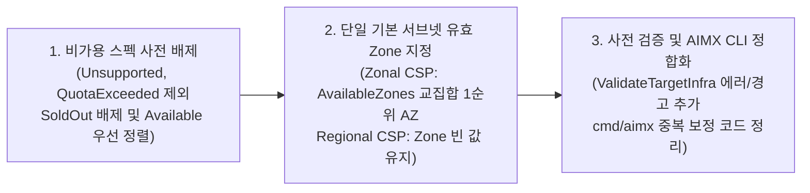

# 가용 영역(Zone) 인지형 인프라 추천 정적 정합성 설계 계획서 (Phase 1 확정안)

- **작성 및 개정일**: 2026-11-12
- **적용 범위 (Phase 1 정적 가용성 정합성 확정)**: 현재 활성 지원 8종 CSP 대상 `CM-Beetle` 추천 엔진(`pkg/core/recommendation`), 사전 검증기(`pkg/core/validation`), `AIMX` CLI(`cmd/aimx`)
- **하부 연동 기준**: `CB-Tumblebug v0.13.8`, `CB-Spider v0.13.17+`
- **보류 및 추후 진행 문서**: 동적 멀티 서브넷 및 실시간 `ZoneCapacity` Failover(`CB-Tumblebug` `retryFailedNodes` 연동), `Beetle UX Lab` UI 고도화, `KT Cloud` / `OpenStack` 활성화는 [zone-and-availability-aware-recommendation-followup-plan.md](./zone-and-availability-aware-recommendation-followup-plan.md)로 분리하여 추후 진행

---

## 1. 추진 배경 및 범위 결정 원칙

`Kotaemon + Ollama` AI 서비스 이관 PR(`ee542b5f`) 병합 이후, 상용 클라우드 리전 대상 GPU 및 범용 인프라 추천 시 발생하는 가용 영역(AZ) 불일치 문제를 **임시 예외 코드나 불필요한 예비 서브넷 생성 없이** `CM-Beetle` 코어 수준에서 정합화합니다.

1. **가용 영역(AZ) 편중 스펙의 `Unsupported` 생성 실패 사전 차단**:
   - 예를 들어 AWS 서울 리전(`ap-northeast-2`)은 4개 가용 영역(`2a`, `2b`, `2c`, `2d`)을 운영하지만, `g6`(`NVIDIA L4`)나 `g5`(`NVIDIA A10G`) 스펙은 특정 일부 AZ(예: `2a`, `2c`)에서만 상품이 개설(Offered)되어 있는 경우가 흔합니다.
   - 기존 `CM-Beetle`의 네트워크 추천(`RecommendVNet`, `buildDefaultVNet`)은 단일 기본 서브넷의 `Zone`을 빈 문자열(`""`)로 반환하여, 하부 `CB-Tumblebug`가 커넥션 대표 Zone(예: `ap-northeast-2b`)에 서브넷을 생성할 경우 물리 재고와 무관하게 즉시 `Unsupported` 오류가 발생합니다.
   - 이에 따라 `AIMX` CLI(`cmd/aimx/infra_migration.go`)에 들어가 있던 클라이언트 측 보정 로직을 백엔드 추천 엔진 코어로 내재화하여 REST API를 호출하는 모든 경로에서 일관되게 동작하도록 합니다.
2. **멀티클라우드(CSP) 서브넷-Zone 스코프 이질성 준수**:
   - **Azure**, **GCP**, **NHN**처럼 서브넷이 리전 전체(Regional Scope)에 걸치는 클라우드에 일괄적으로 Zone을 주입하면 API 스키마 오류 또는 `OverconstrainedZonalAllocationRequest` 할당 거부를 유발하므로 `Zone: ""`을 엄격히 유지합니다.
3. **단순성 원칙 준수 (임시 예외 분기 배제)**:
   - 하부 드라이버의 멀티존 제약(`IBM` VPC Address Prefix, `NCP` 단일 Zone 정책 등)이 혼재된 상태에서 예비 서브넷 사전 생성이나 수동 서브넷 분할을 수행하지 않고, 금번에는 **기존 단일 기본 서브넷 토폴로지를 그대로 유지한 채 유효한 `AvailableZone` 1개를 정적 매핑하는 범위(Phase 1)** 만 우선 반영합니다.

---

## 2. 하부 인프라(`CB-Tumblebug`) 분석 및 CSP 아키텍처 분류

### 2.1 `CB-Tumblebug v0.13.8` 및 `imdl/cloud-model` 내 기구축 자산

구현에 필요한 데이터 모델과 CSP별 가용성 수집기는 이미 `CB-Tumblebug v0.13.8` 및 `CM-Beetle`의 `imdl/cloud-model/copied-tb-model.go`에 정의되어 있습니다.

- **능동 가용성 점검(`AvailabilityChecker`)**:
  - `CB-Tumblebug`는 타겟 스펙 조회(`POST /tumblebug/recommendSpec` 및 `GET /ns/system/resources/spec/{specId}`) 시 `EnrichSpecWithAvailabilityForce`를 수행하여 응답 스펙 객체에 런타임 가용성 메타데이터를 채워 반환합니다.
- **`cloudmodel.SpecInfo` 내 가용성 필드 (`imdl/cloud-model/copied-tb-model.go`)**:
  - `AvailabilityStatus`: `Available`, `SoldOut`, `QuotaExceeded`, `Unsupported`, `Unverified`
  - `AvailableZones`: 해당 스펙이 제공되는 AZ 목록 (예: `["ap-northeast-2a", "ap-northeast-2c"]`)
  - `UnavailableZones`: 해당 스펙이 미제공되거나 품절된 AZ 목록 (예: `["ap-northeast-2b", "ap-northeast-2d"]`)
  - `AvailabilityReason`: 불가 판정 시 상세 사유 문자열

### 2.2 활성 지원 8종 CSP 서브넷-Zone 분류 매트릭스

금번 구현 대상인 활성 8종 CSP(`supportedProviders == true`)는 서브넷-Zone 스코프에 따라 아래 두 축으로 분기 처리합니다.

| 그룹 | CSP | 서브넷 스코프 | 추천 시 `SubnetInfoList[0].Zone` 정책 | 핵심 제약 및 처리 원칙 |
| :--- | :--- | :--- | :--- | :--- |
| **Group A: Zonal Subnet** | **AWS** | 단일 AZ 귀속 | **유효 `AvailableZone` 지정** | GPU 스펙(`g5`, `g6` 등)의 AZ 편중이 심하여 서브넷 AZ 정합성 필수 |
| **Group A: Zonal Subnet** | **Alibaba** | 단일 AZ 귀속 (`vSwitch`) | **유효 `AvailableZone` 지정** | AZ별 `WithStock` 여부가 명확히 구분됨 |
| **Group A: Zonal Subnet** | **Tencent** | 단일 AZ 귀속 | **유효 `AvailableZone` 지정** | 서브넷이 특정 Zone에 고정 생성됨 |
| **Group A: Zonal Subnet** | **IBM** | 단일 AZ 귀속 | **유효 `AvailableZone` 지정** | 단일 서브넷에 스펙 지원 Zone을 매핑하여 VPC Address Prefix 충돌 없이 정합성 확보 |
| **Group A: Zonal Subnet** | **NCP** | 단일 AZ 귀속 | **유효 `AvailableZone` 지정** | 단일 서브넷 생성 시 유효 Zone(`KR-1`, `KR-2` 등) 지정 |
| **Group B: Regional Subnet** | **Azure** | **리전 전체 공유** | **절대 주입 금지 (`""` 유지)** | Zone 지정 시 리전 할당기가 비활성화되어 `OverconstrainedZonalAllocationRequest` 유발 |
| **Group B: Regional Subnet** | **GCP** | **리전 전체 공유** | **주입 불필요 (`""` 유지)** | 서브넷은 Regional 리소스이며 VM 생성 시 하부 엔진이 가용 Zone 배치 수행 |
| **Group C: Regional** | **NHN** | 리전/네트워크 단위 | **기본 `""` 유지** | `AvailabilityStatus` 기반 비가용 스펙 사전 필터링만 적용 |

> [!WARNING]
> **Azure, GCP, NHN에 대한 `SubnetReq.Zone` 빈 문자열(`""`) 보호 원칙**:
> Regional Subnet 구조를 사용하는 **Azure**, **GCP**, **NHN**에는 `SubnetReq.Zone`을 채우지 않고 빈 문자열(`""`)로 유지해야 합니다.

---

## 3. 상세 구현 설계 (Phase 1: 정적 가용성 정합성)

### 3.1 `AvailabilityStatus` 기반 비가용 스펙 사전 필터링 (`resource-node-spec-gpu.go`, `resource-node-spec.go`)

1. **`Unsupported` 및 `QuotaExceeded` 스펙 즉시 제외**:
   - 타겟 리전에서 제공되지 않거나 계정 쿼터가 부족한 스펙은 추천 후보에서 즉시 배제합니다.
2. **`SoldOut` 스펙 배제 및 `No Fallback` 준수**:
   - 동일 조건에 `Available` 또는 `Unverified` 스펙이 1개 이상 존재하면 `SoldOut` 스펙을 제외합니다.
   - 조회된 모든 후보가 `SoldOut`인 경우 비가용 스펙을 임의로 반환하지 않고(`No Fallback` 원칙) 빈 목록을 반환합니다.
3. **Zonal CSP 무효 AZ 스펙 제외 및 `Available` 우선 정렬**:
   - Zonal Subnet CSP(Group A)에서 `UnavailableZones`는 존재하나 `AvailableZones`가 비어 있는 스펙을 제외합니다.
   - 적합도 점수가 동일한 후보들 사이에서는 `Available` 상태 스펙을 `Unverified`보다 우선 정렬합니다.

### 3.2 단일 기본 서브넷의 유효 `AvailableZone` 정적 매핑 (`pkg/core/recommendation/zone_resolver.go`)

1. **단일 책임 파일 분리**:
   - `IsZonalSubnetCSP`, `filterAvailableSpecs`, `availabilityPriority`, `alignCandidateSubnetsWithSpecZones`를 `pkg/core/recommendation/zone_resolver.go`로 분리합니다.
2. **기존 단일 서브넷 토폴로지 유지 및 유효 Zone 주입**:
   - 서브넷 추가나 CIDR 분할을 수행하지 않고 `TargetVNet.SubnetInfoList[0]` 단일 서브넷 구성을 그대로 유지합니다.
   - 후보 인프라(`RecommendedInfra`) 내 모든 `CreateNodeGroupReq`가 참조하는 스펙(`s.Id == ng.SpecId || s.CspSpecName == ng.SpecId`)들의 `AvailableZones` 교집합을 사전순 정렬하여 첫 번째 유효 AZ를 `TargetVNet.SubnetInfoList[0].Zone`에 설정합니다.
   - 복수 NodeGroup이 서로 겹치지 않는 배타적 `AvailableZones`만 가지는 경우에는 임의의 한쪽 AZ를 강제 지정하지 않고(`No Fallback` 원칙) `Zone`을 비워두며 경고 로그를 남겨 `ValidateTargetInfra` 사전 검증에서 명확히 감지되도록 합니다.
3. **Regional Subnet CSP 보호 가드**:
   - `!IsZonalSubnetCSP(cspName)`인 경우 `SubnetInfoList`의 `Zone`을 항상 `""`로 유지합니다.
4. **추천 오케스트레이터 5개 진입점 일괄 연동**:
   - `RecommendGpuInfraCandidates` (`infra-gpu.go`), `RecommendInfraCandidates` 및 `RecommendInfra` (`infra.go`), `RecommendInfraWithNlbCandidates` (`infra-with-nlb.go`), `RecommendCompositeInfraCandidates` (`infra-composite.go`)에서 후보 생성 직후 `alignCandidateSubnetsWithSpecZones`를 호출합니다.

### 3.3 사전 검증기(`pkg/core/validation`) 규칙 추가

1. **`CodeSubnetZoneUnavailable` (`Error`)**:
   - Zonal Subnet CSP에서 NodeGroup이 참조하는 서브넷의 `Zone`이 스펙의 `UnavailableZones`에 속하거나, 스펙의 `AvailableZones` 목록에 포함되지 않는 경우(또는 `UnavailableZones`가 존재함에도 `Subnet.Zone == ""`인 경우) 프로비저닝 전 단계에서 차단합니다.
2. **`CodeRegionalSubnetZonePinned` (`Warning`)**:
   - Regional Subnet CSP(`azure`, `gcp`)에서 `Subnet.Zone`이 비어 있지 않은 경우 할당 제약 위험 경고를 반환합니다.

### 3.4 `AIMX` CLI 중복 로직 정리 (`cmd/aimx/infra_migration.go`)

- `cmd/aimx/infra_migration.go` 내부의 `isZonalSubnetCSP` 중복 정의를 제거하고 `recommendation.IsZonalSubnetCSP`를 재사용합니다.
- `CM-Beetle` 추천 엔진이 설정한 `SubnetInfoList[].Zone`을 기본 수용하며, 사용자가 `kotaemon-config.yaml`에 `preferredZone`을 명시한 경우에만 해당 스펙의 `AvailableZones` 포함 여부를 검증한 뒤 오버라이드합니다.

---

## 4. 수정 대상 파일 요약 및 검증 계획

### 4.1 수정 및 신설 대상 파일

| 구분 | 패키지 / 파일 경로 | 주요 변경 내용 요약 |
| :--- | :--- | :--- |
| **신설** | `pkg/core/recommendation/zone_resolver.go` | CSP 서브넷 스코프 판별(`IsZonalSubnetCSP`), `AvailabilityStatus` 필터링, 단일 기본 서브넷 유효 `AvailableZone` 매핑 |
| **수정** | `pkg/core/recommendation/resource-node-spec-gpu.go`, `resource-node-spec.go` | GPU 및 일반 노드 스펙 추천 시 비가용 스펙 사전 배제 및 `Available` 우선 정렬 |
| **수정** | `pkg/core/recommendation/infra-gpu.go`, `infra.go`, `infra-with-nlb.go`, `infra-composite.go` | 5개 추천 진입점 후보 조립 직후 `alignCandidateSubnetsWithSpecZones` 연동 |
| **수정** | `pkg/core/validation/model.go`, `pkg/core/validation/infra.go` | `CodeSubnetZoneUnavailable` 에러 및 `CodeRegionalSubnetZonePinned` 경고 사전 검증 추가 |
| **수정** | `cmd/aimx/infra_migration.go` | `recommendation.IsZonalSubnetCSP` 통합 재사용 및 백엔드 추천 Zone 기본 수용 |

### 4.2 테스트 및 검증 시나리오

1. **단위 테스트 (`go test`)**:
   - `pkg/core/recommendation/zone_resolver_test.go`: 활성 8종 CSP Zonal/Regional 분기, Zonal CSP 단일 서브넷 유효 `AvailableZone` 자동 주입, Regional CSP(`azure`, `gcp`, `nhn`) `Zone == ""` 보호, 비가용 스펙(`Unsupported`, `QuotaExceeded`, `SoldOut`) 배제 및 전 후보 `SoldOut` 시 빈 결과 반환(`No Fallback`), 이종 배타적 AZ 충돌 시 임의 주입 방지 검증.
   - `pkg/core/validation/infra_zone_test.go`: 미지원 AZ 지정 및 배타적 AZ 미해결 시 `CodeSubnetZoneUnavailable` 에러, Regional CSP Zone 고정 시 `CodeRegionalSubnetZonePinned` 경고 검증.
2. **전체 패키지 테스트 및 바이너리 빌드**:
   - `/usr/local/go/bin/go test ./pkg/core/recommendation/... ./pkg/core/validation/... ./cmd/aimx/...`
   - `/usr/local/go/bin/go build ./cmd/cm-beetle ./cmd/aimx`
