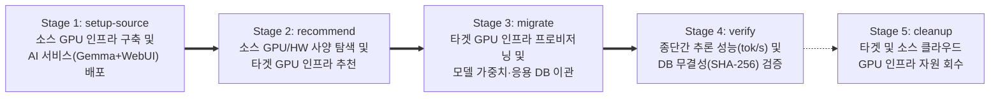
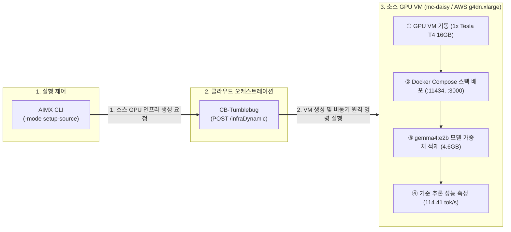
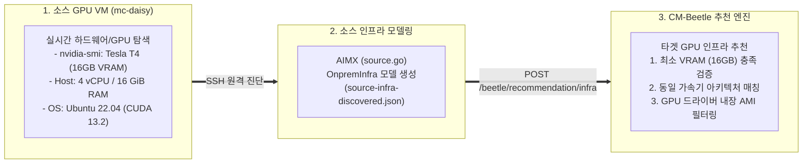
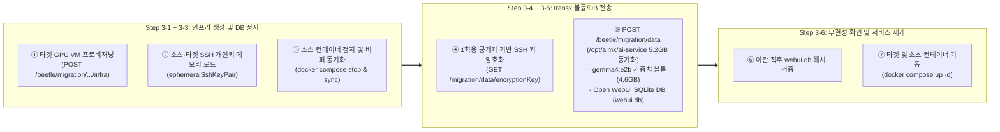
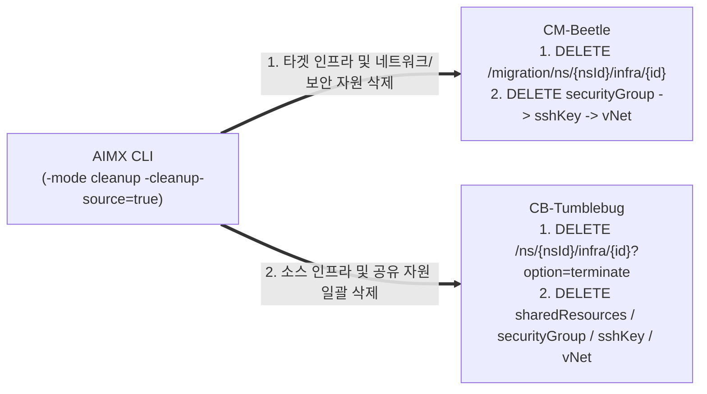
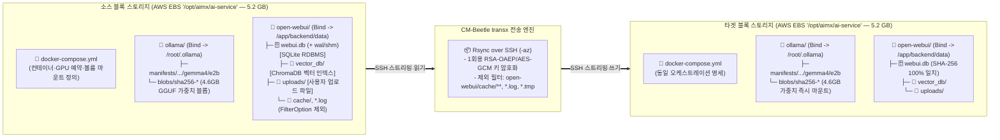

# AI 반도체 기반 AI 서비스 마이그레이션 시나리오 정의 및 구조 설계서 (AIMX)

본 문서는 **CB-Tumblebug**과 **CM-Beetle (`transx`)**을 연계하여 **AI 반도체(GPU) 기반 인프라와 설치형 AI 서비스(Gemma LLM + Open WebUI)**를 클라우드 환경 간에 이전하는 **`AIMX` (AI Migration X)**의 시나리오 정의 및 기술 설계를 다룹니다.

---

## 1. 개요 및 전체 마이그레이션 파이프라인

### 1.1 AI 서비스 마이그레이션의 핵심 범위 (4-Layer Full-Stack)

일반적인 컴퓨팅 인프라 마이그레이션이 가상머신(VM)과 네트워크의 재생성에 초점을 맞춘다면, **AI 반도체 기반 AI 서비스 마이그레이션**은 하드웨어 가속기(GPU)의 연산 환경부터 대용량 언어모델 가중치, 그리고 응용 계층의 상태 데이터베이스까지 **4개 계층(4-Layer Stack)**의 연속성을 보장해야 합니다.

1. **Layer 1 — AI 반도체 인프라 (GPU Compute & Block Storage)**:
   - 소스 워크로드의 연산 요구사항을 충족하는 GPU 가속기(예: `NVIDIA Tesla T4 16GB VRAM`) 및 클라우드 블록 스토리지 구성
2. **Layer 2 — AI 반도체 런타임 (GPU Container Runtime)**:
   - GPU 드라이버(`NVIDIA Driver` / `CUDA`)가 탑재된 OS 이미지 매칭 및 컨테이너 GPU 패스스루(`nvidia-container-toolkit`) 구성
3. **Layer 3 — 설치형 AI 모델 및 가중치 볼륨 (Self-Hosted LLM & Weights)**:
   - 추론 엔진(`Ollama`)과 수 기가바이트(GB) 규모의 모델 가중치 블롭(`Google Gemma 4`) 이관
4. **Layer 4 — 상태 기반 AI 응용 및 데이터베이스 (Stateful AI Web App & DB)**:
   - 웹 인터페이스(`Open WebUI`)와 사용자 계정·대화 이력·벡터 인덱스를 보존하는 데이터베이스(`SQLite`, `ChromaDB`)의 무결성 이관

---

### 1.2 전체 마이그레이션 5단계(Stage) 파이프라인

`AIMX`는 전체 마이그레이션 수명주기를 시간의 흐름에 따라 **5개 단계(Stage 1 ~ Stage 5)**로 정의하고 순차 제어합니다.

|    단계     | 실행 모드 (`-mode`) | 주요 수행 역할                                                                                        |                실측 소요 시간                |
| :---------: | :------------------ | :---------------------------------------------------------------------------------------------------- | :------------------------------------------: |
| **Stage 1** | `setup-source`      | 소스 GPU VM(`mc-daisy`) 프로비저닝 및 `Ollama`(`gemma4:e2b`) + `Open WebUI` 배포·기준 성능 측정       |                   8분 30초                   |
| **Stage 2** | `recommend`         | 소스 GPU VM 실시간 하드웨어/가속기 사양 수집 및 CM-Beetle 기반 타겟 GPU 인프라 추천                   |                     3초                      |
| **Stage 3** | `migrate`           | 타겟 GPU VM(`aimx-gpu-infra-01`) 프로비저닝 및 **CM-Beetle `transx`를 통한 모델 가중치·DB 볼륨 이관** |    6분 41초 _(데이터 전송 2분 49초)_     |
| **Stage 4** | `verify`            | 소스 대비 타겟의 GPU 오프로딩 여부, 추론 처리량(`tokens/sec`), SQLite DB 해시 일치 여부 검증          | 초기 적재 시 3~8분 _(캐시 적재 시 17초)_ |
| **Stage 5** | `cleanup`           | 검증 완료 후 타겟 및 소스 GPU 인프라와 하위 네트워크·보안그룹·SSH 키 자원 일괄 회수                   |                  약 3~10분                   |

---

## 2. 시간의 흐름에 따른 단계별(Stage 1 ~ Stage 5) 실행 구조

각 단계는 상태 파일(`cmd/aimx/testresult/.aimx-state.json`)을 매개로 이전 단계의 산출물을 이어받으며, 전체 통합 실행(`-mode seq`) 또는 단계별 독립 실행을 모두 지원합니다.

### 2.1 [Stage 1] `setup-source` — 소스 GPU 환경 구축 및 AI 서비스 시딩

마이그레이션 대상이 될 소스 GPU VM(`mc-daisy`)을 구성하고, 컨테이너 기반 AI 서비스 스택(`Ollama` + `Open WebUI`)을 배포하여 마이그레이션 전 기준 지표(Baseline Metrics)를 확보합니다.

- **단계별 수행 내역**:
  1. **소스 GPU 인프라 프로비저닝**: CB-Tumblebug의 `POST /tumblebug/ns/default/infraDynamic` API를 호출하여 AWS 서울 리전(`ap-northeast-2`)에 `g4dn.xlarge`(`1x NVIDIA Tesla T4 16GB VRAM`, 4 vCPU, 16 GiB RAM, Ubuntu 22.04 Deep Learning AMI `ami-00ffffe72a332c865`)를 생성합니다.
  2. **컨테이너 스택 구성**: 호스트의 `/opt/aimx/ai-service` 경로에 `docker-compose.yml`과 바인드 마운트 볼륨 디렉터리(`ollama/`, `open-webui/`)를 생성하고 컨테이너를 기동합니다.
  3. **모델 시딩 및 베이스라인 수집**: `ollama pull gemma4:e2b`로 4.6GB 규모의 모델 가중치를 적재한 뒤, 초기 GPU 추론 처리량(`114.41 tokens/sec`)과 `webui.db` 해시를 기록합니다.

---

### 2.2 [Stage 2] `recommend` — 실시간 소스 GPU 탐색 및 타겟 인프라 추천

가동 중인 소스 GPU VM에서 하드웨어 및 가속기 사양을 실시간으로 추출하여 온프레미스/소스 인프라 모델(`OnpremInfra`)을 구성하고, CM-Beetle 추천 엔진을 통해 타겟 클라우드의 최적 GPU 인프라 명세를 도출합니다.

- **단계별 수행 내역**:
  1. **하이브리드 소스 탐색**: 기본 템플릿(`source-infra-base.json`)에 CB-Tumblebug의 보안그룹 규칙과 `nvidia-smi` 실시간 쿼리 결과를 결합하여 실제 가속기 스펙이 반영된 `OnpremInfra` 모델을 완성합니다.
  2. **타겟 GPU 스펙 및 이미지 추천**: CM-Beetle의 `POST /beetle/recommendation/infra`는 소스 노드의 GPU 탑재 여부를 식별하여 VRAM 하한선(`16 GB`)을 보장하는 인스턴스 스펙(`aws+ap-northeast-2+g4dn.xlarge`)과 GPU 드라이버가 사전 설치된 머신 이미지(`ami-00ffffe72a332c865`)를 추천합니다.

---

### 2.3 [Stage 3] `migrate` — 타겟 GPU 인프라 생성 및 `transx` 데이터 마이그레이션

Stage 2에서 도출된 추천 명세를 기반으로 타겟 GPU 인프라(`aimx-gpu-infra-01`)를 프로비저닝하고, CM-Beetle의 데이터 마이그레이션 엔진(`transx`)을 통해 모델 가중치와 응용 데이터베이스를 타겟 볼륨으로 이관합니다.

- **단계별 수행 내역**:
  1. **타겟 인프라 생성 및 런타임 준비**: CM-Beetle을 통해 타겟 GPU VM을 생성하고, Docker Compose 및 NVIDIA Container Runtime 환경을 준비합니다.
  2. **소스 컨테이너 일시 정지 (Quiesce)**: 이관 도중 SQLite 데이터베이스(`webui.db`)의 트랜잭션 불일치가 발생하지 않도록 소스 컨테이너를 정지(`docker compose stop && sync`)하고 파일 접근 권한을 정규화합니다.
  3. **암호화 키 교환 및 `transx` 전송**: 1회용 RSA-OAEP 공개키로 양측 SSH 개인키를 암호화하여 `POST /beetle/migration/data`를 호출합니다. 소스의 `/opt/aimx/ai-service` 볼륨(`5.2GB`)이 타겟의 동일 경로로 전송됩니다 (`2m49s` 소요).
  4. **타겟 서비스 기동**: 타겟 VM에서 `docker compose up -d`를 실행하면 컨테이너 엔진 이미지만 레지스트리에서 Pull하며, **모델 가중치(`4.6GB`)와 사용자 DB(`webui.db`)는 이관된 호스트 볼륨을 즉시 마운트**하여 복원됩니다.

---

### 2.4 [Stage 4] `verify` — 종단간 추론 성능(Benchmark) 및 데이터 무결성 검증

마이그레이션이 완료된 타겟 환경에서 GPU 가속 상태, LLM 추론 처리량(`tokens/sec`), 웹 응용 응답 상태, 그리고 SQLite 데이터베이스의 해시 무결성을 소스 환경과 정량 비교합니다.

> ℹ️ **초기 모델 적재(Cold Start) 소요 시간**: 타겟 VM에서 이관된 디스크 가중치를 GPU VRAM으로 최초 적재할 때는 멀티모달 텐서 매핑 및 버퍼 초기화로 인해 **약 3~8분**이 소요될 수 있습니다. 모델이 GPU VRAM에 적재된 이후(Warm 상태)에는 **약 17~20초** 내에 검증이 완료됩니다.

---

### 2.5 [Stage 5] `cleanup` — 클라우드 GPU 인프라 및 종속 자원 회수

검증 및 비교 시연이 완료된 후, 클라우드 자원 종속성 순서(`Infra` $\rightarrow$ `Security Group` $\rightarrow$ `SSH Key` $\rightarrow$ `vNet & Subnet`)에 따라 타겟과 소스의 모든 클라우드 자원을 회수합니다.

---

## 3. Source ↔ Target 1:1 매칭 및 스토리지·볼륨·DB 이관 명세

### 3.1 Source ↔ Target 4-Layer 1:1 매칭 명세표

| 계층 (Layer)            | 비교 항목                 | 소스 환경 (Source — `mc-daisy`)                                                        | 타겟 환경 (Target — `aimx-gpu-infra-01`)                                               |          매칭 및 검증 결과          |
| :---------------------- | :------------------------ | :------------------------------------------------------------------------------------- | :------------------------------------------------------------------------------------- | :---------------------------------: |
| **Layer 1: 인프라**     | CSP / 리전                | `aws` / `ap-northeast-2`                                                               | `aws` / `ap-northeast-2`                                                               |          ✅ 동일 리전 매칭          |
| **Layer 1: 인프라**     | 인스턴스 스펙             | `aws+ap-northeast-2+g4dn.xlarge` (4 vCPU, 16 GiB RAM)                              | `aws+ap-northeast-2+g4dn.xlarge` (4 vCPU, 16 GiB RAM)                              |       ✅ 동일 스펙 프로비저닝       |
| **Layer 1: AI 반도체**  | GPU 가속기                | `1x NVIDIA Tesla T4 (16 GB VRAM)`                                                      | `1x NVIDIA Tesla T4 (16 GB VRAM)`                                                      |      ✅ 가속기 모델·VRAM 일치       |
| **Layer 1: 스토리지**   | 블록 스토리지 볼륨        | AWS EBS Root Volume (`100 GB gp2`, `ext4`)                                             | AWS EBS Root Volume (`50 GB gp3`, `ext4`)                                              |   ✅ 루트 파일시스템(`/`) 마운트    |
| **Layer 2: 런타임**     | 머신 이미지 (AMI)         | `ami-00ffffe72a332c865` (Ubuntu 22.04 DL AMI)                                          | `ami-00ffffe72a332c865` (Ubuntu 22.04 DL AMI)                                          |  ✅ GPU 드라이버 내장 이미지 매칭   |
| **Layer 2: 런타임**     | Driver / CUDA / Runtime   | Driver `595.91.07` / `CUDA 13.2` / `nvidia-ctk`                                        | Driver `595.91.07` / `CUDA 13.2` / `nvidia-ctk`                                        |     ✅ 컨테이너 `100% GPU` 할당     |
| **Layer 3: AI 모델**    | 추론 컨테이너 & 모델 태그 | `aimx-ollama` (`:11434`) / `gemma4:e2b`                                                | `aimx-ollama` (`:11434`) / `gemma4:e2b`                                                |    ✅ `114.41` vs `114.15 tok/s`    |
| **Layer 3: AI 모델**    | 모델 가중치 볼륨          | Host `/opt/aimx/ai-service/ollama` $\rightarrow$ Container `/root/.ollama`         | Host `/opt/aimx/ai-service/ollama` $\rightarrow$ Container `/root/.ollama`         |     ✅ `transx` 이관 (`4.6 GB`)     |
| **Layer 4: AI 응용**    | 웹 컨테이너 & 서비스 상태 | `aimx-open-webui` (`:3000`, `v0.12.0`)                                                 | `aimx-open-webui` (`:3000`, `v0.12.0`)                                                 |          ✅ `HTTP 200 OK`           |
| **Layer 4: AI 응용/DB** | 응용 데이터/DB 볼륨       | Host `/opt/aimx/ai-service/open-webui` $\rightarrow$ Container `/app/backend/data` | Host `/opt/aimx/ai-service/open-webui` $\rightarrow$ Container `/app/backend/data` | ✅ `webui.db` SHA-256 **100% 일치** |

---

### 3.2 스토리지 · 볼륨 · 데이터베이스(DB) 이관 구조도

소스 VM에서 타겟 VM으로 전송되는 모든 영속 데이터(Stateful Data)는 호스트의 클라우드 블록 스토리지(AWS EBS) 내 **`/opt/aimx/ai-service/` (총 `5.2 GB`)** 경로에 위치하며, Docker Bind Mount를 통해 각 컨테이너 내부 볼륨으로 연결됩니다.

### 3.3 스토리지·볼륨·DB별 세부 전송 항목 명세표

| 구분                          | 소스 호스트 볼륨 경로 (Host Path)                                                 | 컨테이너 내부 마운트 경로             | 저장소 / DB 포맷                           | 포함되는 세부 데이터 내용                                                                                                                                                                                                | 이관 정책 (`transx`)                                                           |
| :---------------------------- | :-------------------------------------------------------------------------------- | :------------------------------------ | :----------------------------------------- | :----------------------------------------------------------------------------------------------------------------------------------------------------------------------------------------------------------------------- | :----------------------------------------------------------------------------- |
| **오케스트레이션 설정**       | `/opt/aimx/ai-service/docker-compose.yml`                                         | _(호스트 직접 참조)_                  | YAML 설정 파일                             | • `aimx-ollama`, `aimx-open-webui` 서비스 및 포트(`11434`, `3000`) 정의 • NVIDIA GPU 디바이스 예약(`driver: nvidia`, `count: all`) • `OLLAMA_LOAD_TIMEOUT=15m`, `OLLAMA_KEEP_ALIVE=30m`                          | ✅ **전송 포함**                                                               |
| **LLM 모델 매니페스트**       | `/opt/aimx/ai-service/ollama/models/manifests/...`                                | `/root/.ollama/models/manifests/...`  | JSON 메타데이터                            | • `registry.ollama.ai/library/gemma4/e2b` 모델 버전 태그 및 레이어별 SHA-256 다이제스트 매핑                                                                                                                             | ✅ **전송 포함**                                                               |
| **LLM 모델 가중치 (Weights)** | `/opt/aimx/ai-service/ollama/models/blobs/sha256-*`                               | `/root/.ollama/models/blobs/sha256-*` | Content-Addressable GGUF Blobs (`~4.6 GB`) | • `gemma4:e2b` (4.65B 파라미터) 36개 정규 레이어 및 5개 Speculative(`draft-mtp`) 레이어 텐서 • 멀티모달(CLIP 비전/오디오) 프로젝터 및 토크나이저                                                                     | ✅ **전송 포함** (`transferModelWeights: true`)                            |
| **웹 응용 관계형 DB**         | `/opt/aimx/ai-service/open-webui/webui.db` `(+ webui.db-wal, webui.db-shm)`   | `/app/backend/data/webui.db`          | **SQLite 3 RDBMS** (`~741 KB`+)            | • **`user` / `auth` 테이블**: 사용자 계정 및 인증 자격증명 • **`chat` / `message` 테이블**: 채팅 세션 및 프롬프트·응답 대화 이력 전체 • **`prompt` / `model` / `config` 테이블**: 커스텀 프롬프트 및 서비스 설정 | ✅ **Quiesce(`stop & sync`) 후 무결성 전송** (`SHA-256 100% 일치`)         |
| **RAG 벡터 스토어**           | `/opt/aimx/ai-service/open-webui/vector_db/`                                      | `/app/backend/data/vector_db/`        | ChromaDB (SQLite + HNSW Index)             | • 문서 기반 질의응답(RAG)을 위해 임베딩된 벡터 인덱스 및 컬렉션 데이터                                                                                                                                                   | ✅ **전송 포함**                                                               |
| **업로드 파일 볼륨**          | `/opt/aimx/ai-service/open-webui/uploads/`                                        | `/app/backend/data/uploads/`          | 파일 스토리지                              | • 사용자가 대화 세션에 첨부한 문서(PDF, TXT) 및 이미지 원본 파일                                                                                                                                                         | ✅ **전송 포함**                                                               |
| **런타임 임시 캐시/로그**     | `/opt/aimx/ai-service/open-webui/cache/**` `*.log`, `*.tmp`, `__pycache__/**` | `/app/backend/data/cache/**`          | 임시 파일 (Ephemeral)                      | • 런타임 임시 캐시, 파이썬 바이트코드, 컨테이너 로그                                                                                                                                                                     | ⏭️ **`FilterOption`으로 제외** (전송 대역폭 최적화)                        |
| **컨테이너 실행 이미지**      | `/var/lib/docker/overlay2/...`                                                    | _(Docker 데몬 영역)_                  | OCI Image Layers                           | • `ollama/ollama:latest`, `ghcr.io/open-webui/open-webui:main` 실행 바이너리 레이어                                                                                                                                      | 🔄 **타겟에서 `docker compose up -d` 시 레지스트리 Pull** (데이터 볼륨과 분리) |

> **아키텍처 설계 원칙 — 실행 이미지(Immutable)와 상태 볼륨(Stateful)의 분리**
> 불변(Immutable) 실행 환경인 컨테이너 이미지 레이어(`/var/lib/docker`)는 타겟 VM의 Docker 데몬이 공식 레지스트리에서 직접 Pull하도록 위임하고, **실제 서비스 상태(Stateful Data)를 담고 있는 호스트 바인드 마운트 볼륨(`/opt/aimx/ai-service` 내 `4.6GB` 모델 가중치 블롭 및 `webui.db` SQLite DB)**만 `transx`로 정밀 전송합니다. 이를 통해 OS 커널이나 Docker 스토리지 드라이버 차이로 인한 호환성 문제 없이 신속하고 일관된 서비스 복원을 달성합니다.

---

## 4. 핵심 컴포넌트 아키텍처 및 심층 기술 설계

### 4.1 전체 시스템 연동 아키텍처

```mermaid
flowchart LR
    subgraph AIMX["AIMX CLI (cmd/aimx)"]
        direction TB
        M["main.go / config.go\n(파이프라인 라우터 및 상태 관리)"]
        S["source.go / infra_migration.go\n(GPU 스펙 탐색 및 추천·생성 제어)"]
        SV["service_migration.go / wait.go\n(비동기 SSE 스트리밍 및 transx 호출)"]
        V["verification.go / report.go\n(추론 벤치마크 및 리포트 생성)"]
    end

    subgraph Beetle["CM-Beetle (:8056)"]
        direction TB
        Rec["GPU Recommender\n(resource-node-spec-gpu.go\nresource-node-image.go)"]
        Mig["Infra Migrator\n(POST /migration/ns/{nsId}/infra)"]
        Tx["transx Data Engine\n(executor-rsync.go / crypto.go)"]
    end

    subgraph Tumblebug["CB-Tumblebug (:1323)"]
        direction TB
        Dyn["Dynamic Infra API\n(POST /infraDynamic)"]
        Cmd["Async SSH & SSE Stream\n(POST /cmd/infra/{id}?async=true\nGET /stream/cmd/infra/{id})"]
        Key["SSH Key Store\n(GET /resources/sshKey/{id})"]
    end

    AIMX ==>|"추천 / 인프라 마이그레이션 / 데이터 전송"| Beetle
    AIMX ==>|"소스 프로비저닝 / 원격 명령 / 키 조회"| Tumblebug
    Beetle ==>|"타겟 클라우드 자원 오케스트레이션"| Tumblebug
```

---

### 4.2 CM-Beetle GPU 추천 알고리즘 (`pkg/core/recommendation/`)

AI 워크로드 이관 시 발생할 수 있는 **GPU VRAM 부족(Out-Of-Memory)** 및 **GPU 드라이버 미설치 이미지 선택** 문제를 방지하기 위해 CM-Beetle 추천 엔진에는 다음 알고리즘이 적용되어 있습니다.

1. **GPU 전용 머신 이미지 필터링 (`resource-node-image.go`)**:
   - CB-Tumblebug의 이미지 메타데이터에서 일반 OS 이미지(`isBasicImage=true`)와 GPU 드라이버 내장 이미지(`isGPUImage=true`)는 상호 배타적으로 분류됩니다.
   - 소스 노드에 GPU(`len(node.GPUCards) > 0`)가 감지되면 자동으로 `IncludeBasicImageOnly = false`, `IsGPUImage = true` 조건으로 전환하여 Deep Learning GPU AMI가 누락 없이 선택되도록 보장합니다.
2. **VRAM 정규화 및 6단계 우선순위 정렬 (`resource-node-spec-gpu.go`)**:
   - **VRAM 티어 정규화 (`snapToStandardVramGB` & `vramTierToleranceGB = 0.5`)**: `nvidia-smi`가 보고하는 가용 메모리(예: `15360 MiB = 15.0 GiB` 또는 L4의 `22.49 GiB`)를 표준 하드웨어 VRAM 티어(`16 GB`, `24 GB` 등)로 정규화하여 상위 티어로 과대 산정되는 현상을 방지합니다.
   - **다단계 후보 정렬 기준**:
     1. **GPU 제조사 일치** (`NVIDIA` == `NVIDIA`)
     2. **GPU 가속기 개수 충족** (`Target GPU Count >= Source GPU Count`)
     3. **총 VRAM 하한선 보장 및 근접도** (`Target VRAM >= Source VRAM` 최우선 배치, 미달 스펙에는 OOM 페널티 부여)
     4. **동일 GPU 아키텍처/모델명 매칭** (`Tesla T4` $\rightarrow$ `T4` 우선 배치, 부재 시 동급 VRAM 가속기로 대체)
     5. **호스트 vCPU / Memory L1 거리 최소화** (`|vCPU_tgt - vCPU_src| + |Mem_tgt - Mem_src|`)
     6. **시간당 비용(`CostPerHour`) 최소화**

---

### 4.3 CB-Tumblebug 비동기 원격 명령(`async=true`) 및 SSE 실시간 스트리밍 (`wait.go`)

대용량 컨테이너 이미지 Pull 및 4.6GB LLM 모델 가중치 다운로드(`ollama pull gemma4:e2b`)와 같이 장시간 소요되는 원격 작업의 안정적인 실행과 진행 상태 가시성을 위해 **비동기 명령 실행 + SSE(Server-Sent Events) 스트리밍** 구조를 채택했습니다.

1. **비동기 태스크 실행**: `POST /tumblebug/ns/{nsId}/cmd/infra/{infraId}?nodeId={nodeId}&async=true` 호출을 통해 원격 SSH 명령을 백그라운드 태스크로 기동하고 `taskId`를 획득합니다.
2. **SSE 이벤트 스트림 수신**: `GET /tumblebug/ns/{nsId}/stream/cmd/infra/{infraId}?taskId={taskId}` 엔드포인트에 연결하여 실시간 `stdout`/`stderr` 로그와 `CommandStatus` 상태 전이(`Handling` $\rightarrow$ `Completed` / `Failed` / `Timeout`)를 수신합니다.
3. **ANSI 제어 시퀀스 정제 및 인플레이스(In-Place) 진행률 렌더링 (`sanitizeStreamLine`)**:
   - Docker Compose 및 Ollama CLI가 터미널 제어를 위해 출력하는 ANSI 이스케이프 시퀀스(`\x1b[?25l`, `\x1b[1A` 등)를 정규식으로 제거합니다.
   - 연속적인 다운로드 진행률 이벤트(`Downloading`, `Pulling`, `Extracting`, `%`)는 캐리지 리턴(`\r`)을 통해 단일 라인에서 갱신하고, 계층별 완료 이벤트(`Pull complete`, `Pulled`, `Started`) 발생 시에만 개행하여 콘솔 출력의 가독성을 확보합니다.

---

### 4.4 CM-Beetle `transx` 보안 키 교환, 전송 전략(`relay` vs `direct`) 및 SQLite 무결성 보장

1. **인메모리(In-Memory) SSH 키 관리 및 1회용 하이브리드 암호화 (`service_migration.go`, `transx/crypto.go`)**:
   - CB-Tumblebug에서 조회한 소스·타겟 VM의 SSH 개인키(PEM)는 로컬 파일시스템에 기록하지 않고 프로세스 메모리(`ephemeralSshKeyPair`)에만 유지한 후 Stage 3 종료 즉시 소거(`defer ephemeralKeys.Clear()`)합니다.
   - `GET /beetle/migration/data/encryptionKey`를 통해 1회용 `RSA-OAEP-256` 공개키(`keyId`)를 발급받고, SSH 개인키 원문을 **`AES-256-GCM`(데이터 암호화) + `RSA-OAEP-256`(대칭키 암호화)** 하이브리드 방식으로 암호화하여 전송합니다. CM-Beetle은 복호화 즉시 인메모리 KeyStore에서 해당 개인키를 파기(Consume)하여 재사용 공격(Replay Attack)을 차단합니다.
2. **멀티 전송 전략 지원 (`transx/executor-rsync.go`)**:
   - **`relay` 전략 (기본값)**: 소스 VM과 타겟 VM이 서로 다른 네트워크/보안그룹에 위치하고 개별 SSH 키를 사용할 때, CM-Beetle이 스테이징 버퍼를 통해 `Source -> CM-Beetle -> Target` 구간을 `rsync -az`로 중계합니다.
   - **`direct` 전략 (SSH 에이전트 포워딩)**: CM-Beetle의 인메모리 SSH 에이전트 키링(`agent.NewKeyring()`)에 **소스 SSH 개인키와 타겟 SSH 개인키를 모두 등록**하고 에이전트 포워딩(`ForwardToRemote`) 채널을 구성하여, 중간 디스크 저장 없이 소스 VM에서 타겟 VM으로 직접 `rsync` 스트리밍을 수행합니다.
3. **SQLite WAL(`Write-Ahead Logging`) 체크포인트 일관성 제어**:
   - Open WebUI의 `webui.db`는 SQLite WAL 모드로 운영되므로, 컨테이너 기동 중에는 최신 트랜잭션이 `webui.db-wal` 파일에 분리되어 존재합니다.
   - `AIMX`는 Stage 3-3에서 컨테이너를 정상 종료(`docker compose stop && sync`)하여 트랜잭션을 완결한 뒤 이관하며, Stage 3-6 및 Stage 4에서 소스와 타겟의 `webui.db` SHA-256 다이제스트를 동일한 체크포인트 시점 기준으로 대조하여 **데이터 무결성(`MATCH 100%`)**을 검증합니다.
