# AI 반도체 기반 AI 서비스 마이그레이션 시나리오 정의 및 구조 설계서 (AIMX)

본 문서는 **CB-Tumblebug**과 **CM-Beetle (`transx`)**을 연계하여 **AI 반도체(GPU) 기반 인프라와 설치형 AI 서비스(Gemma LLM + Open WebUI)**를 클라우드 환경 간에 이전하는 **`AIMX` (AI Migration X)**의 시나리오 정의 및 기술 설계를 다룹니다.

> 📘 **AI 서비스 스택 및 추론 메커니즘 상세 해설서**: 실제 이관되는 AI 볼륨 내부 파일 구조(`GGUF` 가중치 블롭, `manifests`, `webui.db` SQLite WAL, `ChromaDB`)와 GPU VRAM 적재(`Pre-Warmup`) 및 LLM 추론 단계(`Prefill` vs. `Decode`, `KV Cache`)에 대한 배경지식 해설은 [**설치형 AI 서비스 스택 데이터 구조 및 LLM 추론 메커니즘 해설서 (`ai-service-stack-reference.md`)**](./ai-service-stack-reference.md)를 참조하십시오.

---

## 1. 개요 및 전체 마이그레이션 파이프라인

### 1.1 AI 서비스 마이그레이션의 핵심 범위 (4-Layer Full-Stack)

일반적인 컴퓨팅 인프라 마이그레이션이 가상머신(VM)과 네트워크의 재생성에 초점을 맞춘다면, **AI 반도체 기반 AI 서비스 마이그레이션**은 하드웨어 가속기(GPU)의 연산 환경부터 대용량 언어모델 가중치, 그리고 응용 계층의 상태 데이터베이스까지 **4개 계층(4-Layer Stack)**의 연속성을 보장해야 합니다.

1. **Layer 1 — AI 반도체 인프라 (GPU Compute & Block Storage)**:
   - 소스 워크로드의 연산 요구사항을 충족하는 GPU 가속기(예: `NVIDIA Tesla T4 16GB VRAM`) 및 블록 스토리지 (Root Disk) 구성
2. **Layer 2 — AI 반도체 런타임 (GPU Container Runtime)**:
   - GPU 드라이버(`NVIDIA Driver` / `CUDA`)가 탑재된 OS 이미지 매칭 및 컨테이너 GPU 패스스루(`nvidia-container-toolkit`) 구성
3. **Layer 3 — 설치형 AI 모델 및 가중치 볼륨 (Self-Hosted LLM & Weights)**:
   - 추론 엔진(`Ollama`)과 수 기가바이트(GB) 규모의 모델 가중치 블롭(`Google Gemma 4`) 이관
4. **Layer 4 — 상태 기반 AI 응용 및 데이터베이스 (Stateful AI Web App & DB)**:
   - 웹 인터페이스(`Open WebUI`)와 사용자 계정·대화 이력·벡터 인덱스를 보존하는 데이터베이스(`SQLite`, `ChromaDB`)의 무결성 이관

```text
+---------------------------------------------------------------------------------------------------+
|                             구동중인 AI 서비스 Stack (Source GPU VM)                              |
+===================================================================================================+
| [Layer 4] 상태 기반 AI 웹 응용 계층 (Stateful AI Application)                                     |
|  • 실행 컨테이너 : aimx-open-webui (ghcr.io/open-webui/open-webui:main, TCP :3000 -> :8080)       |
|  • 데이터 볼륨   : /opt/aimx/ai-service/open-webui  <-->  /app/backend/data                       |
|    ├─ webui.db (+ wal/shm) : SQLite 3 RDBMS (사용자 계정, 채팅방, 프롬프트·응답 대화 이력)        |
|    ├─ vector_db/           : ChromaDB 로컬 벡터 스토어 (RAG 임베딩 인덱스)                        |
|    └─ uploads/             : 사용자 업로드 문서 및 첨부파일                                       |
+---------------------------------------------------------------------------------------------------+
| [Layer 3] 설치형 AI 모델 및 추론 엔진 계층 (Self-Hosted LLM & Model Weights)                      |
|  • 실행 컨테이너 : aimx-ollama (ollama/ollama:latest, TCP :11434 -> :11434)                       |
|  • 구동 AI 모델  : Google Gemma 4 (gemma4:e2b, 4.65B 멀티모달 파라미터, 114.41 tokens/sec)        |
|  • 가중치 볼륨   : /opt/aimx/ai-service/ollama      <-->  /root/.ollama                           |
|    ├─ models/manifests/... : gemma4:e2b 레이어 구성 및 SHA-256 다이제스트 매핑 JSON               |
|    └─ models/blobs/sha256-*: 약 4.6 GB 규모의 GGUF 양자화 모델 가중치 및 멀티모달 프로젝터 블롭   |
+---------------------------------------------------------------------------------------------------+
| [Layer 2] AI 반도체 런타임 및 오케스트레이션 계층 (GPU Container Runtime)                         |
|  • 오케스트레이션: Docker Engine + Docker Compose v2 (/opt/aimx/ai-service/docker-compose.yml)    |
|  • GPU 패스스루  : NVIDIA Container Toolkit (driver: nvidia, count: all, capabilities: [gpu])     |
|  • OS & 드라이버 : Ubuntu 22.04 Deep Learning AMI + NVIDIA Driver 595.91.07 + CUDA 13.2           |
+---------------------------------------------------------------------------------------------------+
| [Layer 1] AI 반도체 하드웨어 및 클라우드 인프라 계층 (AI Semiconductor Infrastructure)            |
|  • AI 반도체(GPU): 1x NVIDIA Tesla T4 (16 GB GDDR6 VRAM, 36/36 레이어 100% GPU VRAM 적재)         |
|  • 호스트 컴퓨팅 : AWS g4dn.xlarge (4 vCPU, 16 GiB RAM)                                           |
|  • 스토리지      : 블록 스토리지 (Root Disk: AWS EBS 100 GB gp2, ext4 — AI 볼륨 총 5.2 GB 점유)   |
|  • 네트워크/보안 : VPC (10.37.0.0/16) + Security Group (Inbound TCP 22, 3000, 11434 허용)         |
+---------------------------------------------------------------------------------------------------+
```

---

### 1.2 전체 마이그레이션 5단계(Stage) 파이프라인

`AIMX`는 전체 마이그레이션 수명주기를 시간의 흐름에 따라 **5개 단계(Stage 1 ~ Stage 5)**로 정의하고 순차 제어합니다.

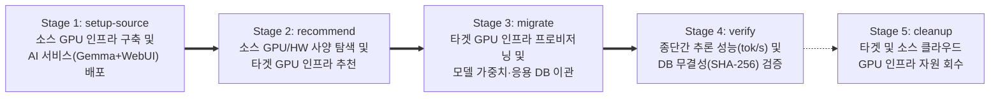

|    단계     | 실행 모드 (`-mode`) | 주요 수행 역할                                                                                        |                                실측 소요 시간                                |
| :---------: | :------------------ | :---------------------------------------------------------------------------------------------------- | :--------------------------------------------------------------------------: |
| **Stage 1** | `setup-source`      | 소스 GPU VM(`mc-daisy`) 프로비저닝 및 `Ollama`(`gemma4:e2b`) + `Open WebUI` 배포·기준 성능 측정       |                                8분 30초 ~ 9분                                |
| **Stage 2** | `recommend`         | 소스 GPU VM 실시간 하드웨어/가속기 사양 수집 및 CM-Beetle 기반 타겟 GPU 인프라 추천                   |                                     3초                                      |
| **Stage 3** | `migrate`           | 타겟 GPU VM(`aimx-gpu-infra-01`) 프로비저닝 및 **CM-Beetle `transx`를 통한 모델 가중치·DB 볼륨 이관** | **5분 30초 ~ 7분**<br/>_(데이터 전송: `direct` **25초** / `relay` 2분 49초)_ |
| **Stage 4** | `verify`            | 소스 대비 타겟의 GPU 오프로딩 여부, 추론 처리량(`tokens/sec`), SQLite DB 해시 일치 여부 검증          |                       **약 6~20초** (Pre-Warmup 적용)                        |
| **Stage 5** | `cleanup`           | 검증 완료 후 타겟 및 소스 GPU 인프라와 하위 네트워크·보안그룹·SSH 키 자원 일괄 회수                   |                                  약 3~10분                                   |

---

## 2. 시간의 흐름에 따른 단계별(Stage 1 ~ Stage 5) 실행 구조 및 시퀀스 다이어그램

각 단계는 상태 파일(`cmd/aimx/testresult/.aimx-state.json`)을 매개로 이전 단계의 산출물을 이어받으며, 전체 통합 실행(`-mode seq`) 또는 단계별 독립 실행을 모두 지원합니다.

---

### 2.1 [Stage 1] `setup-source` — 소스 GPU 환경 구축 및 AI 서비스 시딩

마이그레이션 대상이 될 소스 GPU VM(`mc-daisy`)을 구성하고, 컨테이너 기반 AI 서비스 스택(`Ollama` + `Open WebUI`)을 배포하여 마이그레이션 전 기준 지표(Baseline Metrics)를 확보합니다.

> 📌 **`[AI-MCMP] CB-Tumblebug을 활용한 AWS GPU VM 생성 가이드` 적용 및 정적 템플릿 대체 사유**
>
> - 본 소스 환경은 가이드의 아키텍처(**인프라 ID `mc-daisy`**, **Ubuntu 22.04 Deep Learning OSS Nvidia Driver GPU AMI**, **100GB gp2 Root Disk**)를 기반으로 구성했습니다.
> - 다만 가이드(p.8~10)의 사전 정의 템플릿(`infra-aws-gpu-simple`)은 ① 고정된 `us-west-2` 리전의 `g6.8xlarge`(L4) / `g6e.2xlarge`(L40S) 스펙에 대한 **클라우드 GPU 재고(Stock) 부족(`InsufficientInstanceCapacity`) 및 고사양 vCPU 쿼터 제약**이 발생하고, ② **특정 CSP·리전(`aws/us-west-2`)과 AMI가 정적으로 하드코딩되어 변경이 불가**합니다.
> - 이에 따라 가이드(p.7 `1-a`)에 제시된 **`POST /tumblebug/ns/{nsId}/infraDynamic` 직접 명세 방식**을 채택하여, 가용 재고가 확보된 서울 리전(`aws+ap-northeast-2+g4dn.xlarge`, `1x NVIDIA Tesla T4 16GB`, `ami-00ffffe72a332c865`)을 `test-config.yaml`에서 동적으로 지정해 프로비저닝하도록 구현했습니다.

#### (1) Stage 1 개념 흐름도


#### (2) Stage 1 세부 호출 시퀀스 다이어그램 (`setup-source`)

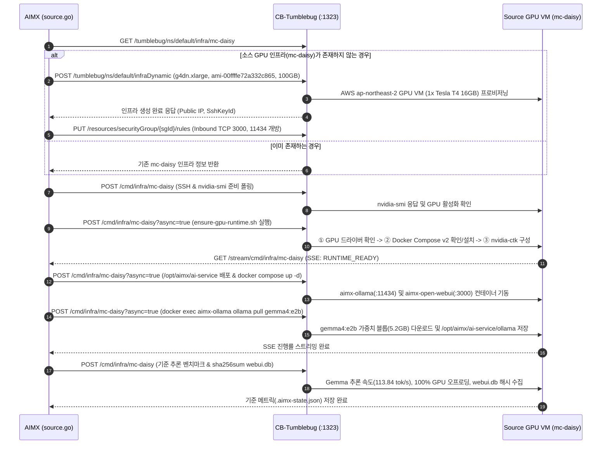

---

### 2.2 [Stage 2] `recommend` — 실시간 소스 GPU 탐색 및 타겟 인프라 추천

가동 중인 소스 GPU VM에서 하드웨어 및 가속기 사양을 실시간으로 추출하여 온프레미스/소스 인프라 모델(`OnpremInfra`)을 구성하고, CM-Beetle 추천 엔진을 통해 타겟 클라우드의 최적 GPU 인프라 명세를 도출합니다.

#### (1) Stage 2 개념 흐름도

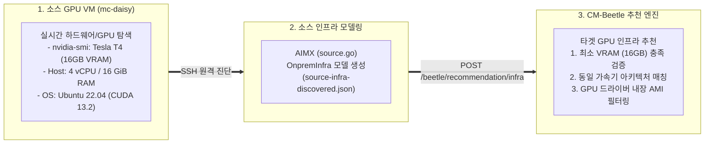

#### (2) Stage 2 세부 호출 시퀀스 다이어그램 (`recommend`)

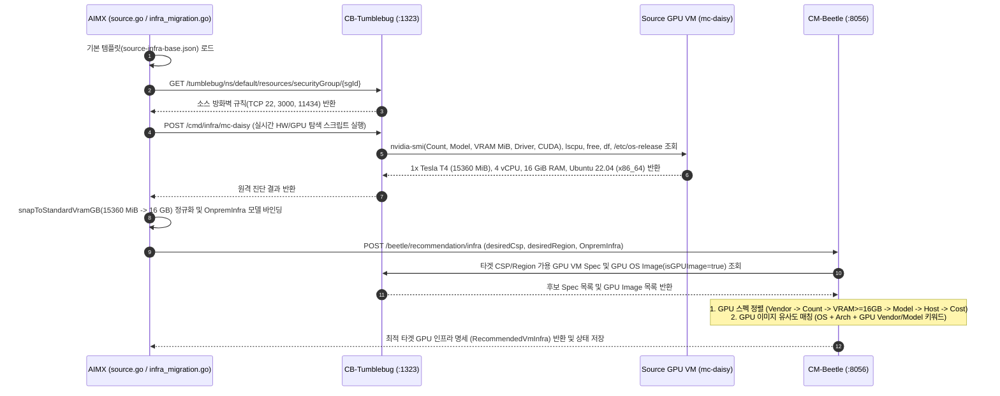

---

### 2.3 [Stage 3] `migrate` — 타겟 GPU 인프라 생성 및 `transx` 데이터 마이그레이션

Stage 2에서 도출된 추천 명세를 기반으로 타겟 GPU 인프라(`aimx-gpu-infra-01`)를 프로비저닝하고, CM-Beetle의 데이터 마이그레이션 엔진(`transx`)을 통해 모델 가중치와 응용 데이터베이스를 타겟 볼륨으로 이관합니다.

#### (1) Stage 3 개념 흐름도

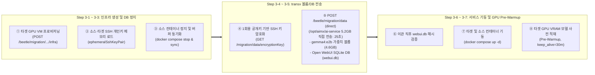

#### (2) Stage 3 세부 호출 시퀀스 다이어그램 (`migrate`)

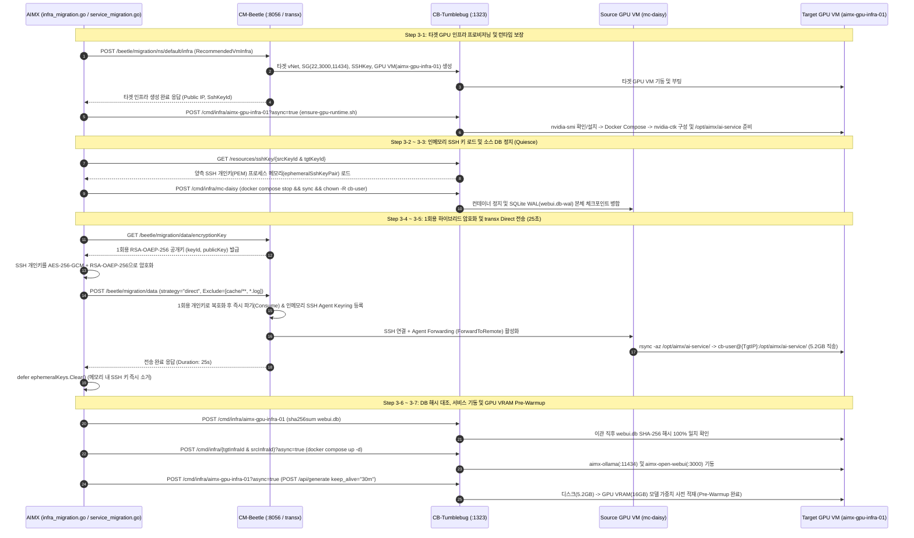

---

### 2.4 [Stage 4] `verify` — 종단간 추론 성능(Benchmark) 및 데이터 무결성 검증

마이그레이션이 완료된 타겟 환경에서 GPU 가속 상태, LLM 추론 처리량(`tokens/sec`), 웹 응용 응답 상태, 그리고 SQLite 데이터베이스의 해시 무결성을 소스 환경과 정량 비교합니다.

#### (1) Stage 4 개념 흐름도

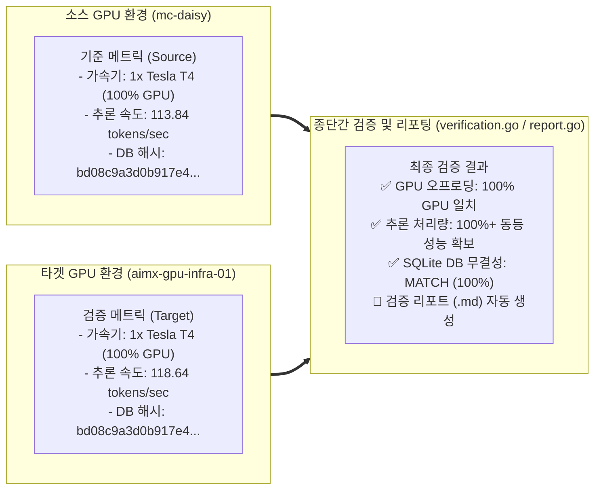

#### (2) Stage 4 세부 호출 시퀀스 다이어그램 (`verify`)

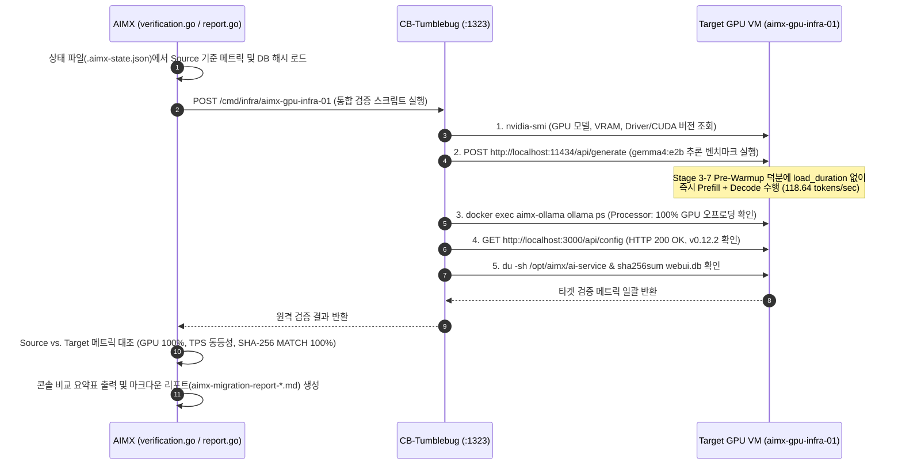

---

### 2.5 [Stage 5] `cleanup` — 클라우드 GPU 인프라 및 종속 자원 회수

검증 및 비교 시연이 완료된 후, 클라우드 자원 종속성 순서(`Infra` $\rightarrow$ `Security Group` $\rightarrow$ `SSH Key` $\rightarrow$ `vNet & Subnet`)에 따라 타겟과 소스의 모든 클라우드 자원을 회수합니다.

#### (1) Stage 5 개념 흐름도

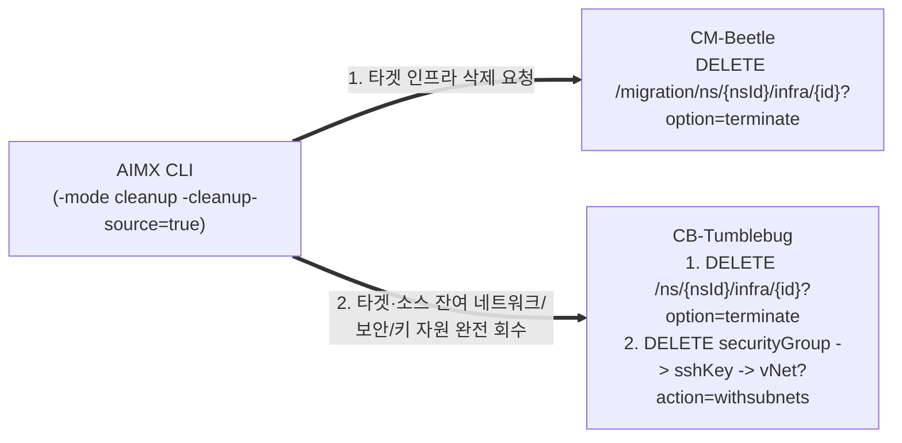

#### (2) Stage 5 세부 호출 시퀀스 다이어그램 (`cleanup`)

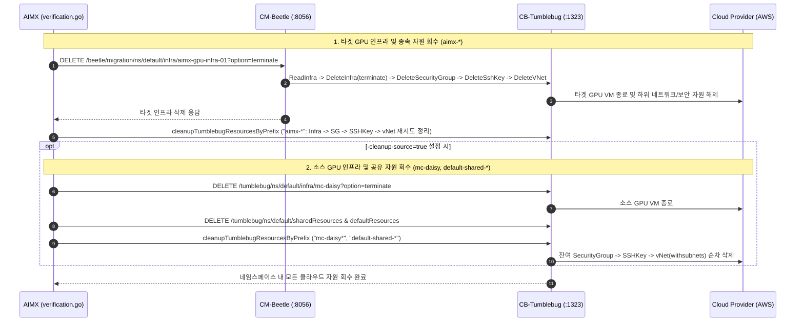

---

### 2.6 End-to-End 통합 마이그레이션 시퀀스 다이어그램 (Stage 1 ~ Stage 5 한눈에 보기)

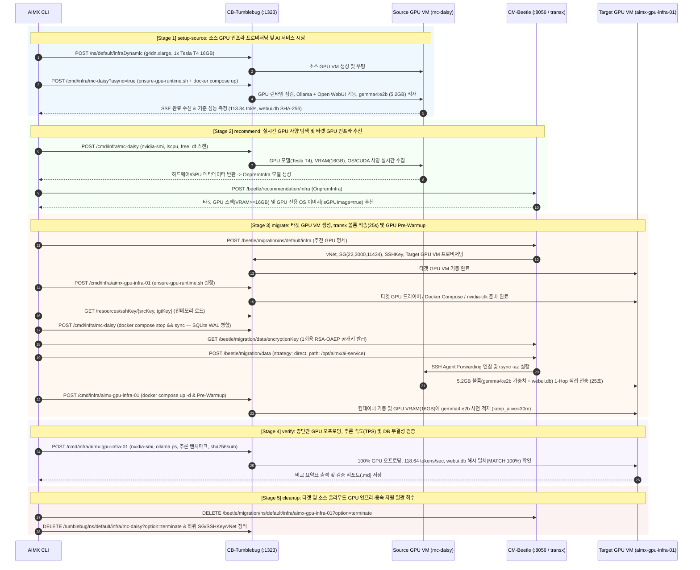

---

## 3. Source ↔ Target 1:1 매칭 및 스토리지·볼륨·DB 이관 명세

### 3.1 Source ↔ Target 4-Layer 1:1 매칭 명세표

| 계층 (Layer)            | 비교 항목                 | 소스 환경 (Source — `mc-daisy`)                                                        | 타겟 환경 (Target — `aimx-gpu-infra-01`)                                               |          매칭 및 검증 결과          |
| :---------------------- | :------------------------ | :------------------------------------------------------------------------------------- | :------------------------------------------------------------------------------------- | :---------------------------------: |
| **Layer 1: 인프라**     | CSP / 리전                | `aws` / `ap-northeast-2`                                                               | `aws` / `ap-northeast-2`                                                               |          ✅ 동일 리전 매칭          |
| **Layer 1: 인프라**     | 인스턴스 스펙             | `g4dn.xlarge` (4 vCPU, 16 GiB RAM)                                                     | `g4dn.xlarge` (4 vCPU, 16 GiB RAM)                                                     |       ✅ 동일 스펙 프로비저닝       |
| **Layer 1: AI 반도체**  | GPU 가속기                | `1x NVIDIA Tesla T4 (16 GB VRAM)`                                                      | `1x NVIDIA Tesla T4 (16 GB VRAM)`                                                      |      ✅ 가속기 모델·VRAM 일치       |
| **Layer 1: 스토리지**   | 블록 스토리지 (Root Disk) | AWS EBS (`100 GB gp2`, `ext4`)                                                         | AWS EBS (`50 GB gp3`, `ext4`)                                                          |   ✅ 루트 파일시스템(`/`) 마운트    |
| **Layer 2: 런타임**     | 머신 이미지 (AMI)         | `ami-00ffffe72a332c865` (Ubuntu 22.04 DL AMI)                                          | `ami-00ffffe72a332c865` (Ubuntu 22.04 DL AMI)                                          |  ✅ GPU 드라이버 내장 이미지 매칭   |
| **Layer 2: 런타임**     | Driver / CUDA / Runtime   | Driver `595.91.07` / `CUDA 13.2` / `nvidia-ctk`                                        | Driver `595.91.07` / `CUDA 13.2` / `nvidia-ctk`                                        |     ✅ 컨테이너 `100% GPU` 할당     |
| **Layer 3: AI 모델**    | 추론 컨테이너 & 모델 태그 | `aimx-ollama` (`:11434`) / `gemma4:e2b`                                                | `aimx-ollama` (`:11434`) / `gemma4:e2b`                                                |    ✅ `113.84` vs `118.64 tok/s`    |
| **Layer 3: AI 모델**    | 모델 가중치 볼륨          | Host `/opt/aimx/ai-service/ollama`<br/>$\rightarrow$ Container `/root/.ollama`         | Host `/opt/aimx/ai-service/ollama`<br/>$\rightarrow$ Container `/root/.ollama`         |  ✅ `transx direct` 이관 (`25초`)   |
| **Layer 4: AI 응용**    | 웹 컨테이너 & 서비스 상태 | `aimx-open-webui` (`:3000`, `v0.12.2`)                                                 | `aimx-open-webui` (`:3000`, `v0.12.2`)                                                 |          ✅ `HTTP 200 OK`           |
| **Layer 4: AI 응용/DB** | 응용 데이터/DB 볼륨       | Host `/opt/aimx/ai-service/open-webui`<br/>$\rightarrow$ Container `/app/backend/data` | Host `/opt/aimx/ai-service/open-webui`<br/>$\rightarrow$ Container `/app/backend/data` | ✅ `webui.db` SHA-256 **100% 일치** |

---

### 3.2 스토리지 · 볼륨 · 데이터베이스(DB) 이관 구조도

소스 VM에서 타겟 VM으로 전송되는 모든 영속 데이터(Stateful Data)는 호스트의 블록 스토리지 (Root Disk: AWS EBS) 내 **`/opt/aimx/ai-service/` (총 `5.2 GB`)** 경로에 위치하며, Docker Bind Mount를 통해 각 컨테이너 내부 볼륨으로 연결됩니다.

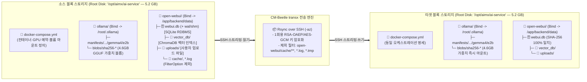

### 3.3 스토리지·볼륨·DB별 세부 전송 항목 명세표

실제 `transx`가 소스 VM의 `/opt/aimx/ai-service/`에서 타겟 VM으로 이관하는 디렉터리 트리 구조와 파일별 역할은 다음과 같습니다.

```text
/opt/aimx/ai-service/ (총 전송 크기: 약 5.2 GB)
├── docker-compose.yml (~1.2 KB)          # 컨테이너 오케스트레이션, GPU 예약(driver: nvidia), 볼륨 마운트, 타임아웃 설정
├── ollama/ (~5.2 GB)                     # Ollama 추론 엔진 영속 볼륨 (Container: /root/.ollama)
│   ├── id_ed25519, id_ed25519.pub        # Ollama 서버 노드 식별용 Ed25519 키쌍 (~464 B)
│   └── models/
│       ├── manifests/
│       │   └── registry.ollama.ai/library/gemma4/e2b (~850 B)
│       │                                 # 모델 레이어 구성 매니페스트 (가중치·프로젝터·템플릿·파라미터 SHA-256 매핑 JSON)
│       └── blobs/                        # Content-Addressable 모델 블롭 저장소 (SHA-256 파일명)
│           ├── sha256-<weights> (~4.6 GB)# gemma4:e2b GGUF 양자화 언어모델 가중치 텐서 (36개 정규 레이어 + 5개 draft-mtp 레이어)
│           ├── sha256-<mmproj> (~580 MB) # 멀티모달(Vision/Audio) 프로젝터 가중치 블롭
│           ├── sha256-<template> (~1.5KB)# Gemma 4 채팅 프롬프트 템플릿 정의
│           ├── sha256-<params> (~200 B)  # 기본 추론 하이퍼파라미터 (temperature, stop 토큰 등)
│           └── sha256-<config> (~550 B)  # 모델 아키텍처 및 레이어 메타데이터 JSON
└── open-webui/ (~1.1 MB+)                # Open WebUI 응용 영속 볼륨 (Container: /app/backend/data)
    ├── .webui_secret_key (~16 B)         # JWT 로그인 세션 토큰 서명용 대칭키 (이관 후 기존 세션 호환성 유지)
    ├── config.json (~120 B)              # Open WebUI 런타임 설정 스냅샷 (Ollama 백엔드 연동 구성 등)
    ├── webui.db (~741 KB+)               # SQLite 3 메인 관계형 DB (사용자 계정, 채팅방, 대화 이력, 프롬프트, 설정 전체)
    ├── webui.db-wal, webui.db-shm        # SQLite WAL 트랜잭션 로그 및 공유 메모리 (Quiesce 정지 시 webui.db로 병합)
    ├── vector_db/                        # ChromaDB 로컬 벡터 데이터베이스 (chroma.sqlite3 및 HNSW 임베딩 인덱스)
    ├── uploads/                          # 사용자가 채팅창에 첨부·업로드한 원본 문서(PDF, TXT, 이미지 등)
    └── [제외] cache/**, *.log, *.tmp     # transx FilterOption에 의해 전송 대상에서 제외되는 임시 캐시 및 로그
```

| 구분                          | 소스 호스트 볼륨 경로 (Host Path)                                                 | 컨테이너 내부 마운트 경로                                  | 저장소 / DB 포맷                           | 포함되는 세부 데이터 내용                                                                                                                                                                                                                                                            | 이관 정책 (`transx`)                                                           |
| :---------------------------- | :-------------------------------------------------------------------------------- | :--------------------------------------------------------- | :----------------------------------------- | :----------------------------------------------------------------------------------------------------------------------------------------------------------------------------------------------------------------------------------------------------------------------------------- | :----------------------------------------------------------------------------- |
| **오케스트레이션 설정**       | `/opt/aimx/ai-service/docker-compose.yml`                                         | _(호스트 직접 참조)_                                       | YAML 설정 파일                             | • `aimx-ollama`, `aimx-open-webui` 서비스 및 포트(`11434`, `3000`) 정의<br/>• NVIDIA GPU 디바이스 예약(`driver: nvidia`, `count: all`)<br/>• `OLLAMA_LOAD_TIMEOUT=15m`, `OLLAMA_KEEP_ALIVE=30m`                                                                                      | ✅ **전송 포함**                                                               |
| **LLM 노드 키 & 매니페스트**  | `/opt/aimx/ai-service/ollama/id_ed25519*`<br/>`.../ollama/models/manifests/...`   | `/root/.ollama/id_ed25519*`<br/>`.../models/manifests/...` | Ed25519 키 / JSON 메타데이터               | • Ollama 인스턴스 고유 식별 키쌍<br/>• `registry.ollama.ai/library/gemma4/e2b` 모델 버전 태그 및 레이어별 SHA-256 다이제스트 매핑 JSON                                                                                                                                               | ✅ **전송 포함**                                                               |
| **LLM 모델 가중치 (Weights)** | `/opt/aimx/ai-service/ollama/models/blobs/sha256-*`                               | `/root/.ollama/models/blobs/sha256-*`                      | Content-Addressable GGUF Blobs (`~5.2 GB`) | • `gemma4:e2b` (4.65B 파라미터) 언어모델 가중치 텐서 블롭(`~4.6 GB`)<br/>• 멀티모달(Vision/Audio) 프로젝터 블롭(`~580 MB`), 프롬프트 템플릿, 하이퍼파라미터 JSON                                                                                                                     | ✅ **전송 포함**<br/>(`transferModelWeights: true`)                            |
| **웹 응용 관계형 DB & 키**    | `/opt/aimx/ai-service/open-webui/webui.db`<br/>`.webui_secret_key`, `config.json` | `/app/backend/data/webui.db`                               | **SQLite 3 RDBMS** (`~741 KB`+)            | • **`user` / `auth`**: 사용자 계정, 프로필, 암호화 해시 자격증명<br/>• **`chat` / `folder` / `tag`**: 채팅 세션 및 프롬프트·응답 대화 이력 전체<br/>• **`prompt` / `memory` / `knowledge` / `model` / `config`**: 커스텀 프롬프트, 사용자 메모리, 지식베이스 메타데이터, 시스템 설정 | ✅ **Quiesce(`stop & sync`) 후 무결성 전송**<br/>(`SHA-256 100% 일치`)         |
| **RAG 벡터 스토어**           | `/opt/aimx/ai-service/open-webui/vector_db/`                                      | `/app/backend/data/vector_db/`                             | ChromaDB (`chroma.sqlite3` + HNSW)         | • 문서 기반 질의응답(RAG)을 위해 청킹·임베딩된 벡터 인덱스 및 컬렉션 데이터                                                                                                                                                                                                          | ✅ **전송 포함**                                                               |
| **업로드 파일 볼륨**          | `/opt/aimx/ai-service/open-webui/uploads/`                                        | `/app/backend/data/uploads/`                               | 파일 스토리지                              | • 사용자가 대화 세션이나 지식베이스(Knowledge)에 업로드한 원본 문서(PDF, TXT) 및 이미지 파일                                                                                                                                                                                         | ✅ **전송 포함**                                                               |
| **런타임 임시 캐시/로그**     | `/opt/aimx/ai-service/open-webui/cache/**`<br/>`*.log`, `*.tmp`, `__pycache__/**` | `/app/backend/data/cache/**`                               | 임시 파일 (Ephemeral)                      | • 오디오/이미지 변환 임시 캐시, 파이썬 바이트코드, 컨테이너 런타임 로그                                                                                                                                                                                                              | ⏭️ **`FilterOption`으로 제외**<br/>(전송 대역폭 최적화)                        |
| **컨테이너 실행 이미지**      | `/var/lib/docker/overlay2/...`                                                    | _(Docker 데몬 영역)_                                       | OCI Image Layers                           | • `ollama/ollama:latest`, `ghcr.io/open-webui/open-webui:main` 실행 바이너리 레이어                                                                                                                                                                                                  | 🔄 **타겟에서 `docker compose up -d` 시 레지스트리 Pull** (데이터 볼륨과 분리) |

> **아키텍처 설계 원칙 — 실행 이미지(Immutable)와 상태 볼륨(Stateful)의 분리**
> 불변(Immutable) 실행 환경인 컨테이너 이미지 레이어(`/var/lib/docker`)는 타겟 VM의 Docker 데몬이 공식 레지스트리에서 직접 Pull하도록 위임하고, **실제 서비스 상태(Stateful Data)를 담고 있는 호스트 바인드 마운트 볼륨(`/opt/aimx/ai-service` 내 `5.2GB` 모델 가중치 블롭 및 `webui.db` SQLite DB)**만 `transx`로 정밀 전송합니다. 이를 통해 OS 커널이나 Docker 스토리지 드라이버 차이로 인한 호환성 문제 없이 신속하고 일관된 서비스 복원을 달성합니다.
>
> - 🔗 각 파일(`manifests`, `blobs/sha256-*`, `webui.db`, `vector_db`)의 세부 구조 및 `4.65B` 모델이 `5.2GB`를 점유하는 원리는 [**AI 스택 해설서 Part 1 (`ai-service-stack-reference.md#part-1`)**](./ai-service-stack-reference.md#part-1-설치형-ai-서비스-스택-해부-및-전송-데이터-구조-optaimxai-service)을 참조하십시오.

---

## 4. 핵심 컴포넌트 아키텍처 및 심층 기술 설계

### 4.1 전체 시스템 연동 아키텍처

```mermaid
flowchart LR
    subgraph AIMX["AIMX CLI (cmd/aimx)"]
        direction TB
        M["main.go / config.go\n(파이프라인 라우터 및 상태 관리)"]
        S["source.go / infra_migration.go\n(GPU 스펙 탐색 및 추천·생성 제어)"]
        SV["service_migration.go / wait.go\n(비동기 SSE 스트리밍 및 transx 호출)"]
        V["verification.go / report.go\n(추론 벤치마크 및 리포트 생성)"]
    end

    subgraph Beetle["CM-Beetle (:8056)"]
        direction TB
        Rec["GPU Recommender\n(resource-node-spec-gpu.go\nresource-node-image.go)"]
        Mig["Infra Migrator\n(POST /migration/ns/{nsId}/infra)"]
        Tx["transx Data Engine\n(executor-rsync.go / crypto.go)"]
    end

    subgraph Tumblebug["CB-Tumblebug (:1323)"]
        direction TB
        Dyn["Dynamic Infra API\n(POST /infraDynamic)"]
        Cmd["Async SSH & SSE Stream\n(POST /cmd/infra/{id}?async=true\nGET /stream/cmd/infra/{id})"]
        Key["SSH Key Store\n(GET /resources/sshKey/{id})"]
    end

    AIMX ==>|"추천 / 인프라 마이그레이션 / 데이터 전송"| Beetle
    AIMX ==>|"소스 프로비저닝 / 원격 명령 / 키 조회"| Tumblebug
    Beetle ==>|"타겟 클라우드 자원 오케스트레이션"| Tumblebug
```

---

### 4.2 CM-Beetle 다중 CSP GPU 추천 알고리즘 (`pkg/core/recommendation/`) 및 런타임 호환성 보장

AI 워크로드 이관 시 발생할 수 있는 **GPU VRAM 부족(Out-Of-Memory)** 및 **CSP별 GPU 드라이버·컨테이너 런타임 호환성** 문제를 방지하기 위해 다음 알고리즘이 적용되어 있습니다.

1. **키워드·구분자 유사도 기반 다중 CSP GPU 머신 이미지 추천 (`resource-node-image.go`, `similarity.go`)**:
   - CB-Tumblebug의 이미지 메타데이터에서 일반 OS 이미지(`isBasicImage=true`)와 GPU 드라이버 내장 이미지(`isGPUImage=true`)는 상호 배타적으로 분류됩니다. 소스 노드에 GPU(`len(node.GPUCards) > 0`)가 감지되면 자동으로 `IncludeBasicImageOnly = false`, `IsGPUImage = true` 조건으로 전환합니다.
   - **키워드 매칭 및 간결성 동점 정렬 (`SetKeywordsAndDelimeters` & `FindAndSortVmOsImageInfoListBySimilarity`)**: 소스 노드의 OS·아키텍처 키워드에 GPU 벤더 및 모델명(`Vendor`, `Model`)을 함께 결합하고, CSP별 이미지 식별자 구분자(`:`, `_`, `-`, `/`)로 토큰화하여 어휘 유사도(`CalcResourceSimilarity`)를 산출합니다. 유사도와 우선순위가 동일한 후보 간에는 불필요한 특수 접미사(`-rocm`, `-v100` 등)가 붙지 않은 간결한 표준 베이스 이미지를 우선 선택합니다.
   - **CSP별 타겟 GPU 스펙 및 이미지 추천 검증 결과** (소스: `1x Tesla T4 16GB`, `Ubuntu 22.04` 기준):

| 타겟 CSP (`Region`)            | 추천 GPU 인스턴스 스펙                         | 추천 GPU OS 이미지 (`isGPUImage=true`)                                                 |
| :----------------------------- | :--------------------------------------------- | :------------------------------------------------------------------------------------- |
| **AWS** (`ap-northeast-2`)     | `g4dn.xlarge` (`1x Tesla T4 16GB`)             | `ami-00ffffe72a332c865` _(Deep Learning OSS Nvidia Driver AMI Ubuntu 22.04)_           |
| **Azure** (`koreacentral`)     | `standard_nc4as_t4_v3` (`1x Tesla T4 16GB`)    | `microsoft-dsvm:ubuntu-2204:2204-gen2:25.06.18` _(Microsoft DSVM Ubuntu 22.04 Gen2)_   |
| **GCP** (`asia-northeast3`)    | `g2-standard-4` (`1x NVIDIA L4 24GB`)          | `ubuntu-accelerator-2204-amd64-with-nvidia-595-v20260817` _(Ubuntu Accelerator Image)_ |
| **Alibaba** (`ap-northeast-2`) | `ecs.gn7i-c8g1.2xlarge` (`1x NVIDIA A10 24GB`) | `ubuntu_22_04_x64_100G_with_gpu_driver_and_cuda_alibase_20260520.vhd`                  |
| **NCP** (`KR`)                 | `gp1t4-g1-h50` (`1x Tesla T4 16GB`)            | `23789321` _(`ubuntu-22.04-gpu (Hypervisor:KVM)`)_                                     |
| **NHN** (`KR1`)                | `g2.t4.c4m32` (`1x Tesla T4 16GB`)             | `adaf3388-5ed7-4320-b793-2dce6555e4cc` _(`Ubuntu Server 22.04.5 LTS with NVIDIA`)_     |

2. **VRAM 정규화 및 6단계 우선순위 정렬 (`resource-node-spec-gpu.go`)**:
   - **VRAM 티어 정규화 (`snapToStandardVramGB` & `vramTierToleranceGB = 0.5`)**: `nvidia-smi`가 보고하는 가용 메모리(예: `15360 MiB = 15.0 GiB` 또는 L4의 `22.49 GiB`)를 표준 하드웨어 VRAM 티어(`16 GB`, `24 GB` 등)로 정규화하여 상위 티어로 과대 산정되는 현상을 방지합니다.
   - **다단계 후보 정렬 기준**:
     1. **GPU 제조사 일치** (`NVIDIA` == `NVIDIA`)
     2. **GPU 가속기 개수 충족** (`Target GPU Count >= Source GPU Count`)
     3. **총 VRAM 하한선 보장 및 근접도** (`Target VRAM >= Source VRAM` 최우선 배치, 미달 스펙에는 OOM 페널티 부여)
     4. **동일 GPU 아키텍처/모델명 매칭** (`Tesla T4` $\rightarrow$ `T4` 우선 배치, 부재 시 동급 이상 VRAM 가속기 `L4`/`A10` 등으로 대체)
     5. **호스트 vCPU / Memory L1 거리 최소화** (`|vCPU_tgt - vCPU_src| + |Mem_tgt - Mem_src|`)
     6. **시간당 비용(`CostPerHour`) 최소화**
3. **CB-Tumblebug 기반 타겟 GPU 드라이버 및 컨테이너 런타임 자동 초기화 (`cmd/aimx/scripts/ensure-gpu-runtime.sh`)**:
   - CB-Tumblebug의 `scripts/usecases/llm/installGpuDriver.sh`를 기반으로, **멱등성(Idempotent) 기반의 Check-then-Install 스크립트([`ensure-gpu-runtime.sh`](file:///y:/home/ubuntu/dev/cloud-barista/cm-beetle/cmd/aimx/scripts/ensure-gpu-runtime.sh))**를 구성하여 `//go:embed`로 내장했습니다.
   - Stage 1 및 Stage 3-4에서 원격 VM의 ① **GPU 드라이버 점검**(`nvidia-smi` 정상 동작 시 유지, 미설치 시 DKMS·커널 헤더·GCC 버전 정합성 확보 및 CUDA Keyring / vGPU 감지 후 `cuda-drivers-580` 설치), ② **Docker Engine 및 Docker Compose v2 점검·설치**, ③ **NVIDIA Container Toolkit (`nvidia-ctk`) 점검·설치 및 `/etc/docker/daemon.json` 런타임 구성**을 순차 수행합니다.

---

### 4.3 CB-Tumblebug 비동기 원격 명령(`async=true`) 및 SSE 실시간 스트리밍 (`wait.go`)

대용량 컨테이너 이미지 Pull 및 4.6GB LLM 모델 가중치 다운로드(`ollama pull gemma4:e2b`)와 같이 장시간 소요되는 원격 작업의 안정적인 실행과 진행 상태 가시성을 위해 **비동기 명령 실행 + SSE(Server-Sent Events) 스트리밍** 구조를 채택했습니다.

1. **비동기 태스크 실행**: `POST /tumblebug/ns/{nsId}/cmd/infra/{infraId}?nodeId={nodeId}&async=true` 호출을 통해 원격 SSH 명령을 백그라운드 태스크로 기동하고 `taskId`를 획득합니다.
2. **SSE 이벤트 스트림 수신**: `GET /tumblebug/ns/{nsId}/stream/cmd/infra/{infraId}?taskId={taskId}` 엔드포인트에 연결하여 실시간 `stdout`/`stderr` 로그와 `CommandStatus` 상태 전이(`Handling` $\rightarrow$ `Completed` / `Failed` / `Timeout`)를 수신합니다.
3. **ANSI 제어 시퀀스 정제 및 인플레이스(In-Place) 진행률 렌더링 (`sanitizeStreamLine`)**:
   - Docker Compose 및 Ollama CLI가 터미널 제어를 위해 출력하는 ANSI 이스케이프 시퀀스(`\x1b[?25l`, `\x1b[1A` 등)를 정규식으로 제거합니다.
   - 연속적인 다운로드 진행률 이벤트(`Downloading`, `Pulling`, `Extracting`, `%`)는 캐리지 리턴(`\r`)을 통해 단일 라인에서 갱신하고, 계층별 완료 이벤트(`Pull complete`, `Pulled`, `Started`) 발생 시에만 개행하여 콘솔 출력의 가독성을 확보합니다.

---

### 4.4 CM-Beetle `transx` 보안 키 교환, 전송 전략(`relay` vs `direct`) 및 SQLite 무결성 보장

1. **인메모리(In-Memory) SSH 키 관리 및 1회용 하이브리드 암호화 (`service_migration.go`, `transx/crypto.go`)**:
   - CB-Tumblebug에서 조회한 소스·타겟 VM의 SSH 개인키(PEM)는 로컬 파일시스템에 기록하지 않고 프로세스 메모리(`ephemeralSshKeyPair`)에만 유지한 후 Stage 3 종료 즉시 소거(`defer ephemeralKeys.Clear()`)합니다.
   - `GET /beetle/migration/data/encryptionKey`를 통해 1회용 `RSA-OAEP-256` 공개키(`keyId`)를 발급받고, SSH 개인키 원문을 **`AES-256-GCM`(데이터 암호화) + `RSA-OAEP-256`(대칭키 암호화)** 하이브리드 방식으로 암호화하여 전송합니다. CM-Beetle은 복호화 즉시 인메모리 KeyStore에서 해당 개인키를 파기(Consume)하여 재사용 공격(Replay Attack)을 차단합니다.
2. **멀티 전송 전략 지원 (`transx/executor-rsync.go`)**:
   - **`relay` 전략 (기본값)**: 소스 VM과 타겟 VM이 서로 다른 네트워크/보안그룹에 위치하고 개별 SSH 키를 사용할 때, CM-Beetle이 스테이징 버퍼를 통해 `Source -> CM-Beetle -> Target` 구간을 `rsync -az`로 중계합니다.
   - **`direct` 전략 (SSH 에이전트 포워딩)**: CM-Beetle의 인메모리 SSH 에이전트 키링(`agent.NewKeyring()`)에 **소스 SSH 개인키와 타겟 SSH 개인키를 모두 등록**하고 에이전트 포워딩(`ForwardToRemote`) 채널을 구성하여, 중간 디스크 저장 없이 소스 VM에서 타겟 VM으로 직접 `rsync` 스트리밍을 수행합니다.
3. **SQLite WAL(`Write-Ahead Logging`) 체크포인트 일관성 제어**:
   - Open WebUI의 `webui.db`는 SQLite WAL 모드로 운영되므로, 컨테이너 기동 중에는 최신 트랜잭션이 `webui.db-wal` 파일에 분리되어 존재합니다.
   - `AIMX`는 Stage 3-3에서 컨테이너를 정상 종료(`docker compose stop && sync`)하여 트랜잭션을 완결한 뒤 이관하며, Stage 3-6 및 Stage 4에서 소스와 타겟의 `webui.db` SHA-256 다이제스트를 동일한 체크포인트 시점 기준으로 대조하여 **데이터 무결성(`MATCH 100%`)**을 검증합니다.

---

### 4.5 GPU 모델 사전 적재(Pre-Warmup / Cold Start 제거)와 LLM 추론 단계(Prefill / Decode)의 구분

AI 서비스 마이그레이션 직후 첫 추론 응답 지연(Latency)을 제어하기 위해, 시스템 레벨의 **Model Pre-Warmup(가중치 VRAM 적재)**과 LLM 추론 파이프라인 내부의 **Prefill / Decode 단계**를 구분하여 설계했습니다.

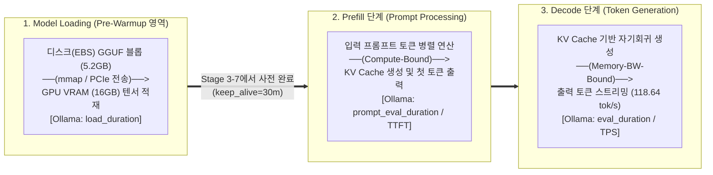

| 구분 단계                                     | 대응 개념 및 Ollama 메트릭                                               | 물리적 동작 내용                                                                                                                                             | 병목 자원 및 소요 시간 특성                                                                                                | `AIMX`에서의 처리 방식                                                                                                                      |
| :-------------------------------------------- | :----------------------------------------------------------------------- | :----------------------------------------------------------------------------------------------------------------------------------------------------------- | :------------------------------------------------------------------------------------------------------------------------- | :------------------------------------------------------------------------------------------------------------------------------------------ |
| **① Model Loading**<br/>(**Pre-Warmup** 대상) | • **Cold Start $\rightarrow$ Warm State**<br/>• 메트릭: `load_duration`  | 블록 스토리지(EBS 디스크)로 이관된 `5.2GB` 모델 가중치 파일을 읽어 PCIe 버스를 통해 **GPU VRAM(`16GB`)에 36개 레이어 텐서와 CUDA 연산 그래프를 적재·초기화** | • **Disk I/O & PCIe 대역폭 병목**<br/>• 마이그레이션 직후 Cold Start 시 **수십 초 ~ 수 분** 소요 (적재 완료 후에는 `~0ms`) | **Stage 3-7 (`Pre-Warmup`)** 에서 타겟 컨테이너 기동 직후 더미 추론(`keep_alive: "30m"`)을 1회 수행하여 **모델을 미리 GPU VRAM에 상주**시킴 |
| **② Prefill**<br/>(프롬프트 처리)             | • **Time-To-First-Token (TTFT)**<br/>• 메트릭: `prompt_eval_duration`    | 이미 GPU VRAM에 올라와 있는 모델 가중치를 사용해 **사용자 입력 프롬프트 토큰 전체를 병렬 행렬 곱으로 처리**하고 **KV Cache**를 생성                          | • **GPU 연산기(Tensor Core) Compute-Bound**<br/>• 일반 질의 시 **수십~수백 ms** 소요                                       | 모델이 Warm 상태이므로 사용자가 Open WebUI에서 질문 입력 시 즉시 Prefill 연산 시작                                                          |
| **③ Decode**<br/>(토큰 생성)                  | • **Tokens Per Second (TPS)**<br/>• 메트릭: `eval_count / eval_duration` | 생성된 KV Cache를 참조하여 **출력 토큰을 1개씩 순차적(Autoregressive)으로 생성**                                                                             | • **GPU VRAM 메모리 대역폭(Memory-BW) 병목**<br/>• Tesla T4 기준 **`113.84 ~ 118.64 tokens/sec`**                          | **Stage 4 (`verify`)** 에서 `eval_count / eval_duration`을 측정하여 소스·타겟 간 GPU 추론 처리량 동등성 검증                                |

- **핵심 차이점 요약**:
  - 추론 분야의 **Prefill**은 *"모델이 이미 GPU VRAM에 적재된 상태에서, 매 질문이 들어올 때마다 입력 프롬프트 토큰을 읽고 KV Cache를 채우는 첫 연산 단계"*입니다.
  - 반면 `AIMX` Stage 3-7의 **Pre-Warmup**은 그보다 앞선 시스템 단계인 ***"마이그레이션된 디스크의 모델 가중치 파일(`5.2GB`)을 GPU VRAM(`16GB`)으로 최초 로드(`load_duration`)하고 CUDA 컨텍스트를 초기화하여 Cold Start를 제거하는 작업"***입니다.
  - 🔗 GPU VRAM `16GB` 내부 메모리 레이아웃(가중치 vs. KV Cache vs. CUDA 버퍼) 및 `100% GPU (36/36 layers)` 오프로딩 원리에 대한 상세 해설은 [**AI 스택 해설서 Part 2 (`ai-service-stack-reference.md#part-2`)**](./ai-service-stack-reference.md#part-2-gpu-메모리vram-구조와-llm-추론-파이프라인-pre-warmup-vs-prefill-vs-decode)를 참조하십시오.
