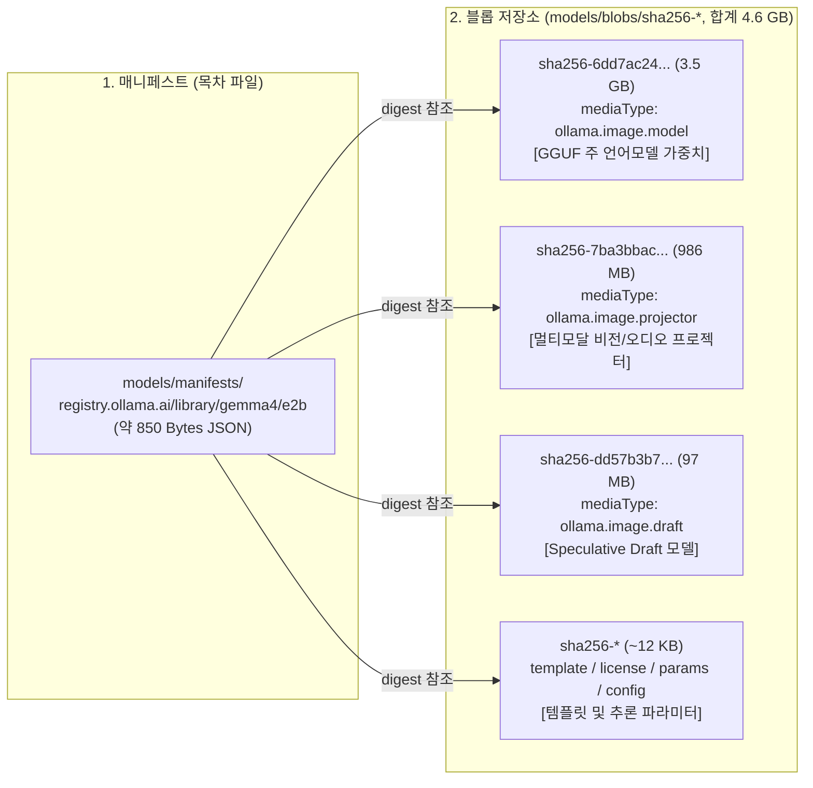
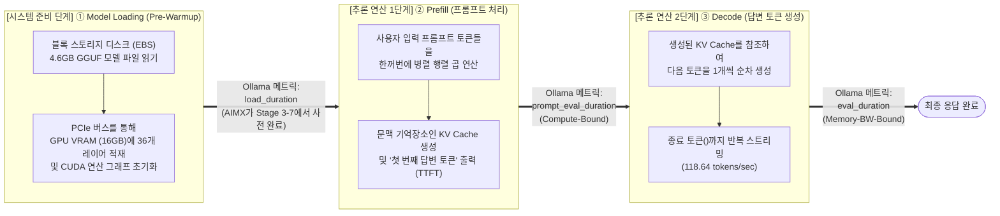

# 설치형 AI 서비스 스택 데이터 구조 및 LLM 추론 메커니즘 해설서 (AIMX 기술 레퍼런스)

> 🔗 **연계 문서**: 본 문서는 [**AI 반도체 기반 AI 서비스 마이그레이션 시나리오 정의 및 구조 설계서 (`ai-service-migration-design.md`)**](./ai-service-migration-design.md)의 기술 배경지식 해설서(Companion Reference)입니다.
> 마이그레이션 파이프라인 및 아키텍처는 본 설계서를 참조하고, **실제 전송되는 AI 서비스 데이터의 내부 구조(Part 1)**와 **GPU 메모리 적재 및 LLM 추론 동작 원리(Part 2)**는 본 문서를 참조하십시오.

---

## Part 1. 설치형 AI 서비스 스택 해부 및 전송 데이터 구조 (`/opt/aimx/ai-service`)

일반적인 웹 애플리케이션이 소스 코드와 RDBMS 데이터만 이관하면 되는 것과 달리, 설치형 AI 서비스(`Ollama` + `Google Gemma 4` + `Open WebUI`)는 **수 기가바이트(GB) 규모의 불변 모델 가중치 텐서(Weights)**와 **실시간으로 변하는 사용자 대화 및 벡터 데이터베이스(Stateful DB)**를 동시에 보유합니다.

### 1.1 실제 이관되는 디렉터리 트리 및 파일별 상세 명세

`AIMX`가 `transx`를 통해 소스 GPU VM에서 타겟 GPU VM으로 전송하는 `/opt/aimx/ai-service` 볼륨(`du -sh` 실측 총 **`5.2 GB`**)의 전체 구조는 다음과 같습니다.

```text
/opt/aimx/ai-service/ (du -sh 실측 총 크기: 약 5.2 GB)
│
├── docker-compose.yml (~1.2 KB)
│   └── 컨테이너 오케스트레이션 정의 (포트 매핑, NVIDIA GPU 할당, 볼륨 바인드 마운트, Ollama 환경변수)
│
├── ollama/ (~4.6 GB) ──> [컨테이너 내부 /root/.ollama 에 마운트]
│   ├── id_ed25519 (~400 B)               # Ollama 서버 인스턴스 고유 식별용 Ed25519 개인키
│   ├── id_ed25519.pub (~64 B)            # Ollama 서버 인스턴스 공개키
│   └── models/
│       ├── manifests/
│       │   └── registry.ollama.ai/library/gemma4/e2b (~850 B)
│       │       └── 모델 구성 매니페스트 JSON (어느 SHA-256 블롭 파일이 가중치, 프로젝터, Draft, 템플릿인지 연결하는 목차)
│       └── blobs/                        # Content-Addressable Storage (합계 약 4.6 GB)
│           ├── sha256-6dd7ac24... (3.5 GB)# ① 주 언어모델(LLM) GGUF 양자화 가중치 텐서 (ollama.image.model)
│           ├── sha256-7ba3bbac... (986 MB)# ② 멀티모달(Vision/Audio) 프로젝터 가중치 텐서 (ollama.image.projector)
│           ├── sha256-dd57b3b7... (97 MB) # ③ 고속 추론용 Speculative Draft 모델 블롭 (ollama.image.draft)
│           ├── sha256-b507b9c2... (13 B)  # ④ Gemma 4 프롬프트 템플릿
│           ├── sha256-7339fa41... (11 KB) # ⑤ 모델 라이선스 텍스트
│           ├── sha256-2365fbb6... (64 B)  # ⑥ 추론 하이퍼파라미터 기본값
│           └── sha256-3ff8a734... (241 B) # ⑦ 모델 아키텍처 메타데이터 JSON
│
└── open-webui/ (~0.6 GB / DB 본체 ~1 MB) ──> [컨테이너 내부 /app/backend/data 에 마운트]
    ├── .webui_secret_key (~16 B)         # JWT 로그인 세션 토큰 서명용 대칭키 (이관 후에도 기존 로그인 유지)
    ├── config.json (~120 B)              # Open WebUI 런타임 설정 스냅샷 (연결된 Ollama URL 등)
    ├── webui.db (~741 KB+)               # SQLite 3 메인 관계형 DB (사용자 계정, 채팅방, 대화 이력 전체)
    ├── webui.db-wal / webui.db-shm       # SQLite Write-Ahead Log 및 공유 메모리 (컨테이너 정지 시 webui.db로 병합)
    ├── vector_db/                        # ChromaDB 로컬 벡터 스토어 (문서 RAG 검색용 HNSW 임베딩 인덱스)
    │   └── chroma.sqlite3                # 벡터 메타데이터 및 컬렉션 인덱스
    ├── uploads/                          # 사용자가 채팅창이나 지식베이스(Knowledge)에 업로드한 원본 파일(PDF, 이미지 등)
    └── [전송 제외] cache/**, *.log, *.tmp # transx FilterOption에 의해 전송에서 자동 제외되는 임시 캐시 및 로그
```

---

### 1.2 Ollama 모델 스토리지 구조 해부 (`manifests` vs. `blobs`)

Ollama는 Docker 컨테이너 이미지 저장 방식(OCI Image Spec)과 매우 유사한 **Content-Addressable Storage (CAS, 내용 기반 주소 지정 저장소)** 구조를 사용합니다.



1. **왜 `manifests`와 `blobs` 두 디렉터리가 모두 이관되어야 하는가?**
   - `blobs/sha256-*` 파일들은 실제 4.6GB의 모델 데이터이지만 파일 이름이 해시값(`sha256-...`)으로만 되어 있어, 이 파일들만 있으면 Ollama는 이것이 `gemma4:e2b` 모델인지 알 수 없습니다.
   - 반대로 `manifests/.../gemma4/e2b` 파일은 *"gemma4:e2b 모델의 주 가중치는 `sha256-6dd7ac24...` 파일이고, 프로젝터는 `sha256-7ba3bbac...` 파일이다"*라고 알려주는 **목차(Index)** 역할을 합니다.
   - 따라서 `AIMX`가 `/opt/aimx/ai-service/ollama` 디렉터리 전체를 그대로 보존하여 이관하면, 타겟 VM의 Ollama 컨테이너는 기동 즉시 인터넷 다운로드(`ollama pull`) 없이 로컬 디스크에서 `gemma4:e2b` 모델을 100% 인식합니다.

---

### 1.3 `gemma4:e2b` 모델 크기(`4.6 GB`)와 전체 볼륨 크기(`5.2 GB`)의 정확한 관계

실행 로그와 리포트에서 등장하는 `3.5 GB`, `4.6 GB`, `5.2 GB`(`5.2G`), `5.3 GB` 수치의 관계는 다음과 같습니다.

| 구성 요소                                                | 세부 설명 (Ollama 공식 매니페스트 및 실측 기준)                                                                                                  |                 크기                 |
| :------------------------------------------------------- | :----------------------------------------------------------------------------------------------------------------------------------------------- | :----------------------------------: |
| **① 주 언어모델 가중치 (`ollama.image.model`)**          | • Google Gemma 4 (`e2b`)의 주 언어모델 GGUF 양자화 가중치 텐서 (`sha256-6dd7ac24...`)<br/>• `ollama pull` 실행 시 첫 번째로 다운로드되는 주 파일 | **`3.5 GB`**<br/>(`3,502,493,472 B`) |
| **② 멀티모달 프로젝터 (`ollama.image.projector`)**       | • 이미지 및 오디오 입력을 언어모델 임베딩 공간으로 변환하는 프로젝터 가중치 블롭 (`sha256-7ba3bbac...`)                                          |  **`986 MB`**<br/>(`986,833,664 B`)  |
| **③ Draft 모델 및 메타데이터 (`ollama.image.draft` 외)** | • 고속 토큰 생성을 위한 Speculative Draft 모델 블롭(`97 MB`, `sha256-dd57b3b7...`) 및 템플릿, 라이선스, 파라미터(`~12 KB`)                       |   **`97 MB`**<br/>(`97,829,369 B`)   |
| **소계: `gemma4:e2b` 모델 총 크기 (`ollama/` 폴더)**     | • **①(`3.5 GB`) + ②(`986 MB`) + ③(`97 MB`) 합계**<br/>• `ollama list`에서 표시되는 `gemma4:e2b` 모델의 공식 용량                                 | **`4.6 GB`**<br/>(`4,587,156,505 B`) |
| **④ `open-webui/` 데이터 및 초기 임베딩 볼륨**           | • Open WebUI 컨테이너 기동 시 생성되는 SQLite DB(`webui.db`), ChromaDB(`vector_db/`), 기본 RAG 임베딩 데이터 등                                  |            **`~0.6 GB`**             |
| **합계: `/opt/aimx/ai-service` 전체 볼륨 (`du -sh`)**    | • Stage 1 및 Stage 4 리포트의 `Service Directory Size` 실측값 (`ollama/` + `open-webui/`)                                                        |        **`5.2 GB` (`5.2G`)**         |
| **(참고) GPU VRAM 적재 시 점유량 (`ollama ps`)**         | • 모델 가중치(`4.6 GB`)가 GPU VRAM에 올라간 뒤 KV Cache 및 CUDA 연산 버퍼(`~0.7 GB`)가 더해진 VRAM 사용량                                        |             **`5.3 GB`**             |

---

### 1.4 Open WebUI 영속 데이터 해부 (`webui.db` & `vector_db`)

`/opt/aimx/ai-service/open-webui` 디렉터리 내의 데이터베이스 파일들은 용량은 작지만, **사용자가 체감하는 서비스 연속성(로그인 계정, 과거 대화방, 설정)의 핵심**입니다.

1. **`webui.db` (SQLite 3 관계형 데이터베이스) 내부 주요 테이블**:
   - **`user` & `auth` 테이블**: 가입된 사용자 프로필(이메일, 이름, 권한 역할 `admin`/`user`)과 bcrypt로 해시된 비밀번호 자격증명을 저장합니다.
   - **`chat` 테이블**: 각 사용자의 모든 채팅방 목록과, 해당 채팅방에서 주고받은 **프롬프트 질문과 Gemma 모델의 답변 전체 이력(JSON 트리 구조)**, 타임스탬프를 저장합니다.
   - **`prompt` / `memory` / `knowledge` / `file` 테이블**: 사용자가 저장해 둔 커스텀 프롬프트 템플릿, 개인화 메모리, RAG용 문서 메타데이터를 저장합니다.
   - **`config` / `model` 테이블**: 관리자가 웹 UI에서 변경한 시스템 설정 및 모델별 커스텀 파라미터를 저장합니다.
2. **`.webui_secret_key` (세션 서명 키)**:
   - Open WebUI가 브라우저 쿠키/로컬스토리지에 발급하는 **JWT(JSON Web Token) 로그인 토큰을 서명 및 검증하는 암호화 대칭키**입니다.
   - 이 파일까지 함께 이관되기 때문에, 사용자는 마이그레이션된 타겟 환경에서도 토큰 만료 전까지 동일한 세션 호환성을 유지할 수 있습니다.
3. **`vector_db/` (ChromaDB 로컬 벡터 데이터베이스)**:
   - 사용자가 문서를 업로드하여 질문(RAG, Retrieval-Augmented Generation)할 때, 문서를 잘게 쪼갠(Chunking) 뒤 임베딩 벡터로 변환하여 저장하는 **벡터 인덱스(`chroma.sqlite3` + HNSW 그래프 파일)**입니다.
4. **왜 이관 직전에 컨테이너를 일시 정지(`Quiesce`: `docker compose stop && sync`)하는가?**:
   - SQLite는 동시성 성능을 높이기 위해 **WAL(`Write-Ahead Logging`) 모드**를 사용합니다. 컨테이너가 실행 중일 때는 방금 나눈 최신 대화 내용이 본체 파일인 `webui.db`가 아니라 임시 로그 파일인 **`webui.db-wal`**에 머물러 있을 수 있습니다.
   - 만약 컨테이너가 살아있는 상태에서 파일을 그대로 복사하면 `webui.db`와 `webui.db-wal`의 시점이 어긋나 최신 대화가 유실되거나 DB가 손상(Corrupt)될 수 있습니다.
   - `AIMX`는 Stage 3-3에서 컨테이너를 정상 정지(`docker compose stop && sync`)시켜 SQLite가 WAL 로그를 `webui.db` 본체 파일로 완전히 병합(Checkpoint)하도록 만든 뒤 전송하고, 이관 전후의 **`webui.db` SHA-256 해시가 100% 일치(`MATCH`)**하는지 검증합니다.

---

### 1.5 왜 컨테이너 실행 이미지(`/var/lib/docker`)는 전송하지 않는가?

컨테이너 기반 AI 서비스를 마이그레이션할 때 흔히 하는 실수가 Docker 데몬의 내부 디렉터리(`/var/lib/docker/overlay2`)까지 통째로 복사하려는 것입니다. `AIMX`는 다음과 같은 이유로 **실행 이미지(Immutable)와 상태 볼륨(Stateful)을 엄격히 분리**합니다.

| 구분               | 컨테이너 실행 이미지 (`/var/lib/docker`)                                                     | AI 서비스 상태 볼륨 (`/opt/aimx/ai-service`)                                                    |
| :----------------- | :------------------------------------------------------------------------------------------- | :---------------------------------------------------------------------------------------------- |
| **데이터 성격**    | **불변(Immutable) 실행 바이너리**<br/>(`ollama/ollama:latest`, `open-webui:main`)            | **가변(Stateful) 고유 데이터**<br/>(`4.6GB` 모델 가중치 + `webui.db` 대화 이력 등 총 `5.2GB`)   |
| **이관 시 문제점** | OS 커널 버전, 파일시스템, Docker 스토리지 드라이버, GPU 아키텍처가 달라지면 레이어 깨짐 발생 | 표준 파일 포맷(`GGUF`, `SQLite`, `JSON`, `YAML`)이므로 **어떤 CSP, OS, GPU로 옮겨도 100% 호환** |
| **AIMX 처리 전략** | 타겟 VM에서 `docker compose up -d` 실행 시 공식 컨테이너 레지스트리에서 깨끗하게 Pull        | **`transx`를 통해 소스 $\rightarrow$ 타겟으로 고속 암호화 직송 (`direct` 25초)**                |

---

## Part 2. GPU 메모리(VRAM) 구조와 LLM 추론 파이프라인 (`Pre-Warmup` vs. `Prefill` vs. `Decode`)

마이그레이션이 끝난 직후 사용자가 웹 브라우저(Open WebUI)에서 질문을 입력했을 때 내부적으로 어떤 일이 일어나는지 이해하려면, **시스템 레벨의 모델 로딩(`Pre-Warmup`)**과 **추론 연산 레벨의 2단계(`Prefill` $\rightarrow$ `Decode`)**를 구분해야 합니다.

### 2.1 한눈에 보는 전체 타임라인 (`load_duration` $\rightarrow$ `prompt_eval_duration` $\rightarrow$ `eval_duration`)

Ollama 추론 엔진에 질의를 보내면 응답 JSON에 정확히 아래 **3가지 소요 시간 메트릭**이 반환됩니다.



---

### 2.2 [단계 1] `Model Loading` (`Pre-Warmup`): 왜 소스 구축 직후에는 바로 응답했고, 마이그레이션 직후에는 Pre-Warmup이 필요한가?

- **무엇을 하는 단계인가? (`load_duration`)**:
  - 디스크(`/opt/aimx/ai-service/ollama/models/blobs/...`)에 파일 형태로 저장되어 있는 `4.6 GB` 모델 가중치는 그 상태로는 GPU가 연산할 수 없습니다.
  - 추론 요청이 최초로 들어오면 Ollama는 디스크에서 이 파일을 읽어 호스트 RAM을 거쳐 PCIe 버스를 통해 **GPU 내부의 전용 고속 메모리인 VRAM(`16 GB GDDR6`)에 36개 레이어 텐서를 하나씩 배치**하고, GPU 연산 커널(CUDA Context & Compute Graph)을 할당합니다.
- **Cold Start vs. Warm State**:
  - **Cold Start (최초 적재)**: 컨테이너가 방금 기동되어 GPU VRAM이 비어 있는 상태에서 최초로 모델을 디스크에서 VRAM으로 올리는 과정입니다. 클라우드 블록 스토리지(AWS EBS 등)의 초기 읽기 상황에 따라 **수십 초에서 1~2분**이 걸립니다.
  - **Warm State (상주 상태)**: 한 번 GPU VRAM에 모델이 올라가고 나면, Ollama는 설정된 유지 시간(`OLLAMA_KEEP_ALIVE=30m`) 동안 모델을 VRAM에서 내리지 않고 그대로 유지합니다. 따라서 두 번째 질문부터는 디스크를 전혀 읽지 않으므로 **`load_duration`이 `0ms`(수 밀리초 이내)**가 되어 즉시 응답합니다.
- **왜 소스 환경(Stage 1 완료 직후)에서는 브라우저 접속 즉시 질의응답이 가능했는가?**:
  - **Stage 1 (`setup-source`)의 마지막 단계(Step 1-4)에서 `AIMX`가 기준 추론 성능 측정(`collectEndpointMetrics`)을 위해 이미 첫 번째 추론 요청을 실행했기 때문**입니다.
  - 실제 Stage 1 실행 로그를 보면, 이 첫 번째 기준 성능 측정 요청에서 **`load_duration: 108.01초`(디스크 $\rightarrow$ GPU VRAM 최초 적재)가 이미 수행**되었습니다. 즉, Stage 1이 완료되었다는 메시지가 출력되었을 시점에는 이미 모델이 GPU VRAM에 100% 올라간 **`Warm State`**였기 때문에 브라우저에서 질문하자마자 즉시 답변이 나왔던 것입니다.
- **왜 타겟 환경(Stage 3 `migrate`)에서도 `Pre-Warmup`(Stage 3-7)을 추가했는가?**:
  - 초기 버전의 Stage 3(`migrate`)에서는 파일만 복사(`transx`)하고 컨테이너만 기동(`docker compose up -d`)한 채 Stage 3을 종료했습니다. 즉, Stage 1과 달리 **타겟 컨테이너 기동 후 첫 추론 요청을 한 번도 보내지 않은 상태(`Cold State`)**로 Stage 3이 끝났던 것입니다.
  - 그 결과 Stage 3 직후 사용자가 타겟 Open WebUI에 접속해 첫 질문을 던지거나 Stage 4(`verify`)를 실행할 때 비로소 `load_duration`이 발생하여 응답 지연이 일어났습니다.
  - 따라서 **Stage 3의 마지막 단계(Stage 3-7)**에도 소스(Stage 1)와 동일하게 더미 추론 요청(`prompt: "Hi"`, `keep_alive: "30m"`)을 1회 보내 **모델 가중치를 미리 GPU VRAM에 100% 적재(`Pre-Warmup`)하고 Stage 3을 마치는 구조**로 통일했습니다. 덕분에 마이그레이션 완료 직후에도 소스 환경과 똑같이 첫 질문부터 대기 시간 없이 즉시 답변이 생성됩니다.

---

### 2.3 [단계 2] `Prefill` (Prompt Processing): 프롬프트 읽기와 KV Cache 생성

LLM 추론(Inference) 분야에서 **`Prefill`**이라고 부르는 과정이 바로 이 단계입니다. 모델이 이미 GPU VRAM에 올라와 있는(`Warm`) 상태에서 사용자가 질문을 보내면 가장 먼저 실행됩니다.

- **무엇을 하는 단계인가? (`prompt_eval_duration`)**:
  - 사용자가 입력한 질문(예: _"Cloud-Barista 프로젝트에 대해 설명해 줘"_)과 이전 대화 문맥 토큰 전체(예: 500 토큰)를 **GPU의 수천 개 코어로 한꺼번에 병렬 행렬 곱(Matrix-Matrix Multiplication) 연산**하여 모델이 질문의 문맥을 이해하는 단계입니다.
- **핵심 산출물: `KV Cache` (Key-Value Cache)**:
  - 이후 답변 단어를 한 글자씩 만들 때마다 처음 질문 500 토큰을 매번 다시 계산하면 엄청난 연산 낭비가 발생합니다.
  - 그래서 `Prefill` 단계에서 입력 토큰들에 대한 각 Transformer 레이어의 **Attention Key(K)와 Value(V) 행렬 값을 계산해 GPU VRAM의 별도 공간(`KV Cache`)에 저장**해 둡니다.
- **성능 지표 및 병목 특성**:
  - 수많은 입력 토큰을 동시에 병렬 계산하므로 **GPU 연산 성능(FLOPS / Tensor Core)이 병목인 Compute-Bound** 단계입니다.
  - 이 단계가 끝나면 비로소 **첫 번째 답변 글자(토큰)**가 화면에 찍히므로, 사용자가 질문 후 첫 글자가 나올 때까지 체감하는 대기 시간인 **TTFT (Time-To-First-Token)**를 결정합니다.

> 💡 **[참고] 추론 프레임워크에서 말하는 `Prefix Caching / Prompt Warmup`과의 비교**
>
> - vLLM이나 대용량 서빙 엔진에서 길고 고정된 시스템 프롬프트(예: 수천 자 분량의 사내 규정 프롬프트)의 **KV Cache를 미리 계산해 두어 `Prefill` 시간을 줄이는 기법**을 _Prefix Caching_ 또는 *Prompt Cache Warmup*이라고 부릅니다.
> - 즉, **Model Pre-Warmup**은 *"디스크 $\rightarrow$ GPU VRAM으로 모델 가중치를 미리 올리는 것(`load_duration` 제거)"*이고, **Prompt Warmup / Prefill**은 *"VRAM 위에서 입력 프롬프트의 KV Cache를 계산하는 것(`prompt_eval_duration`)"*입니다.

---

### 2.4 [단계 3] `Decode` (Token Generation): 답변 생성과 `tokens/sec`의 의미

- **무엇을 하는 단계인가? (`eval_duration`, `eval_count`)**:
  - `Prefill` 단계가 만든 **KV Cache**와 첫 번째 토큰을 바탕으로, 두 번째 토큰 $\rightarrow$ 세 번째 토큰 $\rightarrow$ 마지막 토큰까지 **한 번에 딱 1개의 토큰씩 순차적으로(Autoregressive, 자기회귀 방식)** 이어서 생성하는 단계입니다.
  - Open WebUI 채팅창에서 타자 치듯 글자가 실시간으로 흘러나오는(Streaming) 과정이 바로 `Decode` 단계입니다.
- **성능 지표 및 병목 특성**:
  - 앞 단어가 나와야 다음 단어를 계산할 수 있어 병렬화가 어렵고, **토큰 1개를 만들 때마다 GPU VRAM에 있는 3.5GB의 주 언어모델 가중치 전체를 GPU 연산 코어로 한 번씩 읽어와야** 합니다.
  - 따라서 GPU 연산력보다 **GPU VRAM의 메모리 대역폭(Memory Bandwidth, GB/s)이 병목인 Memory-Bandwidth-Bound** 단계입니다.
  - `AIMX` Stage 4 리포트에 출력되는 **`Inference Speed: 113.84 tokens/sec (Source) vs. 118.64 tokens/sec (Target)`**는 바로 이 `Decode` 단계에서 초당 몇 개의 토큰을 생성했는지(`eval_count / eval_duration`)를 측정한 지표입니다.

---

### 2.5 GPU VRAM (`16 GB`, NVIDIA Tesla T4) 내부 메모리 점유 구조

Stage 4 검증 표에 나타나는 **`GPU Accelerator: 1x Tesla T4 (16GB)`**와 **`Ollama Processor: 100% GPU`**가 실제로 GPU 메모리를 어떻게 사용하고 있는지 도식화하면 다음과 같습니다.

```text
+-----------------------------------------------------------------------------------+
|                   NVIDIA Tesla T4 GPU VRAM (총 16.0 GB GDDR6)                     |
+===================================================================================+
| 1. LLM 모델 가중치 (Model Weights): 약 4.6 GB                                     |
|    • 주 언어모델(3.5GB) + 멀티모달 프로젝터(986MB) + Speculative Draft(97MB) 적재 |
|    • 모든 레이어(36/36)가 시스템 RAM으로 밀려나지 않고 100% VRAM에 올라감          |
|      ==> "Ollama Processor: 100% GPU" (ollama ps SIZE: 5.3 GB)                    |
+-----------------------------------------------------------------------------------+
| 2. KV Cache 및 CUDA 연산 컨텍스트 버퍼: 약 0.7 GB ~ 1.5 GB                        |
|    • Prefill 및 Decode 과정의 문맥(Context Window) Key/Value 텐서 및 작업 공간    |
+-----------------------------------------------------------------------------------+
| 3. 여유 VRAM (Free VRAM): 약 10.0 GB ~ 10.7 GB                                    |
|    • 추가 동시 요청(Parallel Requests) 또는 더 긴 문맥 처리 시 활용 가능          |
+-----------------------------------------------------------------------------------+
```

- **만약 CM-Beetle이 `16GB VRAM`보다 작은 GPU(예: `4GB` 이하)를 추천하거나 CPU-Only VM으로 마이그레이션했다면 어떻게 되는가?**:
  - 모델의 36개 레이어 중 일부가 GPU VRAM에 다 들어가지 못해 느린 호스트 시스템 RAM(CPU)으로 밀려나게 됩니다(예: `50% CPU / 50% GPU` 분할 오프로딩).
  - 이 경우 매 토큰을 생성(`Decode`)할 때마다 느린 PCIe 버스와 CPU 연산을 기다려야 하므로, 추론 속도가 **`118 tokens/sec`에서 `8~15 tokens/sec` 수준으로 약 10배 이상 급락**합니다.
  - 이 때문에 CM-Beetle의 GPU 스펙 추천 알고리즘(`resource-node-spec-gpu.go`)에서 **소스 VRAM 하한선(`Target VRAM >= Source VRAM`) 보장**이 가장 중요한 핵심 제약조건으로 작동합니다.

---

### 2.6 `docker-compose.yml` 내 주요 AI 런타임 설정값 해설

`AIMX`가 배포 및 이관하는 `docker-compose.yml`에 포함된 주요 설정들의 의미는 다음과 같습니다.

| 설정 항목                               | 설정값                                                      | 기술적 역할 및 목적                                                                                                                                                                                                                        |
| :-------------------------------------- | :---------------------------------------------------------- | :----------------------------------------------------------------------------------------------------------------------------------------------------------------------------------------------------------------------------------------- |
| `deploy.resources.reservations.devices` | `driver: nvidia`<br/>`count: all`<br/>`capabilities: [gpu]` | 호스트의 `nvidia-container-toolkit`(`nvidia-ctk`)을 통해 호스트의 NVIDIA GPU 디바이스(`/dev/nvidia0`, `/dev/nvidiactl`, `/dev/nvidia-uvm`)와 드라이버 라이브러리를 컨테이너 내부로 패스스루(Passthrough)합니다.                            |
| `OLLAMA_LOAD_TIMEOUT`                   | `15m` (기본값 5m)                                           | 마이그레이션 직후 Cold Start 상황에서 클라우드 블록 스토리지(EBS 등)의 초기 읽기 지연(Lazy Loading)으로 인해 대용량 모델 가중치 VRAM 적재(`load_duration`)가 5분을 넘기더라도 중간에 취소되지 않도록 로드 제한 시간을 15분으로 확장합니다. |
| `OLLAMA_KEEP_ALIVE`                     | `30m` (기본값 5m)                                           | 한 번 GPU VRAM에 적재(`Pre-Warmup`)된 모델이 30분 동안 VRAM에서 언로드되지 않고 상주(`Warm` 상태 유지)하도록 하여, 시연 및 검증 도중 Cold Start가 재발하지 않도록 보장합니다.                                                              |
| `OLLAMA_BASE_URL`                       | `http://ollama:11434`                                       | `aimx-open-webui` 컨테이너가 Docker 내부 브리지 네트워크(`ai-net`)를 통해 `aimx-ollama` 추론 엔진 컨테이너와 직접 통신하도록 연결합니다.                                                                                                   |

---

## Part 3. 세미나 / 발표 예상 Q&A

**Q1. 이미 학습된 공개 모델인데 타겟에서 새로 다운로드(`ollama pull`)하지 않고 `transx`로 모델 볼륨까지 전송한 이유는 무엇입니까?**

- **A1**: 순정 공개 모델만 사용하는 경우 타겟에서 새로 `ollama pull`로 받아도 동작하며, 실제로 설정(`transferModelWeights: false`)으로 모델 전송을 생략하는 옵션도 구현되어 있습니다. 다만 본 PoC에서는 ① 과제 목표인 **'AI 모델과 응용의 통합 마이그레이션'**을 단일 볼륨(`/opt/aimx/ai-service`) 이관으로 일관되게 실증하고, ② 타겟 VM에서 외부 레지스트리로부터 모델을 재다운로드하는 과정 없이 컨테이너 기동 즉시 소스에서 구동하던 것과 100% 동일한 해시(Revision)의 모델을 복원하기 위해 모델 볼륨까지 함께 이관했습니다.

**Q2. `direct` 전송(25초)과 `relay` 전송(169초)은 왜 속도 차이가 납니까?**

- **A2**:
  - `relay` 전략은 `소스 VM` $\rightarrow$ `CM-Beetle 로컬 디스크` $\rightarrow$ `타겟 VM`으로 5.2GB 데이터가 **두 번 네트워크를 타고 로컬 디스크 I/O까지 거치는 2-Hop 구조**입니다.
  - 반면 `direct` 전략은 CM-Beetle이 인메모리 SSH 에이전트 포워딩(`ForwardToRemote`)만 연결해 주고, 데이터는 **`소스 VM` $\rightarrow$ `타겟 VM`으로 중간 경유지 없이 1-Hop 직송**되기 때문에 훨씬 빠르게 완료됩니다.

**Q3. AWS에서 Azure나 GCP 같은 타 CSP로 마이그레이션할 때도 GPU 드라이버나 이미지가 문제없이 준비됩니까?**

- **A3**: 두 단계의 안전장치가 작동합니다.
  1. **1차 (CM-Beetle GPU 이미지 추천)**: 소스 노드에 GPU가 있으면 일반 OS 이미지를 배제하고 타겟 CSP의 GPU 전용 이미지(`isGPUImage=true`, 예: AWS DLAMI, Azure DSVM, GCP Accelerator Image)를 키워드 및 유사도 매칭으로 우선 추천합니다.
  2. **2차 (AIMX `ensure-gpu-runtime.sh` 자가 치유 스크립트)**: 만약 특정 CSP/리전의 이미지에 GPU 드라이버나 `nvidia-ctk`가 빠져 있더라도, Stage 3에서 내장 스크립트가 `nvidia-smi` $\rightarrow$ `docker compose` $\rightarrow$ `nvidia-ctk` 순으로 동작 여부를 점검하고 미설치된 구성요소를 자동으로 설치 및 활성화(`modprobe nvidia`)합니다.
