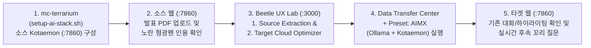

# AIMX (Kotaemon + Ollama) RAG AI 서비스 마이그레이션 구동 테스트 및 시연 가이드

- **작성일**: 2026-11-12
- **대상 범위**: `CM-Beetle` (`cmd/aimx`, `ui/` Beetle UX Lab) 및 `mc-terrarium/examples/aws/ai-stack-testbed`
- **시연 핵심 스택**: `Kotaemon` (`ghcr.io/cinnamon/kotaemon:main-full`, `v0.12.0`, `:7860`) + `Ollama` (`gemma4:12b`, `gemma4:e4b`, 또는 `gemma4:e2b` + `bge-m3`, `:11434`)

---

## 1. 개요 및 시연 아키텍처

본 문서는 `Kotaemon + Ollama` 기반 AI 서비스 마이그레이션 코드가 `upstream/main`에 반영된 이후, 로컬(또는 테스트베드 서버)의 `CM-Beetle`을 재구동하고 **소스 GPU 인프라 구축부터 컨퍼런스 발표자료(PDF) RAG 인덱싱, 타겟 클라우드 GPU 이관, 사후 검증 및 라이브 시연**까지 수행하는 절차를 안내합니다.

### 1.1 왜 `Kotaemon + Ollama` 조합인가?

1. **시각적 임팩트가 확실한 PDF 인용 하이라이팅(Citation Highlighting)**:
   - 컨퍼런스 발표자료(PDF)를 업로드하고 한국어/영어로 질문하면, 화면 좌측에는 대화 내역이 기록되고 우측 내장 PDF 뷰어에는 답변의 근거가 된 슬라이드 페이지가 열리며 **노란색 형광펜 하이라이팅**이 표시됩니다.
2. **단일 루트 디렉토리(`/opt/aimx/ai-service`) 완전 격리 이관**:
   - 호스트의 `/opt/aimx/ai-service` 아래에 `docker-compose.yml`, `ollama/`(GGUF 모델 가중치 블롭), `ktem_app_data/`(`user_data/sql.db` 계정 및 대화 이력, 원본 PDF `files/`, `ChromaDB` 벡터 DB, `LanceDB` 전문 검색 인덱스, `chunks_cache_dir/` 슬라이드 하이라이팅 좌표 캐시)가 모두 집약됩니다.
   - `CM-Beetle`의 `transx` 데이터 마이그레이션 1회 실행만으로 타겟 GPU VM에서 **모델 재다운로드(0초) 및 PDF 재인덱싱(0초) 없이** 기존 대화 스레드와 노란색 인용 하이라이팅이 즉시 그대로 재현됩니다.
3. **컨테이너 내부 DNS 고정 및 무인 DB 초기화**:
   - `Kotaemon` 컨테이너는 호스트 공인 IP가 아닌 Docker 내부 브리지 DNS(`KH_OLLAMA_URL=http://ollama:11434/v1/`)로 `Ollama`를 바라보므로, 소스 VM에서 타겟 VM으로 공인/사설 IP가 바뀌어도 설정 수정이 전혀 필요하지 않습니다.
   - 초기 프로비저닝 스크립트(`cmd/aimx` 및 `setup-ai-stack.sh`)가 `sql.db` 내 `llm_table`/`llm`/`embedding` 테이블의 `ollama` 항목을 자동으로 `default=1`로 활성화하고, `settings` 테이블(`admin` 계정)에 **Docling 파서(`reader_mode: "docling"`), 리랭킹 중복 채점 해제(`use_reranking: false`, `use_llm_reranking: false`), 한국어 응답(`reasoning.lang: "ko"`), 인라인 각주 인용(`highlight_citation: "inline"`), 마인드맵 생성(`create_mindmap: true`)** 기본값을 영구 저장하므로 재구축 및 타겟 이관 직후 수동 설정 없이 동일한 RAG 품질이 유지됩니다.

---

## 2. Upstream PR 반영 후 서버 재구동 절차

PR이 `upstream/main`에 병합된 뒤 테스트를 수행할 작업 환경(기본 클론 디렉토리 또는 `cloud-migrator` 서버)에서 아래 순서대로 서버를 최신화하고 재기동합니다.

### 2.1 최신 코드 동기화

```bash
# 1) cm-beetle 메인 작업 디렉토리 최신화
cd /path/to/cm-beetle
git fetch upstream
git checkout main
git pull upstream main

# 2) (시나리오 B 사용 시) mc-terrarium 최신화
cd /path/to/mc-terrarium
git pull
```

### 2.2 `CM-Beetle` 백엔드 및 `Beetle UX Lab` UI 재구동

구동 방식(컨테이너 통합 구동 vs 바이너리/개발 서버 구동)에 맞춰 한 가지 방법을 선택합니다.

#### 방법 1: Docker Compose 통합 환경으로 구동 중인 경우 (권장)

```bash
cd /path/to/cm-beetle

# 전체 스택을 새로 빌드하며 기동하는 경우
make up

# 또는 기존 CB-Tumblebug / CB-Spider / DB 컨테이너는 유지하고 cm-beetle과 UI만 빠르게 재빌드/재기동하는 경우
cd deployments/docker-compose
DOCKER_BUILDKIT=1 docker compose up -d --build cm-beetle cm-beetle-ui
cd ../..

# 컨테이너 재시작 직후 OpenBao 잠금 해제 확인 (필수)
make unseal
```

> [!IMPORTANT]
> 최초 기동 환경이거나 CSP 인증정보가 아직 등록되지 않은 경우에만 `make init`을 추가로 실행하여 `OpenBao` 및 `CB-Tumblebug` 커넥션을 초기화합니다.

#### 방법 2: 로컬 호스트에서 백엔드 바이너리(`make run`) + UI 개발 서버(`make dev-ui`)로 구동하는 경우

`ui/src/app/api/probe/workload/route.ts`(포트 `7860` 워크로드 프로브 허용)와 `DataTransferCenter.tsx`(`Kotaemon` 프리셋) 변경사항이 반영되려면 백엔드와 프론트엔드 프로세스를 모두 재시작해야 합니다.

```bash
# 터미널 1: 기존 cm-beetle 바이너리 종료 후 재빌드 및 실행 (:8056)
cd /path/to/cm-beetle
make stop
make run

# 터미널 2: Beetle UX Lab (Next.js) 개발 서버 재시작 (:3000)
cd /path/to/cm-beetle
make dev-ui
```

### 2.3 재구동 후 상태 점검 (Health Check)

```bash
# CM-Beetle 백엔드 상태 확인 (:8056)
curl -fsS http://localhost:8056/beetle/readyz && echo " -> Beetle OK"

# CB-Tumblebug 상태 확인 (:1323)
curl -fsS http://localhost:1323/tumblebug/readyz && echo " -> Tumblebug OK"

# Beetle UX Lab UI 응답 확인 (:3000)
curl -s -o /dev/null -w "UI HTTP Status: %{http_code}\n" http://localhost:3000
```

---

## 3. GPU 스펙, 모델 크기 및 가용 영역(Zone) 선택 가이드

라이브 시연에서는 생성 LLM과 다국어 임베딩 모델(`bge-m3`) 두 개가 `OLLAMA_MAX_LOADED_MODELS=2` 설정으로 **GPU VRAM에 동시에 상주**해야 질문할 때마다 모델을 디스크에서 다시 읽는 스왑 지연(5~15초)이 발생하지 않습니다.

### 3.1 GPU VRAM 용량별 권장 모델 및 클라우드 스펙

| 구분 | GPU 카드 및 VRAM | 대표적인 CSP 스펙 예시 | 권장 모델 조합 (`modelName` + `embeddingModel`) | 예상 VRAM 점유량 | 특징 및 시연 적합도 |
| :--- | :--- | :--- | :--- | :--- | :--- |
| **기본 (16GB)** | `NVIDIA Tesla T4` (16GB) | AWS `g4dn.xlarge` (4 vCPU, 16 GiB)<br>GCP `n1-standard-4` + T4 | **`gemma4:e2b`** (~4.6GB) + **`bge-m3`** (~1.2GB) | 약 **5.8GB ~ 7.0GB** (여유 충분) | 재고 확보가 가장 쉽고 빠르며 두 모델이 100% GPU에 상주 |
| **고성능 (24GB)** | `NVIDIA L4` (24GB)<br>`NVIDIA A10G` (24GB) | AWS `g6.2xlarge` / `g6.xlarge` (L4)<br>AWS `g5.2xlarge` / `g5.xlarge` (A10G)<br>GCP `g2-standard-8` / `g2-standard-4` (L4) | **`gemma4:12b`** (~8.2GB) + **`bge-m3`** (~1.2GB)<br>*(또는 `gemma4:e4b` ~9.6GB + `bge-m3`)* | 약 **9.4GB ~ 12.5GB** (`OLLAMA_CONTEXT_LENGTH=16384` 포함 24GB 내 상주) | 표/도표 포함 한국어 RAG 및 인라인 인용(`[1]`, `[2]`), 마인드맵 시각화에 최적 |

### 3.2 AWS 쿼터(Quota) 및 서울 리전(`ap-northeast-2`) 용량 부족 회피 팁

1. **별도 쿼터 증설 없이 24GB GPU(`g5`) 활용하기**:
   - AWS에서 `g4dn`(T4 16GB), `g5`(A10G 24GB), `g6`(L4 24GB)는 모두 **`Running On-Demand G and VT instances`** 라는 동일한 온디맨드 vCPU 쿼터 버킷을 공유합니다.
   - 서울 리전에서 `g6`(L4)는 물리 재고 소진(`InsufficientInstanceCapacity`) 빈도가 높으므로, 24GB VRAM이 필요할 때는 재고 풀이 훨씬 넉넉한 **`g5.xlarge`**(4 vCPU, 16 GiB, 24GB A10G) 또는 **`g5.2xlarge`**(8 vCPU, 32 GiB, 24GB A10G)를 사용하는 것이 유리합니다.
2. **사전 가용 영역(AZ) 조회 및 `preferredZone` 고정**:
   - 특정 GPU 스펙이 서울 리전 내 어느 AZ에 개설되어 있는지 테스트 전에 `CB-Tumblebug` API로 즉시 확인할 수 있습니다.
   ```bash
   curl -s -u default:default \
     "http://localhost:1323/tumblebug/availableZonesForSpec?providerName=aws&regionName=ap-northeast-2&cspSpecName=g5.xlarge" | jq .
   ```
   - `AIMX` CLI는 Zonal 서브넷 CSP(`aws`, `alibaba`, `tencent`, `ibm`, `ncp`, `kt`)로 이관할 때 추천 스펙의 `AvailableZones[0]`을 자동으로 서브넷 Zone에 반영합니다. 만약 특정 AZ(예: `ap-northeast-2a`)에 일시적 재고 부족이 발생하면 `cmd/aimx/testconf/kotaemon-config.yaml`의 `test.cases[]`에서 `preferredZone: ap-northeast-2c` 주석을 해제하여 다른 가용 AZ로 즉시 우회할 수 있습니다.
3. **멀티클라우드 이기종 GPU 이관 시연 (`AWS T4 -> GCP L4`)**:
   - AWS 서울 리전 GPU 재고나 쿼터가 모두 빠듯할 경우, 소스는 AWS `g4dn.xlarge`(T4 16GB)에 두고 `kotaemon-config.yaml`에서 `GCP-Seoul-GPU`(`gcp` / `asia-northeast3`, `execute: true`)를 활성화하면 `GCP g2-standard-4`(`NVIDIA L4` 24GB)로 크로스 클라우드 및 세대 업그레이드 이관 시연이 가능합니다.

---

## 4. 실행 시나리오 A: `AIMX` CLI 기반 단계별 테스트 워크플로우

백엔드 API 오케스트레이션(`setup-source -> recommend -> migrate -> verify -> cleanup`)만으로 전체 4계층 이관을 검증하는 표준 절차입니다.

### Step 0. 설정 파일 생성 및 확인

최초 1회 `make test-aimx-kotaemon` 실행 시 템플릿으로부터 아래 설정 파일이 자동 복사됩니다. 필요 시 사전 복사 후 인증정보나 리전을 수정합니다.

```bash
cd /path/to/cm-beetle
cp -n cmd/aimx/testconf/template-auth-config.json cmd/aimx/testconf/auth-config.json
cp -n cmd/aimx/testconf/template-kotaemon-config.yaml cmd/aimx/testconf/kotaemon-config.yaml
```

### Step 1. 소스 GPU VM 구축 및 `Kotaemon + Ollama` 배포 (`setup-source`)

```bash
make test-aimx-kotaemon EXTRA_ARGS="-mode setup-source"
```

- **수행 동작**:
  - `source.infraId`(`mc-daisy`)가 없으면 `aws+ap-northeast-2+g4dn.xlarge` GPU VM을 자동 생성하고 보안그룹에 `7860`, `11434` 포트를 개방합니다.
  - `/opt/aimx/ai-service`에 `Ollama` + `Kotaemon` 컨테이너를 기동하고, `gemma4:e2b` 및 `bge-m3` 모델을 다운로드한 뒤 `sql.db` 기본 커넥터를 활성화하고 두 모델을 GPU VRAM에 워밍업합니다.
- 완료 로그에 출력된 **`http://<SOURCE_PUBLIC_IP>:7860`** 주소를 확인합니다.

### Step 2. 소스 `Kotaemon`에 발표자료(PDF) 인덱싱 및 질의응답 생성 (브라우저)

1. 웹 브라우저에서 `http://<SOURCE_PUBLIC_IP>:7860`에 접속하여 기본 관리자 계정(`admin` / `admin`)으로 로그인합니다.
2. 상단 **File Index** 탭으로 이동하여 Cloud-Barista 컨퍼런스 발표자료 PDF 파일을 업로드하고 인덱싱 완료(`Indexed`) 상태를 확인합니다.
3. **Chat** 탭으로 이동하여 방금 업로드한 문서를 선택(`Select All` 또는 파일 지정)한 뒤 2~3개의 질문을 입력합니다.
   - 예시 질문: *"이 발표자료에서 제시하는 AI 서비스 마이그레이션의 핵심 구성 계층과 기대 효과를 요약해 줘."*
4. 좌측 대화 목록에 스레드가 저장되고, **우측 PDF 슬라이드 뷰어에 노란색 형광펜 인용 하이라이팅**이 렌더링되는지 확인합니다.

### Step 3. 하이브리드 소스 탐색 및 타겟 GPU 인프라 추천 (`recommend`)

```bash
make test-aimx-kotaemon EXTRA_ARGS="-mode recommend"
```

- **수행 동작**:
  - 소스 GPU VM 내부에서 실시간 `nvidia-smi` 정보를 수집하여 온프레미스 인프라 모델(`cmd/aimx/testresult/source-infra-discovered.json`)을 생성합니다.
  - `POST /beetle/recommendation/infra`를 호출하여 타겟 CSP/리전의 호환 GPU 스펙, 가용 영역(`Zones`), OS 이미지 후보를 추천받아 출력합니다.

### Step 4. 타겟 GPU VM 생성 및 무결성 볼륨 이관 (`migrate`)

```bash
make test-aimx-kotaemon EXTRA_ARGS="-mode migrate"
```

- **수행 동작**:
  - **Stage 3-1**: `CM-Beetle`을 통해 타겟 GPU VM을 프로비저닝하고 보안그룹에 `7860`, `11434` 포트를 개방합니다.
  - **Stage 3-2**: 소스 컨테이너를 안전 정지(`docker compose stop && sync`)하여 SQLite WAL을 플러시한 뒤 `sql.db`의 SHA-256 해시를 기록합니다. 이어서 `CM-Beetle transx`(`POST /beetle/migration/data`)로 `/opt/aimx/ai-service` 전체를 암호화 전송하고, 타겟 호스트 계정 소유권 정규화 후 컨테이너를 기동하여 `gemma4:e2b`와 `bge-m3`를 타겟 GPU VRAM에 즉시 선로딩합니다.

### Step 5. 종단간 검증 리포트 생성 및 타겟 후속 질문 시연 (`verify`)

```bash
make test-aimx-kotaemon EXTRA_ARGS="-mode verify"
```

- **수행 동작**:
  - 타겟 GPU 인식 상태(`nvidia-smi`), `Ollama` GPU 가속률(`100% GPU`) 및 초당 토큰 생성 속도(`tok/s`), `Kotaemon` HTTP 응답(`200`), 그리고 **소스 대 타겟 `sql.db` SHA-256 해시 100% 일치(`Verified Identical`)** 여부를 검증합니다.
  - 검증 결과표를 콘솔에 출력하고 `cmd/aimx/testresult/aimx-migration-report-<TargetName>.md` 리포트를 생성합니다.
- **브라우저 라이브 검증**:
  - `http://<TARGET_PUBLIC_IP>:7860`에 접속(`admin` / `admin`)하여 Step 2에서 업로드한 PDF와 대화 내역, 노란색 슬라이드 하이라이팅이 그대로 열리는지 확인합니다.
  - 동일 대화 스레드 아래에 **후속 꼬리 질문**을 입력하여 타겟 클라우드 GPU가 문맥을 이어받아 새로운 인용 슬라이드와 함께 즉시 답변하는지 확인합니다.

### Step 6. 테스트 리소스 정리 (`cleanup`)

```bash
# 타겟 GPU 인프라만 삭제 (소스 테스트베드는 보존)
make test-aimx-kotaemon EXTRA_ARGS="-mode cleanup"

# 타겟 및 소스 GPU 인프라까지 모두 삭제
make test-aimx-kotaemon EXTRA_ARGS="-mode cleanup -cleanup-source=true"
```

---

## 5. 실행 시나리오 B: `mc-terrarium` + `Beetle UX Lab` UI 라이브 시연

온프레미스 모사 환경(`mc-terrarium`)과 웹 대시보드(`Beetle UX Lab`)를 결합한 컨퍼런스 무대 시연용 워크플로우입니다.



1. **소스 AI 테스트베드 준비 (`mc-terrarium`)**:
   ```bash
   cd /path/to/mc-terrarium/examples/aws/ai-stack-testbed
   terraform init
   terraform apply -auto-approve
   ./setup-ai-stack.sh
   ```
   - 스크립트 완료 시 출력되는 `source_kotaemon_url` (`http://<SOURCE_IP>:7860`)에 접속(`admin` / `admin`)하여 발표자료 PDF 업로드 및 질의응답을 생성합니다.
2. **`Beetle UX Lab` 소스 추출 및 타겟 GPU 프로비저닝**:
   - 브라우저에서 `http://localhost:3000`에 접속합니다.
   - **1. Source Extraction** 탭에서 `CM-Honeybee`로 소스 서버를 스캔하거나 `source-infra-discovered.json`을 로드하여 소스 GPU 사양과 방화벽 포트(`22`, `7860`, `11434`)를 확인합니다.
   - **2. Target Cloud Optimizer** 탭에서 타겟 클라우드/리전을 선택해 GPU 인프라를 추천받고 타겟 노드를 프로비저닝합니다.
3. **`Data Transfer Center` 원클릭 AI 스택 이관**:
   - **Data Transfer Center**로 이동하여 **Launch New Data Migration**을 클릭합니다.
   - 상단 프리셋 버튼 **`+ Preset: AIMX (Ollama + Kotaemon)`**을 클릭하면 경로(`/opt/aimx/ai-service`), 포함 필터(`ktem_app_data/**`, `ollama/**`, `docker-compose.yml`), 소스 정지/재개 스크립트, 타겟 GPU 드라이버/Docker/`nvidia-ctk` 자동 설치 및 듀얼 모델(`gemma4:e2b` + `bge-m3`) 워밍업 명령어가 자동 세팅됩니다.
   - 소스/타겟 SSH 접속 정보를 확인한 뒤 마이그레이션을 실행합니다.
4. **UI 4계층 상태 검증 및 타겟 시연**:
   - 전송 완료 후 **Verify Source & Target AI Stack** 버튼을 눌러 소스와 타겟 양쪽의 `Kotaemon (:7860)` 및 `Ollama (:11434)` 엔드포인트 상태가 모두 초록색(`Ready`)으로 표시되는지 확인합니다.
   - 타겟 `http://<TARGET_IP>:7860`을 열어 이관된 PDF 슬라이드 하이라이팅을 시연하고 후속 질문을 실행합니다.

---

## 6. 주요 점검 사항 및 트러블슈팅

| 증상 / 상황 | 주요 원인 | 조치 방법 |
| :--- | :--- | :--- |
| 컨테이너 기동 직후 `:7860` 접속이 안 됨 | `Kotaemon`(Gradio + Python 패키지 초기화)은 최초 기동 시 25~40초의 초기화 시간이 소요됨 | 타겟 VM에서 `sudo docker logs -f aimx-kotaemon`으로 `Running on local URL: http://0.0.0.0:7860` 출력 여부를 확인하고, 타겟 보안그룹에 TCP `7860` 인바운드가 열려 있는지 점검 |
| 타겟 이관 후 PDF 업로드 또는 채팅 저장 시 `Permission denied` (`readonly database`) | 소스 VM 계정(`ubuntu`, UID 1000)과 타겟 VM 계정(`cb-user`, UID 1001 등) 간 파일 소유권 차이 또는 root 소유 생성 | `AIMX` CLI 및 UI 프리셋의 Post-Command에 포함된 `sudo chown -R $(id -un):$(id -gn) /opt/aimx/ai-service`가 정상 실행되었는지 확인 후 `sudo docker compose restart kotaemon` 수행 |
| 첫 질문 응답에 10초 이상 걸림 | `Ollama` 모델이 디스크에서 GPU VRAM으로 아직 로드되지 않은 Cold Start 상태 | `sudo docker exec aimx-ollama ollama ps`를 실행하여 `gemma4:e2b`와 `bge-m3` 두 모델이 모두 `100% GPU`로 올라와 있는지 확인 (`OLLAMA_MAX_LOADED_MODELS=2` 필수) |
| AWS 타겟 생성 시 `InsufficientInstanceCapacity` 또는 `Unsupported` 발생 | 해당 AZ에 선택된 GPU 카드 실시간 재고가 소진되었거나 스펙 미개설 AZ에 서브넷이 배치됨 | 3.2절의 `/tumblebug/availableZonesForSpec` API로 가용 AZ를 확인한 뒤 `kotaemon-config.yaml`에 `preferredZone`을 지정하거나, 타겟 리전을 `us-west-2` / 타겟 CSP를 `gcp`(`asia-northeast3`)로 전환 |
