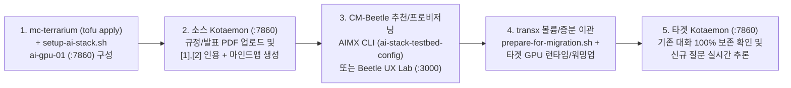

# AIMX (Kotaemon + Ollama) RAG AI 서비스 마이그레이션 구동 테스트 및 시연 가이드

- **작성일**: 2026-11-12
- **대상 범위**: `CM-Beetle` (`cmd/aimx`, `ui/` Beetle UX Lab) 및 `mc-terrarium/examples/aws/ai-stack-testbed`
- **시연 핵심 스택**: `Kotaemon Full` (`ghcr.io/cinnamon/kotaemon:main-full`, `v0.12.0`, `:7860`) + `Ollama` (`gemma4:12b`, `gemma4:e4b`, 또는 `gemma4:e2b` + `bge-m3`, `:11434`)

---

## 1. 개요 및 시연 아키텍처

본 문서는 `Kotaemon + Ollama` 기반 AI 서비스 마이그레이션 기능과 Zone/가용성 기반 GPU 추천 및 검증 기능을 활용하여, **소스 GPU 인프라(`ai-stack-testbed` 10-Node 테스트베드 또는 `CB-Tumblebug` 단일 노드) 구축부터 규정/발표자료 PDF RAG 인덱싱, 타겟 클라우드 GPU 이관, 증분 데이터 동기화 및 사후 검증**까지 수행하는 절차를 안내합니다.

### 1.1 왜 `Kotaemon + Ollama` 조합인가?

1. **근거 확인이 명확한 인라인 인용(`inline` Citation) 및 마인드맵 시각화**:
   - 사내 규정집이나 컨퍼런스 발표자료(PDF)를 업로드하고 한국어로 질문하면, 답변 문장마다 `[1]`, `[2]` 인라인 각주가 부여되고 우측 `[Preview]` 패널에 원문 근거 청크 하이라이팅과 마인드맵 다이어그램이 함께 표시됩니다.
2. **단일 루트 디렉토리(`/opt/aimx/ai-service`) 완전 격리 및 고속 증분 이관**:
   - 호스트의 `/opt/aimx/ai-service` 아래에 `docker-compose.yml`, `ollama/`(GGUF 모델 가중치 블롭), `ktem_app_data/`(`user_data/sql.db` 계정/설정/대화 이력, 원본 PDF `files/`, `ChromaDB` 벡터 스토어, `LanceDB` 전문 검색 인덱스, `chunks_cache_dir/` 근거 청크 캐시), `.nv/`(CUDA 캐시)가 모두 집약됩니다.
   - `CM-Beetle`의 `transx` 데이터 마이그레이션 실행만으로 타겟 GPU VM에서 **모델 재다운로드(0초) 및 PDF 재인덱싱(0초) 없이** 기존 대화 스레드와 문서 근거 뷰어가 즉시 그대로 재현되며, 이후 추가된 대화(`sql.db`)만 수 초 내에 증분(Delta) 동기화할 수 있습니다.
3. **컨테이너 내부 DNS 고정, 무인 DB 기본값 시딩 및 베어 OS GPU 런타임 자동 구성**:
   - `Kotaemon` 컨테이너는 호스트 공인 IP가 아닌 Docker 내부 브리지 DNS(`KH_OLLAMA_URL=http://ollama:11434/v1/`)로 `Ollama`를 호출하므로, 타겟 클라우드로 이전되어 공인/사설 IP가 변경되어도 설정 수정 없이 즉시 동작합니다.
   - 배포 스크립트(`setup-ai-stack.sh` 및 `cmd/aimx`)가 `sql.db` 내 `ollama` 기본 커넥터(`default=1`)와 `admin` 계정의 `settings` 테이블 기본값(**`Docling` 표/그림 파서, LLM/외부 중복 리랭킹 비활성화, 한국어 응답, `inline` 인용, 마인드맵 활성화**)을 영구 저장합니다.
   - 타겟 클라우드 VM이 GPU 드라이버가 없는 일반 OS 이미지(예: GCP 기본 Ubuntu 22.04)로 생성되더라도 `ensure-gpu-runtime.sh`가 NVIDIA 드라이버(`550`), Docker Compose v2, `nvidia-container-toolkit`을 자동 설치합니다.

---

## 2. 서버 최신화 및 재구동 절차

테스트를 수행할 작업 환경(로컬 워크스테이션 또는 `ai-stack-testbed`의 `cloud-migrator` 노드)에서 아래 순서대로 서버를 최신화하고 기동합니다.

### 2.1 최신 코드 동기화

```bash
# 1) cm-beetle 최신화
cd /path/to/cm-beetle
git fetch upstream
git checkout main
git pull upstream main

# 2) mc-terrarium 최신화 (10-Node ai-stack-testbed 사용 시)
cd /path/to/mc-terrarium
git pull
```

### 2.2 `CM-Beetle` 백엔드 및 `Beetle UX Lab` UI 기동

#### 방법 1: Docker Compose 통합 환경으로 구동하는 경우 (권장)

```bash
cd /path/to/cm-beetle

# 전체 스택 기동
make up

# 기존 CB-Tumblebug / CB-Spider 컨테이너는 유지하고 cm-beetle과 UI만 재빌드/재기동하는 경우
cd deployments/docker-compose
DOCKER_BUILDKIT=1 docker compose up -d --build cm-beetle cm-beetle-ui
cd ../..

# 컨테이너 재시작 직후 OpenBao 잠금 해제 확인 (필수)
make unseal
```

> [!IMPORTANT]
> 최초 기동 환경이거나 CSP 인증정보가 아직 등록되지 않은 경우(`cloud-migrator` 초기 기동 포함)에는 `make init`을 실행하여 `OpenBao` 및 `CB-Tumblebug` 커넥션을 초기화합니다.

#### 방법 2: 호스트에서 백엔드 바이너리(`make run`) + UI 개발 서버(`make dev-ui`)로 구동하는 경우

```bash
# 터미널 1: cm-beetle 백엔드 재빌드 및 실행 (:8056)
cd /path/to/cm-beetle
make stop
make run

# 터미널 2: Beetle UX Lab (Next.js) 개발 서버 실행 (:3000)
cd /path/to/cm-beetle
make dev-ui
```

### 2.3 기동 후 상태 점검 (Health Check)

```bash
curl -fsS http://localhost:8056/beetle/readyz && echo " -> Beetle OK"
curl -fsS http://localhost:1323/tumblebug/readyz && echo " -> Tumblebug OK"
curl -s -o /dev/null -w "UI HTTP Status: %{http_code}\n" http://localhost:3000
```

---

## 3. GPU 스펙, 모델 크기 및 가용 영역(Zone) 선택 가이드

라이브 시연에서는 생성 LLM과 다국어 임베딩 모델(`bge-m3`) 두 개가 `OLLAMA_MAX_LOADED_MODELS=2` 설정으로 **GPU VRAM에 동시에 상주**해야 질문 시 디스크 스왑 지연(5~15초)이 발생하지 않습니다.

### 3.1 GPU VRAM 용량별 권장 모델 및 클라우드 스펙

| 구분 | GPU 카드 및 VRAM | 대표적인 CSP 스펙 예시 | 권장 모델 조합 (`modelName` + `embeddingModel`) | 예상 VRAM 점유량 | 특징 및 시연 적합도 |
| :--- | :--- | :--- | :--- | :--- | :--- |
| **고성능 표준 (24GB, `ai-stack-testbed` 기본)** | `NVIDIA L4` (24GB)<br>`NVIDIA A10G` (24GB) | AWS `g6.2xlarge` / `g6.xlarge` (L4)<br>AWS `g5.2xlarge` / `g5.xlarge` (A10G)<br>GCP `g2-standard-8` / `g2-standard-4` (L4) | **`gemma4:12b`** (~8.2GB) + **`bge-m3`** (~1.2GB)<br>*(또는 `gemma4:e4b` ~9.6GB + `bge-m3`)* | 약 **9.4GB ~ 12.5GB** (`OLLAMA_CONTEXT_LENGTH=16384` 및 `Docling` 포함 24GB 내 상주) | 표/도표 포함 한국어 규정집 RAG, `inline` 인용(`[1]`, `[2]`), 마인드맵 시각화에 최적 |
| **경량 기본 (16GB, `mc-daisy` 기본)** | `NVIDIA Tesla T4` (16GB) | AWS `g4dn.xlarge` (4 vCPU, 16 GiB)<br>GCP `n1-standard-4` + T4 | **`gemma4:e2b`** (~4.6GB) + **`bge-m3`** (~1.2GB) | 약 **5.8GB ~ 7.0GB** (여유 충분) | 쿼터 및 재고 확보가 쉽고 두 모델이 100% GPU에 상주 |

### 3.2 Zone 가용성 자동 매칭 및 멀티클라우드 이관 팁

1. **추천 단계의 가용 스펙 필터링 및 Zonal/Regional 서브넷 자동 배정**:
   - `CM-Beetle` 추천 API(`POST /beetle/recommendation/infra`)는 `AvailabilityStatus`가 비가용(`Unsupported`, `QuotaExceeded`, `SoldOut`)인 스펙을 자동 제외합니다.
   - Zonal 서브넷 CSP(`aws`, `alibaba`, `tencent`, `ibm`, `ncp`, `kt`)는 추천 스펙이 실제 개설된 가용영역 교집합(`AvailableZones[0]`)을 `targetVNet.subnetInfoList[].zone`에 자동 기록하며, Regional 서브넷 CSP(`azure`, `gcp`)는 Zone을 비워 리전 내 가용 풀 전체를 활용합니다.
   - 사전 검증 API(`POST /beetle/validation/ns/{nsId}/infra`)는 Zonal 서브넷 AZ 불일치 시 `SUBNET_ZONE_UNAVAILABLE`(`error`), Regional 서브넷 Zone 수동 고정 시 `REGIONAL_SUBNET_ZONE_PINNED`(`warning`)를 반환합니다.
2. **특정 AZ 수동 고정 (`preferredZone`) 및 `AWS -> GCP` 이관 시연**:
   - 특정 AZ의 실시간 GPU 물리 재고 확인이 필요하면 아래 `CB-Tumblebug` API로 조회할 수 있습니다.
   ```bash
   curl -s -u default:default \
     "http://localhost:1323/tumblebug/availableZonesForSpec?providerName=aws&regionName=ap-northeast-2&cspSpecName=g6.2xlarge" | jq .
   ```
   - 컨퍼런스 대표 시나리오로는 AWS 서울 리전 `ai-gpu-01`(`g6.2xlarge`, `NVIDIA L4` 24GB, 8 vCPU, 32 GiB RAM)에서 **GCP 서울 리전(`asia-northeast3`) `g2-standard-8`(`NVIDIA L4` 24GB, 8 vCPU, 32 GiB RAM)**로의 멀티클라우드 동급 L4 이관을 권장합니다.

---

## 4. 실행 시나리오 A (권장): `mc-terrarium` (`ai-stack-testbed`) 소스 + `AIMX` CLI / `Beetle UX Lab` 시연

`mc-terrarium/examples/aws/ai-stack-testbed`로 구축한 10-Node 온프레미스 모사 환경(3개 클러스터 9대 소스 VM + `cloud-migrator` 1대)의 대표 GPU 노드인 **`ai-gpu-01`**을 소스로 삼아 타겟 클라우드로 이관하는 컨퍼런스 표준 시나리오입니다.



### Step 1. 10-Node 소스 테스트베드 및 `ai-gpu-01` AI 스택 구축 (`mc-terrarium`)

상세 구축 옵션은 `../mc-terrarium/examples/aws/ai-stack-testbed/README.md`를 따릅니다.

```bash
# 1) OpenBao 환경변수 로드 (cm-beetle의 OpenBao를 공유하는 경우 Option A-2 사용 가능)
cd /path/to/mc-terrarium/examples/aws/ai-stack-testbed
grep -E '^(VAULT_ADDR|VAULT_TOKEN)=' ../../../../cm-beetle/deployments/docker-compose/.env > .env
set -a && source .env && set +a

# 2) terraform.tfvars의 allowed_cidr_blocks에 현재 접속 공인 IP(/32) 포함 확인 후 OpenTofu 배포
tofu init
tofu plan
tofu apply

# 3) 10대 노드 방화벽 점검 및 ai-gpu-01에 AI 스택(Ollama + gemma4:12b + bge-m3 + Kotaemon v0.12.0) 자동 구성
./check-firewall.sh
./setup-ai-stack.sh
```

- `tofu apply` 완료 시 현재 디렉토리에 SSH 키(`private_key_ai_stack_testbed.pem`)와 9대 소스 노드 일괄 등록 파일인 `source_connections_public.{csv,json,yaml}` 및 `source_connections_private.{csv,json,yaml}`(`0600` 권한)이 자동 생성됩니다.
- (선택) 테스트베드 내부의 `cloud-migrator` VM에서 `CM-Beetle`을 구동하려면 `./setup-cloud-migrator.sh` 실행 후 `~/.cloud-barista/credentials.yaml.enc`를 복사하고 `cloud-migrator` 안에서 `make up` 및 `make init`을 수행합니다.

### Step 2. 소스 `Kotaemon` 포털(`:7860`) 문서 인덱싱 및 대화 내역 구성

1. 소스 `Kotaemon` 접속 주소를 확인하고 브라우저에서 **`admin` / `admin`**으로 로그인합니다.
   ```bash
   tofu output -json demo_endpoints | jq -r .source_kotaemon_url
   ```
2. **`Files` -> `File Collection`** 탭에서 규정집 또는 발표자료 PDF 파일들을 업로드합니다.
   - `Docling` 파서, 한국어 응답, `inline` 인용, 마인드맵 생성 옵션이 이미 기본값으로 적용되어 있습니다.
   - 다수의 PDF를 한 번에 올릴 때는 GPU에서 순차 인덱싱되므로 파일 목록의 `note` 컬럼(`{"tokens": ..., "loader": "DoclingReader"}`)으로 완료 여부를 확인합니다. 브라우저 세션이 끊어져 누락된 파일이 있으면 새로고침(`F5`) 후 `Force reindex file`을 체크해 재업로드합니다.
3. 좌측 **`Chat`** (`File Collection`) 탭에서 질의응답을 생성합니다.
   - 특정 규정/문서에 대한 정밀 질의는 **`Search In File(s)`**를 선택하고 대상 문서를 지정하여 타 문서 청크 간섭을 방지합니다. 전체 문서 종합 질의는 **`Search All`**을 선택합니다.
   - 답변 내 `[1]`, `[2]` 각주, 우측 `[Preview]` 패널의 근거 하이라이팅, 마인드맵 생성 및 좌측 대화 목록 저장을 확인합니다.
   - **주의**: 채팅 입력창 하단 `Chat settings` 바에서 변경한 값은 현재 브라우저 세션에만 임시 적용됩니다. 설정을 서버 `sql.db`에 영구 저장하려면 상단 **`Settings`** 탭에서 수정 후 **`Save`**를 클릭합니다.

### Step 3-A. 경로 1: `AIMX` CLI로 외부 테스트베드(`ai-gpu-01`) 직접 추천/이관/검증

`template-ai-stack-testbed-config.yaml`은 `source_connections_public.json`의 `ai-gpu-01` 접속 정보를 직접 참조하며, `modelName: auto` / `embeddingModel: auto` 설정을 통해 소스의 `docker-compose.yml`에 등록된 모델(`gemma4:12b` + `bge-m3`)을 자동 감지합니다.

```bash
cd /path/to/cm-beetle
cp -n cmd/aimx/testconf/template-auth-config.json cmd/aimx/testconf/auth-config.json
cp -n cmd/aimx/testconf/template-ai-stack-testbed-config.yaml cmd/aimx/testconf/ai-stack-testbed-config.yaml
```

> [!TIP]
> `cloud-migrator` VM 내부(`10.0.1.0/24` 사설망)에서 실행할 때는 `cmd/aimx/testconf/ai-stack-testbed-config.yaml`의 `source.connectionsFile` 경로를 `~/cm-beetle/source_connections_private.json`으로 지정합니다.

```bash
# 1) ai-gpu-01 실시간 GPU/모델 사양 추출 및 타겟 클라우드(기본: GCP asia-northeast3 g2-standard-8) 추천
make test-aimx EXTRA_ARGS="-config testconf/ai-stack-testbed-config.yaml -mode recommend"

# 2) 타겟 GPU VM 생성 + prepare-for-migration.sh(QUIESCED_DB_SHA256) + transx 전송 + 타겟 GPU 런타임/모델 워밍업
make test-aimx EXTRA_ARGS="-config testconf/ai-stack-testbed-config.yaml -mode migrate"

# 3) 타겟 GPU 추론 속도(tok/s), Kotaemon HTTP 200, sql.db SHA-256 100% 일치 검증 및 리포트 출력
make test-aimx EXTRA_ARGS="-config testconf/ai-stack-testbed-config.yaml -mode verify"
```

- **소스 대화 정리 후 고속 증분(`Delta`) 재동기화**:
  - 최초 이관 완료 후 소스 `Kotaemon` 포털에서 대화 내역이나 영구 설정을 추가/정리한 경우, 타겟 인프라를 삭제할 필요 없이 `-mode migrate`만 다시 실행합니다.
  - `AIMX`가 기존 타겟 VM을 그대로 재사용하여 타겟 컨테이너를 안전 정지한 뒤 변경된 `sql.db` 등 델타 파일만 수 초 내에 덮어쓰고(`rsync` 증분 전송), 컨테이너 재기동 및 해시 일치를 즉시 완료합니다.

### Step 3-B. 경로 2: `Beetle UX Lab` 웹 대시보드(`:3000`)로 대화형 이관 및 검증

1. 브라우저에서 `http://localhost:3000`에 접속합니다.
2. **1. Source Extraction** 탭에서 **`Import CSV / JSON / YAML`** 버튼을 눌러 `source_connections_public.json`(또는 `cloud-migrator` 내부에서는 `source_connections_private.yaml`)을 임포트하고 `ai-gpu-01`의 GPU(`NVIDIA L4 24GB`) 및 방화벽 포트(`22`, `7860`, `11434`)를 스캔합니다.
3. **2. Target Cloud Optimizer** 탭에서 타겟 클라우드(예: `GCP` `asia-northeast3`)를 선택해 `g2-standard-8` 후보를 추천받고 타겟 인프라를 프로비저닝합니다.
4. **Data Transfer Center**에서 **Launch New Data Migration** -> **`+ Preset: AIMX (Ollama + Kotaemon)`**을 클릭합니다.
   - 프리셋이 경로(`/opt/aimx/ai-service`), 소스 정지/재개 스크립트, 타겟 컨테이너 선행 정지(증분 재전송 대비), 타겟 GPU 드라이버/Docker/`nvidia-ctk` 자동 설치 및 `docker-compose.yml` 기반 듀얼 모델 자동 워밍업 명령어를 세팅합니다.
5. 전송 완료 후 **Verify Source & Target AI Stack**으로 양측 `Kotaemon (:7860)` 및 `Ollama (:11434)` 상태를 확인하고, 타겟 `http://<TARGET_IP>:7860`에 접속하여 **기존 대화 보존 화면**과 **신규 질문 추론 화면**을 확인합니다.

### Step 4. 리소스 정리

```bash
# 1) CM-Beetle로 생성한 타겟 GPU 인프라 삭제
cd /path/to/cm-beetle
make test-aimx EXTRA_ARGS="-config testconf/ai-stack-testbed-config.yaml -mode cleanup"

# 2) (전체 시연 종료 시) mc-terrarium 10-Node 소스 테스트베드 삭제
cd /path/to/mc-terrarium/examples/aws/ai-stack-testbed
set -a && source .env && set +a
tofu destroy
```

---

## 5. 실행 시나리오 B: `CB-Tumblebug` 단독 소스(`mc-daisy`) CLI 테스트 워크플로우

`mc-terrarium` 없이 `CB-Tumblebug`만으로 경량 소스 GPU VM(`aws+ap-northeast-2+g4dn.xlarge`, `Tesla T4 16GB`, `gemma4:e2b` + `bge-m3`)의 생성부터 타겟 이관까지 한 번에 검증하는 절차입니다.

```bash
cd /path/to/cm-beetle

# Step 1. 소스 GPU VM(mc-daisy) 생성 및 Kotaemon + Ollama(gemma4:e2b + bge-m3) 자동 배포
make test-aimx-kotaemon EXTRA_ARGS="-mode setup-source"

# Step 2. 출력된 http://<SOURCE_PUBLIC_IP>:7860 (admin / admin)에서 PDF 업로드 및 질의응답 생성

# Step 3. 소스 탐색 및 타겟 GPU 인프라 추천
make test-aimx-kotaemon EXTRA_ARGS="-mode recommend"

# Step 4. 타겟 GPU VM 생성 및 /opt/aimx/ai-service 무결성 이관
make test-aimx-kotaemon EXTRA_ARGS="-mode migrate"

# Step 5. 종단간 검증 리포트(cmd/aimx/testresult/aimx-migration-report-*.md) 생성
make test-aimx-kotaemon EXTRA_ARGS="-mode verify"

# Step 6. 타겟 및 소스 GPU 인프라 일괄 정리
make test-aimx-kotaemon EXTRA_ARGS="-mode cleanup -cleanup-source=true"
```

---

## 6. 주요 점검 사항 및 트러블슈팅

| 증상 / 상황 | 주요 원인 | 조치 방법 |
| :--- | :--- | :--- |
| 답변에 근거 하이라이팅이 생략되고 로그에 `Got 0 cited docs` 출력 | `citation: highlight` 모드는 강제 Function Calling(`tool_choice="required"`)을 요구하여 경량 로컬 모델에서 누락될 수 있음 | 상단 **`Settings`** 탭 -> Reasoning settings에서 Citation 옵션을 **`inline`**으로 설정 후 **`Save`** 클릭 (`setup-ai-stack.sh` 및 `cmd/aimx` 최신 버전은 기본값으로 자동 주입됨) |
| 다수 PDF 일괄 업로드 중 브라우저 연결이 끊어짐 | `Docling`이 GPU에서 문서를 순차 파싱하는 동안 긴 배치에서 브라우저 세션 타임아웃 발생 | 새로고침(`F5`) 후 **`Files`** 탭의 `note` 컬럼(`"loader": "DoclingReader"`)을 확인하고, 미완료 파일만 `Force reindex file`을 체크해 재업로드 |
| 증분(`Delta`) 재이관 후 타겟 포털에 이전 대화가 그대로 보임 | 타겟 `Kotaemon` 컨테이너가 실행 중인 상태에서 `sql.db`가 덮어써져 기존 프로세스/WAL 핸들이 유지됨 | 최신 `cmd/aimx` (`Stage 3-3`) 및 UI 프리셋은 전송 전 타겟에서 `sudo docker compose stop`을 먼저 수행함. 수동 `rsync` 시 반드시 타겟 컨테이너를 먼저 정지 후 전송 |
| 컨테이너 기동 직후 `:7860` 접속이 안 됨 | `Kotaemon`(Gradio + Docling 초기화)은 최초 기동 시 25~40초의 초기화 시간이 소요됨 | 타겟 VM에서 `sudo docker logs -f aimx-kotaemon`으로 `Running on local URL: http://0.0.0.0:7860` 출력 여부를 확인하고 보안그룹 TCP `7860` 개방 여부 점검 |
| 타겟 이관 후 채팅 저장 시 `readonly database` 오류 | 소스 계정(`ubuntu`, UID 1000)과 타겟 계정(`cb-user` 등) 간 파일 소유권 불일치 | Post-Command의 `sudo chown -R $(id -un):$(id -gn) /opt/aimx/ai-service` 실행 여부를 확인하고 `sudo docker compose restart kotaemon` 수행 |
| 첫 질문 응답에 10초 이상 소요됨 | `Ollama` 모델이 디스크에서 GPU VRAM으로 아직 적재되지 않은 Cold Start 상태 | `sudo docker exec aimx-ollama ollama ps`로 생성 LLM(`gemma4:12b` 또는 `gemma4:e2b`)과 `bge-m3` 두 모델이 모두 `100% GPU`로 적재되어 있는지 확인 (`OLLAMA_MAX_LOADED_MODELS=2` 필수) |
